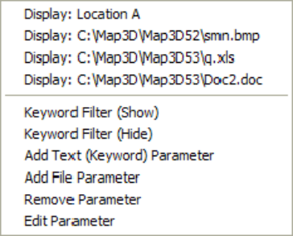

This feature can be used to display a database of useful geologic information such as grade, rockmass quality etc.

Each point can be tagged with a series of:

- numeric values (e.g. colour, magnitude, orientation etc.)

- keywords

- text messages

- file names (e.g. graphics files, documents, spreadsheets etc.)

To activate this feature you right-click on a visualization data point (see Visualization).

If there are no visualization points one can be created using Make Point - adds of a new point.

Upon right-clicking you will be presented with a popup menu with the following options:

The "Display" items in the upper section of this menu are data that are attached to the data point (respectively, a text string, bitmap, spreadsheet and document). Selecting of these will display that item.

The items in the lower section of this menu are functions that access the database:

- **Keyword Filter (Show)** – used to specify a series of show keyword filters. Only point data that has one of these keywords associated with it will be visible, all others will be hidden. This allows users to filter display of desired database entries.

- **Keyword Filter (Hide)** – used to specify a series of hide keyword filters. Point data that has one of these keywords associated with it will be hidden, all others will be visible. This allows users to filter display of unwanted database entries.

- **Add Text (Keyword) Parameter** - used to add a text string to a data point. This text is used for keyword filtering. This text will be added to the display list.

- **Add File Parameter** - used to add a file parameter to a data point. The file name is used for keyword filtering. This file will be added to the display list. Any file name can be specified here (.e.g. graphics files, spreadsheet files, document files etc.) If the file type is associated with an application, that application will be automatically started in order to display the specified file.

**Remove Parameter** - used to remove a parameter from the data point.

**Edit Parameter** - used to edit or modify a parameter.
