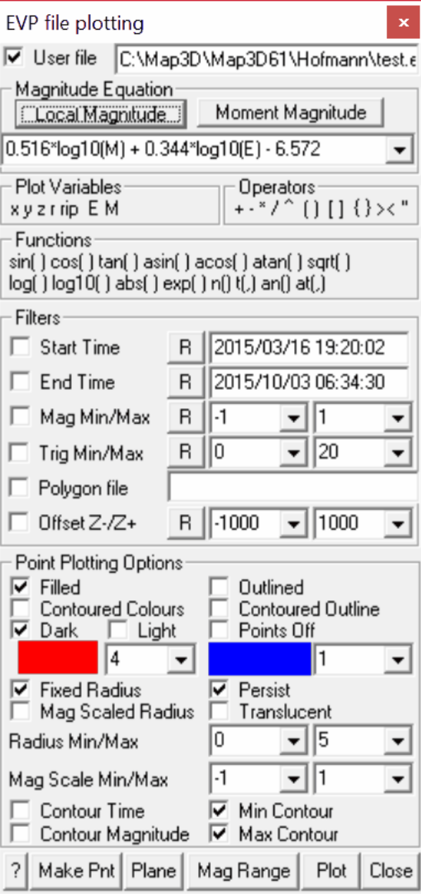

This option enables visualization of point data in EVP file format (from IMS seismic systems). Points can be displayed as light source shaded spheres with diameter and/or colour varying as magnitude, and contoured on a plane to display density etc.

Map3D also supports visualization of text formatted files.

Each point can be tagged with a series of:

- numeric values (e.g. colour, magnitude, orientation etc.)

- text messages

- file names (e.g. graphics files, documents, spreadsheets etc.)

Upon left clicking on a point, the location, magnitude and text message are displayed on the status bar.

Right clicking on a point activates the Visual Database. This feature can be used to display a database of useful geologic information such as grade, rockmass quality etc. Each point can be tagged with a series of:

- numeric values (e.g. colour, magnitude, orientation etc.)

- text messages

- file names (e.g. graphics files, documents, spreadsheets etc.)

#### Event File:

The event file is in *.EVP file format.

EVP event files are produced by IMS seismic systems.

Seismic data are stored as a series of points as follows:

**date time le x1 y1 z1 M  E Mp Ep Ms Es trigs... "text message" "file name"... date time le x2 y2 z2 M  E Mp Ep Ms Es trigs... "text message" "file name"... date time le x3 y3 z3 M  E Mp Ep Ms Es trigs... "text message" "file name"...**

where **xi yi zi** represent the coordinates of each point,

**M** represents the seismic moment, **E** represents the energy radiated, **trigs** represents the number of triggers,

**text message** indicates an optional series of text strings that must be enclosed in double quotes. **file name** indicates an optional series of file names that must be enclosed in double quotes.

- The text message and file name are displayed in the status bar across the bottom of the screen by picking an event with the left mouse button.

- They can also be edited by picking an event with the right mouse button.

- Picking with the right mouse button also allows for display of the file if the file name has been associated with an application (refer to Windows documentation on how to "Associate a file with a program").

#### Merging multiple files into one database

You may select multiple files simultaneously by holding the standard windows "shift" or "ctrl" keys for multiple selections.

These files will be merging into one database.

This allows you to keep separate parts of your visualization data in different files then easily merge them together into one database.

#### Magnitude Equation:

Defines the parameter that will be plotted, e.g. **(0.516*log10(M) + 0.344*log10(E) - 6.572**

The pull-down window allows you to store up to 20 different equations. These are stored between Map3D sessions in the map3d.ini file.

#### Plot Variables:

**E M** data fields in the event file.

#### Functions:

**sin() cos() tan()** sine, cosine and tangent trigonometric functions **asin() acos() atan()** Inverse trigonometric functions **sqrt()** square root function

**log()** natural logarithmic function **log10()** base 10 logarithmic function **abs()** absolute value **exp()** exponential function (antilogarithm) **n() t(,)** normal and t-distribution **an() at(,)** inverse normal and t-distribution

#### Location:

**x y z** coordinate of grid point.

#### Operators:

- **+ - * /** ^   addition, subtraction, multiplication, division and exponentiation operators. Note that exponentials are computed first, followed by multiplication and division and finally addition and subtraction.

- **() [] &#123;&#125;** styles of brackets. Pairs of brackets must match.

- maximum value. For example if the plot equation is specified as f1 > 10, the larger of f1 or 10 will be plotted.

- **&lt;** minimum value. For example if the plot equation is specified as f1 &lt; 10, the smaller of f1 or 10 will be plotted.

#### Filters:

**Start/End Time** – the lower and upper limits of the date/time filter. **Mag Min/Max** – the lower and upper limits of the magnitude filter. **Trig Min/Max** – the lower and upper limits of the # triggers filter.

**Polygon File** – the name of the file containing the polygon filter. This file must be in *.pnt file format. To assist in creating this file the **Plane** function allows you to set the UDCS (user defined coordinate system) to the best fit plane.

**Offset Z-/Z+** – the lower and upper limits of the Z-offset from the Polygon filter.

#### Point Plotting Options:

**Filled** – points are filled with the specified colour, contoured colour and/or shaded. **Contoured Colours** –fill colour is adjusted according to the magnitude determined from the **Plot Equation** .

- **Dark** – fill colour is shaded to appear as light source shaded spheres using a dark rich colour scheme.

- **Light** – fill colour is shaded to appear as light source shaded spheres using a bright shinny colour scheme.

**Outlined** – points are outlined with the specified colour or contoured colour.

**Contoured Outline** – points are drawn with contour colours adjusted according to the magnitude determined from the **Plot Equation** .

**Contour Plane** – enables or disables display of a contour plane (refer to **Plane** ).

**Fixed Radius** – points will be plotted as spheres with a the specified **Radius:** parameter.

**Magnitude Scaled Radius** – points will be plotted as spheres with radius scaled to the magnitude (determined from the **Magnitude Equation** ) such that if the magnitude is less than the minimum of the contour range, the sphere is drawn with Min radius specified by the **Radius:** parameter.. If the magnitude exceeds the maximum of the contour range, the vector is drawn with the Max radius specified by the **Radius:** parameter.

#### Other:

- **Persist** – when checked, the points will be re-plotted each time the model is reoriented, translated or zoomed. Since this may be time consuming for large models this option may not always be desired.

**Translucent** - draws the points as translucent spheres.

**Min Contour** - when unchecked, contours below the minimum contour range are not drawn. This is useful for displaying contours where only the upper part of the contour range is important.

**Max Contour** - when unchecked, contours above the maximum contour range are not drawn. This

is useful for displaying contours where only the lowerer part of the contour range is important. **Make Point** - adds of a new point.

**Plane** – enables setup of the contour plane.

**Range** – specify the minimum, maximum and interval for radius scaling and contouring.

Plot regenerates the plot. This button can be placed on either the View Toolbar (Tools > View Toolbar Configure) or the Contour Toolbar (Tools > Contour Toolbar Configure).
