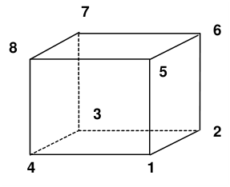
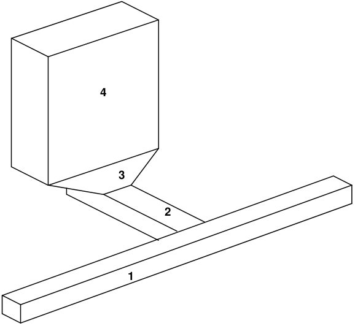

For many problems the details of the exact shape of excavation surfaces is not important since one is looking for a more global assessment of stability, such as pillar, abutment or hanging wall conditions. Since it is very tedious to describe the location and connections for every surface, in Map3D models can also be assembled out of three-dimensional building blocks.

CAD > Build > Block

CAD > Build > DD Loop CAD > Build > FF Loop

#### CAD > Build > Tunnel

These blocks are used for construction of three-dimensional excavations, alternate material zones and back-filled zones. They are defined by a top and bottom, each with 4 corners. The corners can be entered in either the clockwise or counter clockwise orientation, provided the top and bottom sides line up with one another (i.e. corner 5 must be opposite corner 1, 2 opposite 6, etc.). The sides do not have to be neither parallel nor planar and any of the corners can be repeated to define 3 sided shapes and wedges.

These blocks can be stacked together to create complex excavation shapes or ore zone boundaries. They are linked together either by sharing common corners or by virtue of the fact that they intersect. Sides, which are common to more than one block or penetrate other blocks are automatically cut off and deleted. The volume contained within the block structure defines an excavation, ore zone, yield zone, backfilled zones, etc.

To illustrate this point, consider a simple drawpoint configuration, which has been assembled out of 4 blocks. Block 1 represents the extraction drift, block 2 represents the crosscut, block 3 represents the drawpoint, and block 4 represents the stope. The pre-processor in Map3D identifies the connections between these blocks, cuts them off and deletes the surfaces, which are common to adjacent blocks.
