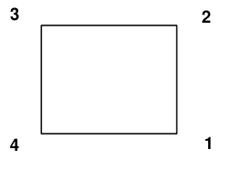
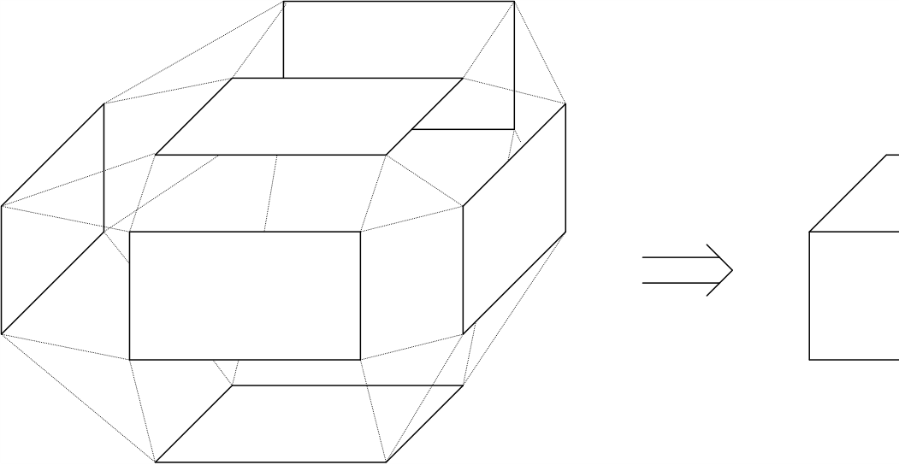
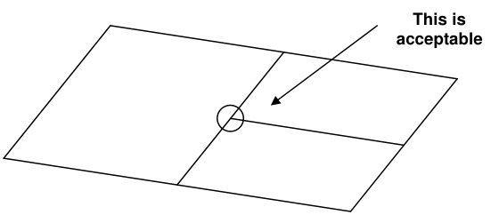

Models can be built out of individual surface patches.

CAD > Build > Block

#### CAD > Build > DD Loop

These are defined by 3 or 4 sided polygons that need not be planar. The corners can be entered in either clockwise or counter clockwise orientation. Any of the corners can be repeated to define 3 sided shapes and wedges.

Surface patches can also be used to construct excavation surfaces and complex ore outlines if desired. The

#### CAD > Build > FF Loop

routine can assist you in constructing complex as-built layouts with ease. The routine works by tracing around multiple level plans or sections, then automatically linking them together.

This is often the best approach, particularly when attempting to construct as-built models of structures where the exact shape is well known. This approach is useful for very detailed analysis of many civil type structures where stress concentrations and assessment of local instabilities are of primary concern.

These shapes can be constructed using the CAD functions built into Map3D or can be imported from other CAD packages in either

- AutoCAD-DXF format. This is a popular drawing exchange file with the extension ".DXF".

- Point file format is a universal ASCII data file with the extension ".PNT".

Even for simple shapes, this construction procedure can quickly get out of hand. Since it is necessary to create a series of surface patches that when taken together, form a seamless, non-overlapping, continuous skin, one cannot leave gaps or holes.

When models are built in this way, Map3D checks that closed surfaces are formed

#### Analysis > Options > Closure

Also, all surfaces will be renumbered in a consistent manner to ensure that they create positive volumes

#### Analysis > Options > Renumber

This renumbering may fail is surfaces are unclosed, i.e. there are holes in the excavation due to missing portions.

Unlike other analysis programs (isoparametric boundary element methods and the finite element or finite difference methods), it is not necessary that these plates share common corner points. Users are free to define elements with subdivisions mid-way along their edges, provided no gaps exist. Although models can be built using this surface modelling technique, an easier and more reliable technique is to use solid modelling

Building Models Out of Blocks
