In this section a few common construction errors are described along with suggestions as to how to avoid and correct these problems. Connecting a Cross Cut onto a Straight Drift

In this example, the crosscut is easily constructed by snapping its corners to the edge of the access drift. The "nearest edge" snap mode

#### CAD > Snap > Nearest Edge

should be used to select the indicated points. The built-in Boolean intersection capabilities of Map3D will automatically create the intersection between the two blocks during stage 2 of the analysis. This construction will work fine.

While for simple geometries this works fine, in many situations this connection is not so straightforward.

Let's consider a more complex geometry where the segments of the footwall access drift do not line up with the desired locations of the crosscuts.

#### Connecting a Cross Cut onto a Complex Drift

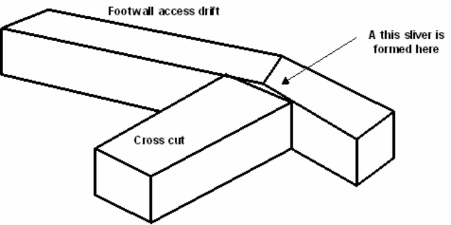

In this example, the crosscut does not join onto the footwall access drift correctly. A thin pillar is formed at the end of the crosscut. Map3D will detect this pillar and attempt to analyze it, probably without success. Just as this feature would be in reality physically unstable, it is also unstable numerically. Map3D can actually conduct a successful analysis of this feature, but only if the adjacent faces of the pillar are discretized with boundary elements of size similar to the pillar thickness. However, this is not a desirable approach since it would require a large number of elements and this pillar does not actually exist.

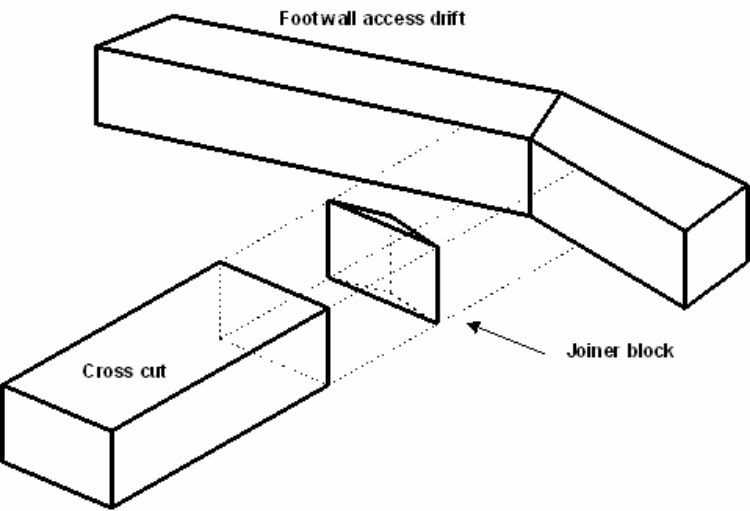

In order to avoid this problem, an additional joiner block could be built as shown in the adjacent exploded view. The "nearest corner" snap mode should be used so that this new block will join onto the drift and cross cut properly. This joiner block effectively mines out the undesired pillar thus properly connecting the cross cut to the footwall access drift.

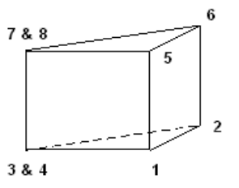

Note that the joiner block has only three points around the top and bottom. This can be readily constructed by selecting one of the corners twice at the same location (e.g. points 3 & 4 and 7 & 8).

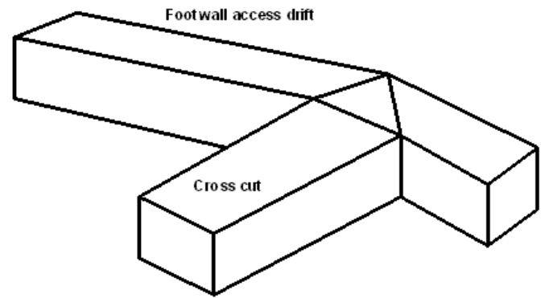

This problem can be avoided entirely if we construct the segments of the footwall access drift such they line up with the desired locations of the cross cuts. This is easily accomplished by subdividing the footwall access drift as shown. Often some for thought will help in easing the difficulty of construction.

#### Connecting Miss-Matched Stoping Blocks

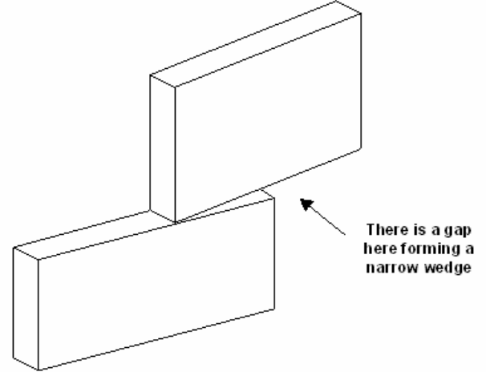

Often the situation arises where multiple stoping blocks must be joined along their common edges.

In this example, if the bottom of the upper block and the top of the lower block were at the same elevation, the built-in Boolean intersection capabilities of Map3D would automatically create the intersection between the two blocks during stage 2 of the analysis. This construction will work fine.

The problem occurs during construction when one attempts to snap the corners of one block to join along the side of the other. In this example, the upper block has been snapped onto the top edge of the lower block leaving a gap.

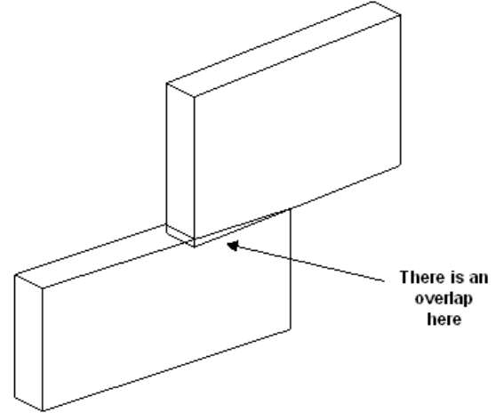

In order to eliminate this gap, one could snap the corners of the lower block onto the bottom edge of the upper block using the stretch function. But this will create an overlap, and hence does not fix the problem.

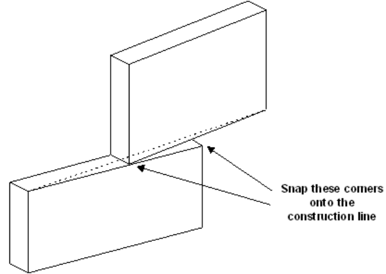

The alternative is to create a joiner block as described above. However, a simpler alternative is to create a construction lines that spans the problem area and snap corners from the upper and lower block to these lines. This procedure would have to be completed for both the back and front faces of the stoping blocks.

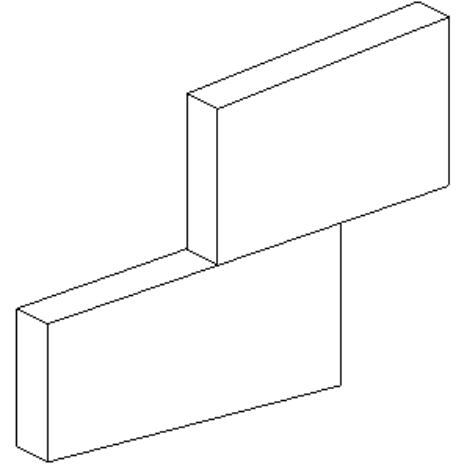

This method has the draw back that it does alter the shape of the stoping blocks, possibly in undesirable ways.

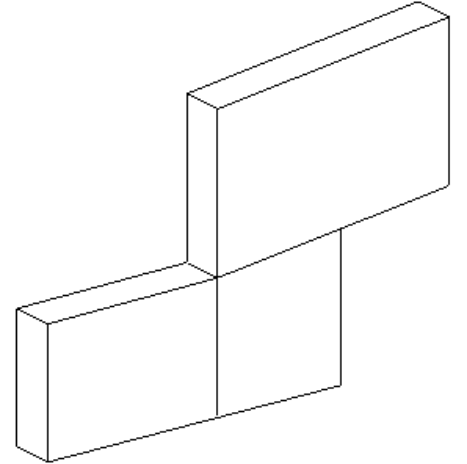

The best alternative is probably to subdivide one or both of the stoping blocks. This is the most effective technique for eliminating gaps and joining miss-fitting blocks.

#### Connecting Offset Stoping Blocks

Often the situation arises where the shape of one stoping block does not match the adjacent stoping block.

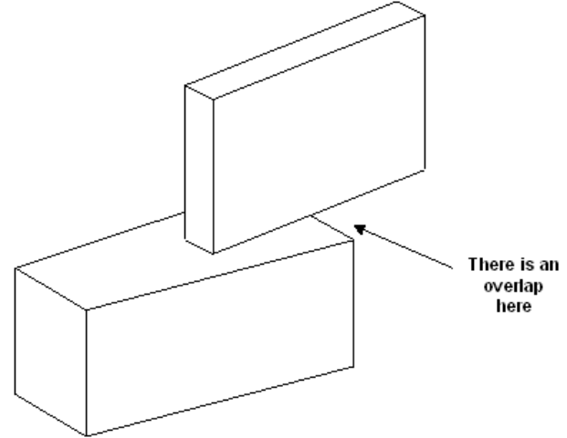

This situation can be easily accommodated by the built-in Boolean intersection capabilities of Map3D. The program will automatically create the intersection between the two blocks during stage 2 of the analysis.

These routines work best if all points on the bottom side of the upper block and all points on the topside of the lower block are at the same elevation. This can be achieved using

#### CAD > Edit > Move Vertices to Z

The routines will even work if the bottom side of the upper block and the topside of the lower block are non-planar and at different elevations as long as they do in fact intersect one another. In this latter case however, the resulting intersection may contain many complex elements. While these shapes will work fine, they could slow the analysis down owing to their large number and the fact that often they must be discretized heavily.

#### Connecting A Drift to a Stoping Block

Often the situation arises where one wants to intersect a drift with stoping block.

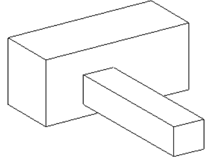

As above, this situation can be easily accommodated by the built-in Boolean intersection capabilities of Map3D. The program will automatically create the intersection between the drift and the stoping block during stage 2 of the analysis.

These routines work best if the intersecting faces are planar and parallel. The routines will even work if the intersecting faces are non-planar and non-parallel as long as they do in fact intersect one another. In this latter case however, the resulting intersection may contain many complex elements. While these shapes will work fine, they could slow the analysis down considerably owing to their large number and the fact that often they must be discretized heavily.
