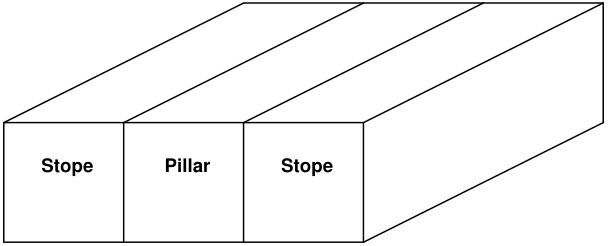
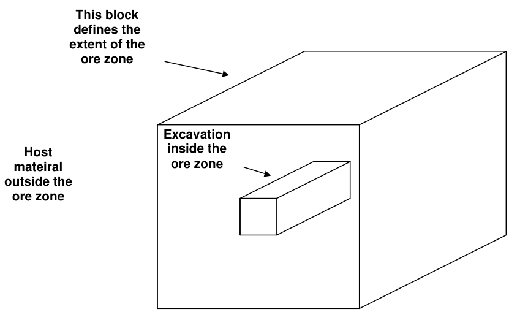
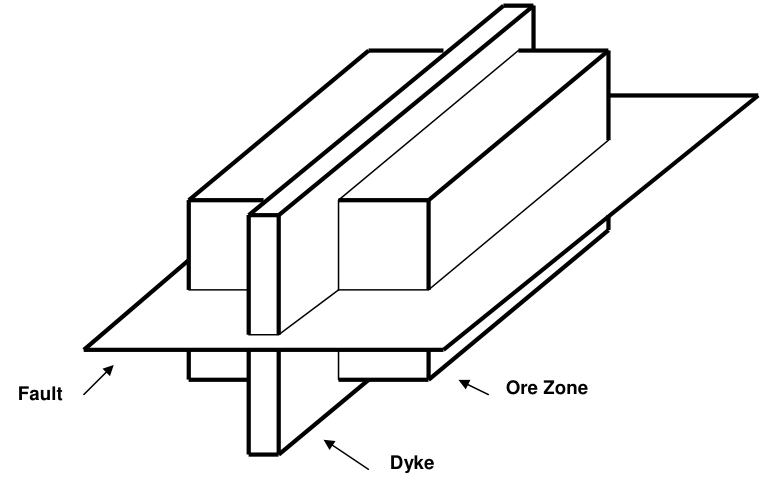

Models, which use multiple materials, are built using similar principles as normal excavation type models. Instead of defining the interior of a block as excavated (i.e. material code zero), one simply specifies the number of the material that exists inside the block.

By default, the host material is material number 1. Any region, which has a different set of properties (initial stress, elastic response or strength), must be defined just as an excavation would be defined using Fictitious Force type boundary elements. Instead of assigning these blocks a zero (to indicate zero surface stresses) or negative material code number (to indicate some specified stress state), they are simply assigned a positive material code number to indicate the properties to be associated with each particular group of blocks.

Recall that complex excavation shapes are built by combining several blocks with the same block number together to form the desired shape. In exactly the same manner, separate regions each with a

different set of material properties, are formed by building the desired shape out of many blocks, which have the same block number.

An important consideration here is that as few as possible block numbers should be used since all surfaces between groups of blocks with differing block numbers will be maintained in the database.

There are two methods of defining regions which are to be assigned material number 2 or higher (i.e. a different material number than the host material).

In the first method, regions with a different material numbers are constructed out of blocks, which appear exactly as excavations do.

This technique is useful for defining details of, for example, soft modulus zones around the periphery of excavations. This is also the best method of defining isolated features such as stiff dykes or blast damaged pillars.

The second method of defining regions is a more global approach where an entire excavation system (or part of it) is enveloped in a set of blocks, which define for example the ore zone. It is permissible to enclose one envelope with another (i.e. like an onion skin), and to overlap envelopes. Drifts, for example, are permitted to protrude through the ore zone into the host rock mass. Map3D constructs the required intersections.

These two methods can be used simultaneously. It is permissible to use blocks that define a global region using the second method. These blocks can either completely or only partially envelop other excavations defined using the first method.

The only consideration, which must be strictly observed when defining multiple material zones, is the convention that higher material numbers take priority over lower material numbers. This convention has been adopted to overcome the ambiguity when considering the intersection of two different features such as a fault with a dyke. When a fault and a dyke intersect, it is not clear whether the fault should be assumed to persist through the dyke or vise versa. Another example is the case where a dyke intersects an ore zone. Should the dyke be assumed to be persistent and cut through the ore, or should the ore be assumed to be persistent and cut off the dyke.

In either of these cases, it is the feature, which is assigned the higher material number, which is persistent. If the fault was assigned material number 4, the dyke assigned material number 3, and the ore assigned material number 2, the fault would persist throughout. Because it has the highest material number, the fault would be continuous though the ore and through the dyke, but not through excavations of course. Since the ore has the lowest material number, it would not cut through the dyke, but rather the dyke would cut through the ore.

You can use the following hide functions to assist in resolving which material cuts through other materials:

#### View > Hide > Solids

#### View > Hide > Unused

Logic has been built in to support the intersection of up to five features simultaneously (i.e. the intersection of blocks with five different block numbers). An unlimited number of blocks may intersect, but a maximum of five can only intersect at the same location. This will permit specification for example of multi-layer ore zones, with excavations on either side of the contact, and a fault running along the contact. Map3D automatically detects blocks which are partially or totally enclosed within other blocks,

and blocks which are adjacent to other blocks thus permitting a practically unlimited number of regions with different material types to be considered in any analysis.

When viewing the excavation geometry in graphics mode, the user can move the mouse cursor over a block of interest. Upon pressing a mouse button, the block number and the block name will be displayed. Also, the material code assigned to that block and the material code of the region adjacent or enveloping that block surface will be displayed. For example, for block surfaces adjacent to the host material, the "adjacent material code" will be one (recall material one represents the host rock mass). If the block surface is adjacent to an excavation, which has been assigned material code 2, and then the "adjacent material code" will be 2.

During the analysis, results are generated on field point grids. Map3D automatically detects whether grid points are located inside excavations or within regions with different material properties. When contour results are displayed, the user can move the mouse cursor over the field point of interest. Upon pressing a mouse button, the material code assigned to the region where that particular field point is located will be displayed along with the coordinates, displacements and stress state information. Note that strength factor calculations will be made using the material properties specified for that region. This feature permits assessment of strength, which may be different from one region to another.
