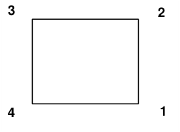
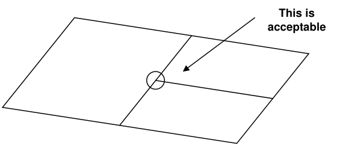
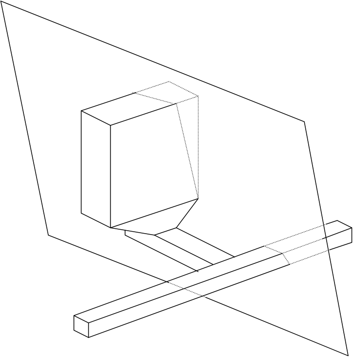
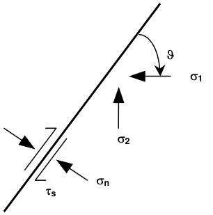

Models can be built out of individual surface patches. These are defined by 3 or 4 sided polygons that need not be planar. The corners can be entered in either clockwise or counter clockwise orientation. Any of the corners can be repeated to define 3 sided shapes and wedges.

#### CAD > Build > DD Loop

These shapes can be constructed using the CAD functions built into Map3D or can be imported from other CAD packages in either:

- AutoCAD-DXF format. This is a popular drawing exchange file with the extension ".DXF".

- Point file format is a universal ASCII data file with the extension ".PNT".

Unlike other analysis programs (isoparametric boundary element methods and the finite element or finite difference methods), it is not necessary that these plates share common corner points. Users are free to define elements with subdivisions mid-way along their edges, provided no gaps exist.

Fault planes and tabular mining are built using the same principles as normal excavation type models. These features are simply specified along with other excavations and multiple material zones, and can be used simultaneously with all other Map3D features.

Fault planes and tabular mining zones are defined using displacement discontinuity elements. These can only be specified in terms of plate definitions. The four corners of the plate define the extremities of

the displacement discontinuity. Displacement discontinuities can intersect excavations at any location, since Map3D builds edge intersections internally.

As in the section above, the only consideration, which must be strictly observed when defining fault planes, is the convention that higher material numbers take priority over lower material numbers. When considering the intersection of two different features such as a fault with a dyke, it is the feature that has been assigned the higher material number that will persist through the other.

A concern, which must be addressed when using non-linear modelling (whether fault slip or generalized yielding in Map3D Non-Linear), is that the far field stress should not exceed the strength. If the far field stresses exceed the rock mass strength, then the rock mass itself will be unstable. Although this may be admissible in some creep problems, it is generally not acceptable, and steady state (i.e. non-creeping) solutions are not possible.

This limitation is more severe when simulating faults. Any fault may be at or very near static equilibrium (i.e. stresses equal to the strength) with the far field stress state. For weak faults under high stress ratios the principal stresses must be oriented almost perpendicular or parallel to the fault plane, otherwise the fault will be unstable, and slip even without any mining. This condition is generally not acceptable since steady state (i.e. non-creeping) solutions are not possible.

For the case where s1 is oriented at the angle J from the fault plane, the shear stress and normal stress acting on the fault are given by

ts = ( s1 - s2 ) sin(J) cos(J)

sn = s1 sin² (J) +  s2 cos² (J)

substituting these into the shear strength relation

|ts| = Cohesion + sn tan(j)

it can be found that the stress state must satisfy

|( s1 - s2 ) sin(J) cos(J)| = Cohesion + [ s1 sin² (J) +  s2 cos² (J) ] tan(j)

For example, with

s1 = 32 MPa s2 = 16 MPa Cohesion = 0 j = 10°

then J must be less than 11° or between 69° and 90°.

With

s1 = 60 MPa s2 = 16 MPa Cohesion = 0 j = 30°

then J must be less than 15° or between 45° and 90°.
