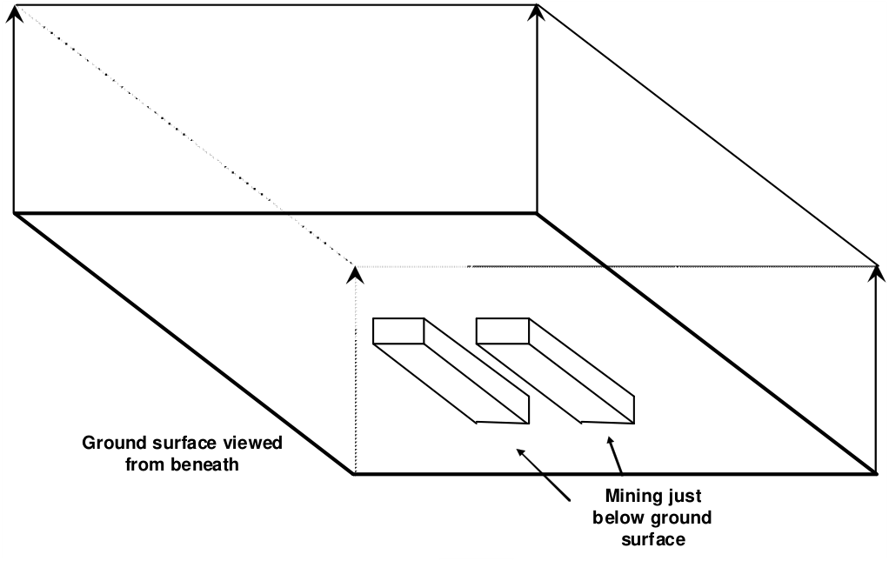

Ground surface is best defined using a large FF zone with its lower surface as the ground surface. By assigning a material code of zero to these elements, Map3D will ensure zero normal and shear stresses along these surfaces thus simulating a free surface.

It is only necessary to define ground surface when your mining excavations are fairly shallow, (i.e. the depth of mining is less than approximately twice the lateral extent of the mining). For these cases, the free surface should extend at least twice the lateral extent of the mining in all directions.

The user should not extend field point grids near or through the free surface unless absolutely

necessary, since this will result in the discretization of the free surface into a large number of boundary elements.
