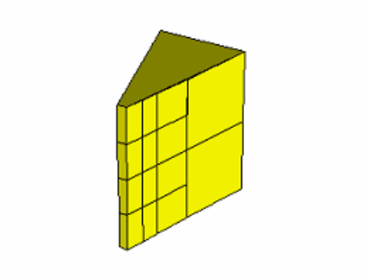
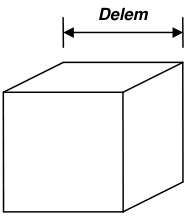
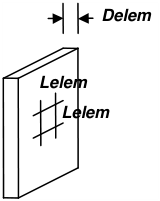
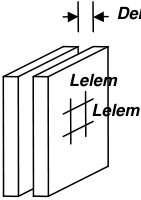
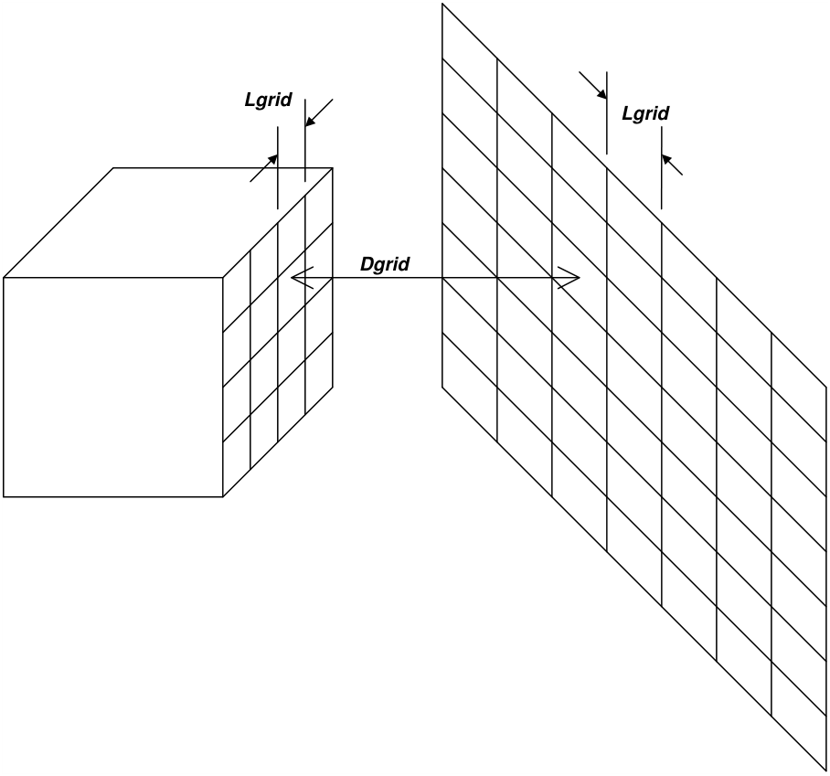
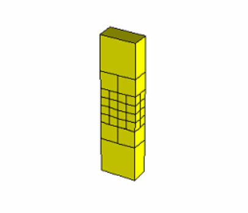
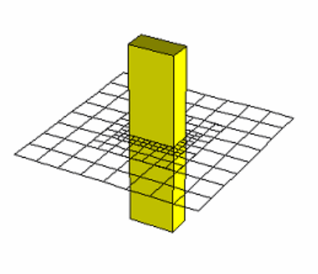
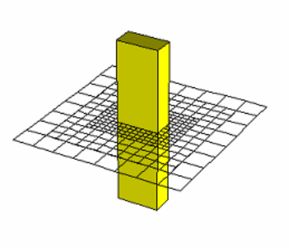
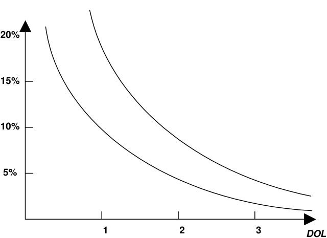
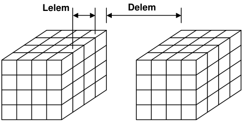

Map3D uses several different, but complimentary strategies to permit analysis of very large problem sizes. Discretization is controlled such that boundary elements are only used in locations where they are needed. Several forms of lumping are then used to reduce analysis time and disk space requirements. Together, these features enable Map3D to accommodate very large problem sizes (more than 2,000,000 elements) on PC platforms.

Without lumping, a 64000 element problem would take 147 GB of disk space. With lumping, this can be reduced to less than 1 GB. The time required for analysis reduces by approximately the same proportion. This permits users to specify existing mining geometry in detail, and add new mining as

required. This greatly reduces the effort required to set up and run analyzes and permits the whole mine to be considered when necessary.

All discretization and lumping parameters are expressed in terms of a distance over length ratio. In all cases the distance is measured between two points of interest (e.g. from one element to another, or from an element to the nearest grid point). In this ratio, the length is the size of the element, or grid spacing at one of the points of interest.

Suggested values for the discretization and lumping parameters are as follows:

- _AL_ should be set equal to twice the smallest pillar or stope width. Use the same units used to specify the coordinates (e.g. metres or feet).

- _AG_ should be set equal to the smallest dimension of interest. Use the same units used to specify the coordinates (e.g. metres or feet).

- _DON_ =0.5, _DOL_ = _DOC_ =1, _DOE_ = _DOG_ =2 for 10-20% error

- _DON_ =0.5, _DOL_ = _DOC_ =2, _DOE_ = _DOG_ =4 for 5-10% error

- _DON_ =1.0, _DOL_ = _DOC_ =4, _DOE_ = _DOG_ =8 for &lt; 5% error

These parameters are set using the CAD > Properties > Control Parameters dialogue.

The details of the use of these parameters for control of discretization and lumping are described below.

**_DON_ and** **_AL_ - Matrix Conditioning**

During the discretization process all model surfaces (surfaces of FF blocks and DD planes) are subdivided into boundary elements with side length

_Lelem_ = _Delem_ / _DON_

where _Delem_ is determined by Map3D as the smallest distance between adjacent model surfaces. Since at some locations the distance _Delem_ may be zero, the minimum element side length _AL_ must be specified.

_AL_ should be set equal to twice the smallest pillar or stope width. The same units used to specify the coordinates should be used (e.g. metres or feet).

A value for _DON_ of 0.5 is generally adequate for all problems except those with very narrow excavations or pillars. In this latter case a value for _DON_ of 1.0 is recommended.

Although higher values of _DON_ results in generation of more boundary elements and hence longer run times, this is necessary to obtain a well-conditioned solvable problem for very narrow excavations or pillars.

_DON_ controls the way block surfaces are discretized into boundary elements. This parameter along with _AL_ , is used to ensure that a well-conditioned, solvable coefficient matrix will be generated by the Boundary Element Analysis.

Matrix conditioning can be directly related to the magnitude of _DON_ . A well-conditioned, easily solved matrix can be guaranteed by using larger values (near one) of _DON_ .

_DON_ = 0.5

#### _DON_ = 1.0

These parameters control how fine the discretization will be for surfaces, which pass near one another. For example comparing examples using _DON_ of 0.5 and 1.0, it can be observed that larger values of _DON_ produce smaller boundary elements where the stope is locations.

From an analysis point of view, there are three basic types of problems. The easiest to solve are problems, which use bulky, three-dimensional shapes such, that surfaces are spaced well apart.

For this type of problem, a well-conditioned coefficient matrix will always be generated, and the effect of _DON_ and _AL_ are not important.

The next most difficult type of problem to solve is one where narrow stopes are defined. For this case, the distance _Delem_ (which is the smallest distance from one element to another) is just the stope width. Since the element side length _Lelem_ can be calculated from the _DON_ ratio as

#### _Lelem_ = _Delem_ / _DON_

such that _Lelem_ is not less that _AL_ , small values of _DON_ will generate small elements only near locations where stopes are narrow. As one moves away from these areas, the element size will very quickly increase. The use of fictitious force elements to create this type of tabular shaped excavation can result in a poorly conditioned matrix unless a value of _DON_ of approximately one half is used. This must of course be accompanied by a sufficiently small value of _AL_ to permit small elements to be generated.

_AL_ should normally be set equal to the width of the narrowest pillar, stope, or the smallest hangingwall to footwall distance. This will permit the discretization routine to use as small size elements as are necessary to ensure proper matrix conditioning.

The most difficult type of problem to solve is one where narrow pillars are defined or where narrowly spaced joints are used. As above, _Delem_ is the stope or pillar width. The element side length can also be calculated from the _DON_ ratio, however, for this type of problem, where excavations are very near one another, creating narrow pillars, a poorly conditioned unsolvable matrix will be created unless a value of _DON_ of approximately one is used. This must of course be accompanied by a sufficiently small value of _AL_ to permit small elements to be generated.

The recommended value of _DON_ is 0.5 for narrow stopes problems and 1 for narrow pillar problems.

_AL_ should normally be set equal to the width of the narrowest pillar or the smallest hangingwall to footwall distance. This will permit the discretization routine to use as small size elements as are necessary to ensure proper matrix conditioning.

In summary, _AL_ should be set equal to the width of the narrowest pillar or the smallest hangingwall to footwall distance. Larger values may be necessary if too many elements are generated. _DON_ should be set to 0.5 for normal problems, and 1.0 for problems where narrow pillars are defined.

During discretization, Map3D will attempt to satisfy the specified _DON_ ratio for all elements. When discretizing, the maximum number of boundary elements that any block or plate edge can be divided into is 256. If this number of subdivisions is reached, and the specified _DON_ ratio has still not been

achieved, Map3D will issue a warning message instructing the user to subdivide the block or plate into smaller pieces.

Once discretization is complete, the distance _Delem_ can be plotted using

Plot > Miscellaneous > Delem Distance to nearest element on surfaces

The ratio of _Delem/Lelem_ can be plotted using

Plot > Miscellaneous > Delem/Lelem _DON_ ratio on surfaces

Locations where _DON_ is small (less than 0.5) could result in a non-convergent solution process.

Note that if desired, this behaviour can be overridden on an element by element basis my specifying the maximum width for each element

#### CAD > Edit > Entity Properties > Maximum Width

#### _DOL_ and _AG_ - Solution Accuracy

During the discretization process Blocks and DD planes are subdivided into boundary elements with side length _Lgrid_ . The element size is determined from the minimum distance _Dgrid_ to the nearest field point grid plane according the relation

_Lgrid_ = _Dgrid_ / _DOL_

Since at some locations the distance _Dgrid_ may be zero, a minimum element side length _AG_ must also be specified.

This same relationship is also used to subdivide grid planes into points where field stresses, strains and displacements are calculated. A minimum grid spacing of half _AG_ will be used.

The _AG_ parameter should be set equal to smallest dimension of interest. To obtain reasonable accurate results, _AG_ should be set to approximately one quarter the stope or pillar width. For example if the user wants to see the stress distribution across a 2m wide pillar, a value of 0.5 for _AG_ would give a sufficient number of field points for accurate contouring.

The same units used to specify the coordinate locations should be used (e.g. metres or feet).

A value for _DOL_ of 1.0 is recommended for all problems except those where increased accuracy is required. With a value of 1.0 an error of 10-20% can be expected. A value of 2.0 should provide 5-10% error. A value of 4.0 should provide less than 2% error.

Although higher values for _DOL_ result in more elements being generated, this is necessary to obtain increased accuracy.

_DOL_ controls the way in which grids and block surfaces are subdivided. This parameter along with _AG_ , is used to control the amount of detailed accuracy one requires in the results.

_AG_ should be selected to reflect the size of interest. For example, if details of the stress distribution are only required to within one metre of the surface excavations, then _AG_ should be set equal to one metre.

The field point spacing and element side length _Lgrid_ , are determined from the specified _DOL_ ratio. _Dgrid_ is determined as the minimum distance from a given element to the nearest grid. Since _Lgrid_ can be calculated from the _DOL_ ratio as

_Lgrid_ = _Dgrid_ / _DOL_

such that _Lgrid_ is not less that _AG_ , small values of _DOL_ will generate small elements and grid spacing only near locations where grids pass near to stopes. As one moves away from these areas, the element size will very quickly increase.

_DOL_ = 1

_DOL_ = 2

_DOL_ = 1

#### _DOL_ = 2

Small values of _DOL_ (one or less) will generate small field point spacings and small elements only near locations where the grid intersects or passes very close to the block. As one moves further away from these areas, the field point spacing and element side length will very quickly increase. Larger values of _DOL_ (two or more) will increase the distance over which the field point spacing and element side length are kept small.

#### ERROR

Result accuracy can be directly related to the magnitude of _DOL_ . Errors are limited to approximately 1020% for _DOL_ near one, and 5-10% for _DOL_ near two. These values are only approximate, and it is therefore recommended that in problems where high accuracy is required, values of _DOL_ near four be used. In problems where low accuracy is necessary, _DOL_ near one is adequate. It is not recommended to set _DOL_ less that one.

Note that large values of _DOL_ and small values for _AG_ result in increased number of elements and increased run times, but greater accuracy.

In summary, _AG_ should be set to the resolution of interest (a fraction of the stope width). _DOL_ should be set to 1 for coarse analysis results, 2 for detailed analysis results, and 4 when very high accuracy is required.

During discretization, Map3D will attempt to satisfy the specified _DOL_ ratio for all elements and grids. When discretizing, the maximum number of boundary elements that any block or plate edge can be divided into is 256. The maximum number of field points that any grid edge can be divided into is also 256. If this number of subdivisions is reached, and the specified _DOL_ ratio has still not been achieved, Map3D will issue a warning message instructing the user to subdivide the block, plate or grid into smaller pieces.

Once discretization is complete, the distance _Dgrid_ can be plotted on model surfaces using

Plot > Miscellaneous > Dgird Distance to nearest grid on surfaces

or on grids using

Plot > Miscellaneous > Dgrid Distance to nearest element on grids

The ratio of _Dgrid_ / _Lgrid_ can be plotted on model surfaces using

Plot > Miscellaneous > Dgrid/Lgrid _DOL_ ratio on surfaces

or on grids using

Plot > Miscellaneous > Dgrid/Lgrid _DOL_ ratio on grids

Note that if desired, this behaviour can be overridden on a grid by grid basis by specifying the maximum width for each grid

CAD > Edit > Entity Properties > Maximum Width

#### _DOR_ - Element Aspect Ratio

_DOR_ controls the maximum element aspect ratio. If the ratio of the side length of an element is determined to exceed _DOR_ , that element is subdivided. The recommended value of _DOR_ is 5. If erratic results are detected, _DOR_ should be decreased to 2. Note that smaller values of _DOR_ results in more elements and longer run times, but greater accuracy.

During discretization, Map3D will attempt to satisfy the specified _DOR_ ratio for all elements. When discretizing, the maximum number of boundary elements that any block or plate edge can be divided into is 256. If this number of subdivisions is reached, and the specified _DOR_ ratio has still not been achieved, Map3D will issue a warning message instructing the user to subdivide the block or plate into smaller pieces.

#### _DOC_ - Matrix Lumping

During matrix assembly, the distance _Delem_ between groups of Blocks and DD planes is examined to see if these can be lumped together for calculation and storage purposes. The amount of lumping depends on how many elements can fit into a zone with side length _Lelem_ , determined from the relation

#### _Lelem_ = _Delem_ / _DOC_

A value for _DOC_ of 1.0 is recommended for all problems except those where increased accuracy is required. With a value of 1.0 an error of 10-20% can be expected. A value of 2.0 should provide 5-10% error. A value of 4.0 should provide less than 5% error.

Although higher values of _DOC_ result in larger problem sizes, this is necessary to obtain increased accuracy.

_DOC_ controls the way in which elements are lumped during matrix assembly. Elements with combined side length _Lelem_ , are lumped if the distance _Delem_ , to the affected element exceeds the required _DOC_ ratio. If the stope to stope distances are large, many elements can be lumped.

Small values of _DOC_ (one or less) will provide maximum lumping, however, stresses near excavation surfaces will deteriorate in accuracy, and matrix conditioning will be reduced. Larger values of _DOC_ (two or more) will provide less lumping, but accuracy and good matrix conditioning will be maintained.

_DOC_ should be set to 1 for coarse analysis results, 2 for detailed analysis results, and 4 when very high accuracy is required. Note that large values of _DOC_ results in increased matrix size and longer run times, but greater accuracy.

#### _DOE_ - Element Lumping

During the calculation of field points (i.e. grid assembly), the distance _Dgrid_ between these points and groups of Blocks and DD planes is examined to see if these groups can be lumped together for calculation purposes. The amount of lumping depends on how many elements can fit into a zone with side length _Lgrid_ , determined from the relation

#### _Lgrid_ = _Dgrid_ / _DOE_

A value for _DOE_ of 2.0 is recommended for all problems except those where increased accuracy is required. With a value of 2.0 an error of 10-20% can be expected. A value of 4.0 should provide 5-10% error. A value of 8.0 should provide less than 5% error.

Although higher values of _DOE_ result in larger analysis times, this is necessary to obtain increased accuracy.

_DOE_ controls the way in which elements are lumped during field point calculations. Elements with combined side length _Lgrid_ , are lumped if the distance _Dgrid_ , to the field point exceeds the required _DOE_ ratio. Small values of _DOE_ (two or less) will provide maximum lumping, however, stresses distributions near excavation surfaces will deteriorate in accuracy and become erratic. Larger values of _DOE_ (four or more) will provide less lumping, but accuracy and smooth stress distributions will be ensured.

_DOE_ should be set to 2 for coarse analysis results, 4 for detailed analysis results, and 8 when very high accuracy is required. Note that large values of _DOE_ results in increased matrix size and longer run times, but greater accuracy.

#### _DOG_ - Grid Lumping

During the calculation of field points (i.e. grid assembly), the distance _Dgrid_ between these points and groups of Blocks and DD planes is examined to see if these field points can be lumped together for calculation purposes. The amount of lumping depends on how many field points can fit into a zone with side length _Lgrid_ , determined from the relation

_Lgrid_ = _Dgrid_ / _DOG_

A value for _DOG_ of 2.0 is recommended for all problems except those where increased accuracy is required. With a value of 2.0 an error of 10-20% can be expected. A value of 4.0 should provide 5-10% error. A value of 8.0 should provide less than 5% error.

Although higher values of _DOG_ result in larger analysis times, this is necessary to obtain increased accuracy.

_DOG_ controls the way in which field points are lumped during field point calculations. Field points with combined spacing length _Lgrid_ , are lumped if the distance _DOG_ , to the affecting element exceeds the required _DOG_ ratio. Small values of _DOG_ (two or less) will provide maximum lumping, however, stresses distributions near excavation surfaces will deteriorate in accuracy and become erratic. Larger values of _DOG_ (four or more) will provide less lumping, but accuracy and smooth stress distributions will be ensured.

_DOG_ should be set to 2 for coarse analysis results, 4 for detailed analysis results, and 8 when very high accuracy is required. Note that large values of _DOG_ results in increased matrix size and longer run times, but greater accuracy.
