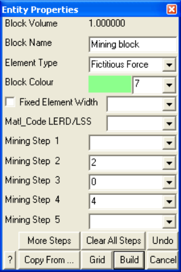

The mining step sequence is specified simply by designating appropriate material codes at the desired mining step. The material code represents the number of the material that exists inside the block. By default, the host material is material number 1. Any region which has a different set of properties (initial stress, elastic response or strength) from the host, should simply be assigned a positive material code number to indicate the properties to be associated with each particular group of blocks.

Material code 0 specifies that the element will have zero surface stresses. This is the default and is normally used for excavation surfaces, ground surface and open pit walls.

Material code -M (e.g. -2) specifies that the element will have surface stresses equal to the stress state associated with material number M. This is useful for modelling pressurized openings or stresses that vary with depth (e.g. backfill).

Material code +M (e.g. 2) specifies that the enclosed region will behave with the properties associated with material number M. This code is used to specify regions that have properties different from the host material (e.g. ore, dyke, backfill, etc.).

Material codes are assigned during model building using

CAD > Build > Block CAD > Build > DD Loop CAD > Build > FF Loop

Material codes can be assigned at any time using

CAD > Edit > Entity Properties

You will be prompted as follows

In this example, the selected block is not used at step 1. Assigned the properties for material number 2 at mining step 2. At mining step 3 the block is excavated. Finally at mining step 4, the block is backfilled with material number 4.

This procedure can be used with fictitious force type elements to define three-dimensional zones with different stresses and material properties (e.g. stiff dykes, soft ore zones or yielding zones). It can also be used with Displacement Discontinuity type elements to define planar zones with different stresses and material properties (e.g. gouge filled faults, tabular mining yielding pillars).

The material codes can be specified a different value at each mining step. If no material code is assigned (i.e. the material code is left blank), the block will remain inactive.

It is important to remember the convention that higher material numbers (material codes) take priority over lower material numbers. This convention has been adopted to overcome the ambiguity when considering the intersection of several different features such as a fault with a dyke, or backfill placed in part of a stope. To ensure you will not have problems it is advisable to use the highest material numbers for backfill.

When simulating stiff support systems such as arches, steel sets, props, thick liners, chalks, strong backfill etc., it is necessary to model the ground movement up to the point of support placement, then insert the support elements either in a stress/strain free state, or with a prescribed pre-stressing. To accomplish this you must first excavate the desired support element (either a 3D FF block or DD plane) to the desired pre-stressed state (use a zero material code for zero stresses or a negative material number for a prescribed stress state), then in a subsequent mining step insert the support material (use a positive material number to do this). With the Analysis > Options > Zero Strain Support Placement option checked, Map3D conducts the necessary calculations to place support elements in a stress/strain free state or with a prescribed pre-stressing at the current mining step. The action of excavation to a zero or prescribed stress state followed by insertion of an alternate material signals Map3D to conduct the required calculations.

This procedure is particularly useful for simulation of structural support elements and can accommodate placement, modification of properties and subsequent removal if desired. This option has been enabled for use with 3D FF blocks and/or DD planes.

Without this option, all materials are placed at the pre-mining deformation state. This can cause erroneous large stresses particularly in stiff support elements.

The mining sequence achieved can be viewed while in Map3D graphics mode simple by flipping between mining steps using

File > Mining Step
