To demonstrate model building using digitized mine plans, let's build a simple VRM bulk mining geometry.

Construction lines are used to define detailed locations of underground features such as excavations, contacts structure etc. A Map3D model is normally built on top of this construction line data.

The mine plans have been previously digitized using Map3D

#### CAD > Digitizer Setup

or some other CAD program. These plans can be saved in either:

Point file format is a universal ASCII data file with the extension ".PNT". This format is useful for exchanging raw construction line data with other CAD software.

AutoCAD-DXF format is a popular drawing exchange file with the extension ".DXF". This format is useful for exchanging construction line data with other CAD software.

We want to start with a clean slate, so we will select

#### File > New (Model)

Before beginning please note that the user can hover over any button to obtain a tooltip identifying that buttons function. Also the use can right click on any item to obtain detailed help on that function.

#### Importing digitized mine plans

First we must open a file containing the digitized mine plans. This is done using

#### File > Open (Construction Lines)

In this case the construction lines have been saved in DXF format, so change the "Files of Type" to *.dxf

The file "BULK.dxf" is included with the Map3D installation and should be available to import.

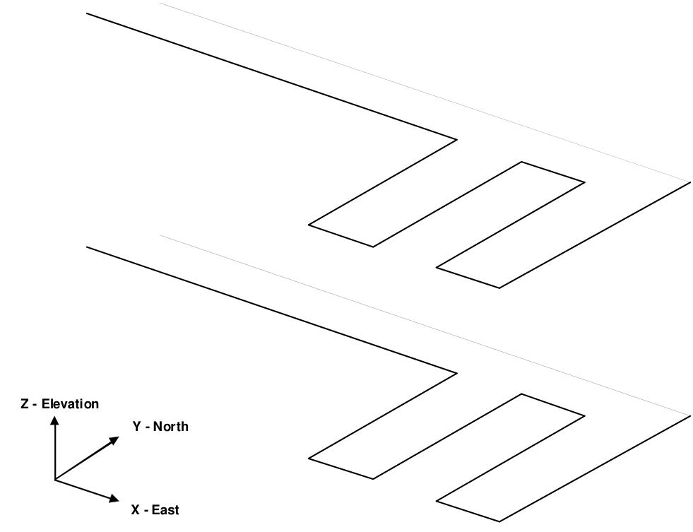

The access drifts measure approximately 5m wide by 5m high, and the distance between levels is 25m.

#### Repositioning The View

During block building or at any other time, the user is free to reposition (translate, rotate or zoom) the geometry to make visualization easier. This is readily accomplished by several means (refer to Rotating the Model and Translating the Model). The easiest way is to rotate is simply hold down the left mouse button will dragging the cursor across the screen. Translation is achieved by holding down the right mouse button. The model can be zooming in or out by holding down both mouse buttons.

Position the view so that the construction lines are readily visible.

#### Building Footwall Access Drifts and Cross Cuts

There are numerous methods that can be used to construct these entities. In this tutorial a few different techniques will be demonstrated.

#### Building Blocks One at a Time

The simplest (although the most time consuming) approach is to construct a series of 8 cornered blocks one at a time.

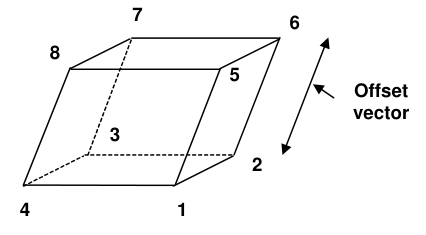

To construct the first block, use CAD > Build > FFLoop. This function can be selected from the CAD toolbar as follows (activate the CAD toolbar if it is not visible using Tools > CAD Toolbar):

Select CAD > Build from the CAD toolbar

You will be presented with the sub-menu of build functions

Now select

#### CAD > Build > FFLoop

Since we want to snap to construction lines we must set the snap mode. This is done using CAD > Snap > Nearest Edge. This function can be selected from the Build Entity toolbar

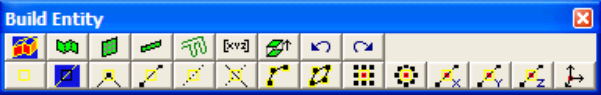

To activate the nearest edge snap select

#### CAD > Snap > Nearest Edge

(this only needs to be done if the nearest edge snap button is not already highlighted ).

In this mode, a pick-box will be displayed at the intersection of the cross-hairs.

**The nearest point on this edge will be selected**

Although the coordinates of the current cursor location are indicated on the status bar, if the pick-box is located over the corner of a construction line, that corner will be selected, otherwise, the nearest point on the edge of the construction line under the pick-box will be selected. In either case all 3 coordinate values (x, y and z) are uniquely specified.

You will see that the FFLoop building routine is prompting you to enter the first corner of the block on the status bar

Input: Select Point 1

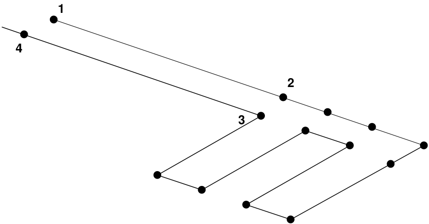

Move the cursor about until you locate point #1. Select this point by clicking the left mouse button once.

You will now be prompted for the next block corner

#### Input: Select Point 2

As you move the cursor about you will see that not only is the current cursor location indicated at the lower left hand corner of the display, but also the offset of the current point from the last one selected (i.e. the offset vector from point 1 to point 2). Select point #2. Repeat this selection process for point #3 and #4.

If you select the wrong location for a point, simply undo that selection using the undo button

CAD > Build > Undo Point then try again.

Finally, reselect the first point (i.e. point #1).

When first point has been reselected, the base of the block has been completely formed. You will be prompted with the message

Loop complete: Start next loop.

To complete building the block we will generate the remaining 4 points from the first 4 corners by adding an offset to them. To use this latter procedure, select the offset function from the Build Entity toolbar

#### CAD > Build > Extrude/Offset Remaining

You will be prompted for this offset vector as follows

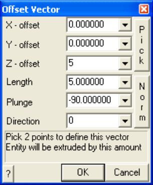

Enter the offset as:

X-offset > 0 Y-offset > 0 Z-offset > 5

Points 5, 6, 7 and 8 will be generated respectively from points 1, 2, 3 and 4 by adding the offset values to their coordinates.

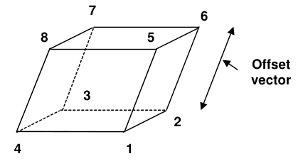

Upon completion of block construction you will automatically be prompted to enter the block properties ( CAD > Build > FFLoop)

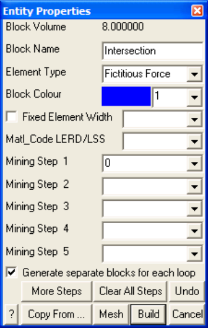

Enter the following:

Block Name: Intersection Element Type: Fictitious Force Block Colour: 1

This intersection block should be excavated at mining step 1. This is indicated by specifying Mining Step 1: 0

We are now finished and can Build this block by pressing the

button.

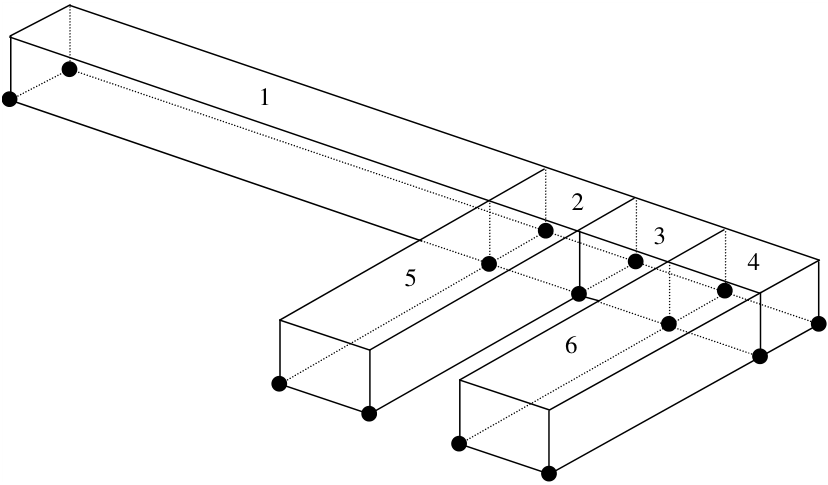

By repeating the above FFLoop construction procedure the entire level can be constructed as a series of blocks.

#### Building Complex Blocks

Let's now construct more complex shaped blocks.

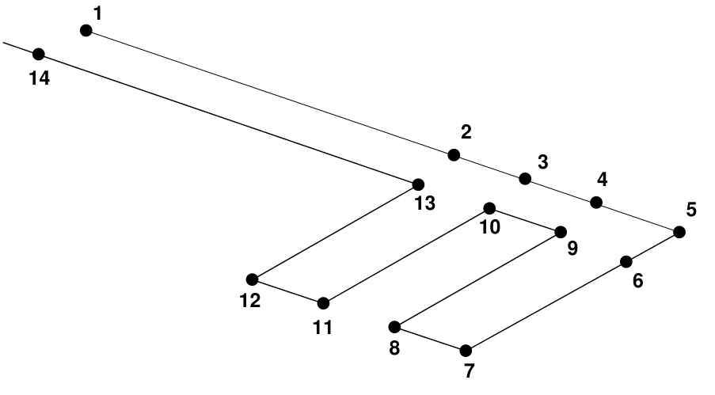

This can be done using the same FFLoop construction technique described above, except we will select all 14 points as the floor plan. Once the point #14 has been selected you must reselect point #1 to complete the base of the block. You will be prompted with the message

#### Loop complete: Start next loop.

To complete building the block select the offset function from the build entity toolbar as before.

#### CAD > Build > Extrude/Offset Remaining

This construction procedure will create one large continuous block covering the entire floor plan. If desired the user could build one block using the point sequence 1-2-3-4-5-6-9-10-13-14-1 to build the hangingwall drive, then 13-10-11-12 and 9-6-7-8 to build the cross-cuts as separate blocks. This later procedure would be desirable if the cross-cuts were to be mined at a different mining step than the hangingwall drive.

Now build the access drifts on the lower level using the same procedure.

#### Building VRM Panels

The VRM panels can now be built. These will be constructed using FFLoop blocks with 8 corners.

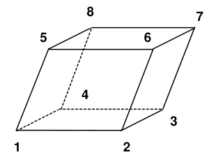

To begin building select

#### CAD > Build > FFLoop

Since we want to snap to corners of previously constructed blocks we must set the snap mode to CAD > Snap > Nearest Corner. This function can be selected from the Build Entity toolbar

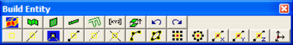

To activate the nearest corner snap select

#### CAD > Snap > Nearest Corner

(this only needs to be done if the nearest edge snap button is not already highlighted ).

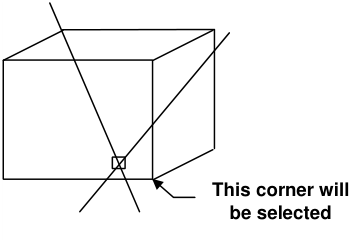

In corner snap mode, a pick-box will be displayed at the intersection of the cross-hairs. The nearest corner on the entity or construction line under the pick-box will be selected (snapped to), thus all 3 coordinate values (x, y and z) are uniquely specified.

We could actually use edge snap mode here

#### CAD > Snap > Nearest Edge

since the corners of the blocks would be selected anyway (as long as the corner is located within the pick box). However, using corner snap allows us to be sloppier with our selection since only corners will be selected.

Select the first 4 points as shown below. Remember to reselect point #1 to complete construction of the floor plan loop.

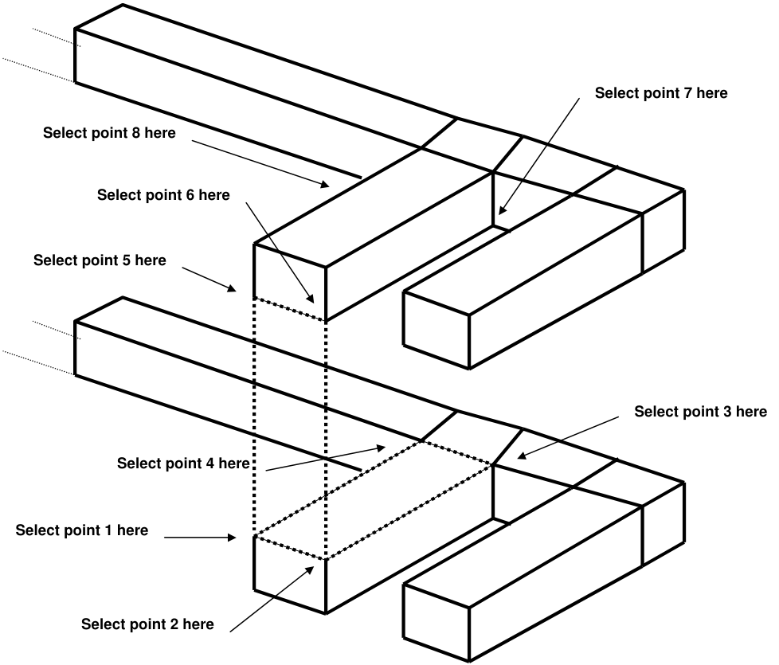

To select points 5 to 8 we will need to rotate the model so we are looking up from below. This is easily done by holding the left mouse button down while dragging the mouse cursor upwards on the screen.

Select points 5 to 8 as shown below. Remember to reselect point #5 to complete construction of the upper plan loop.

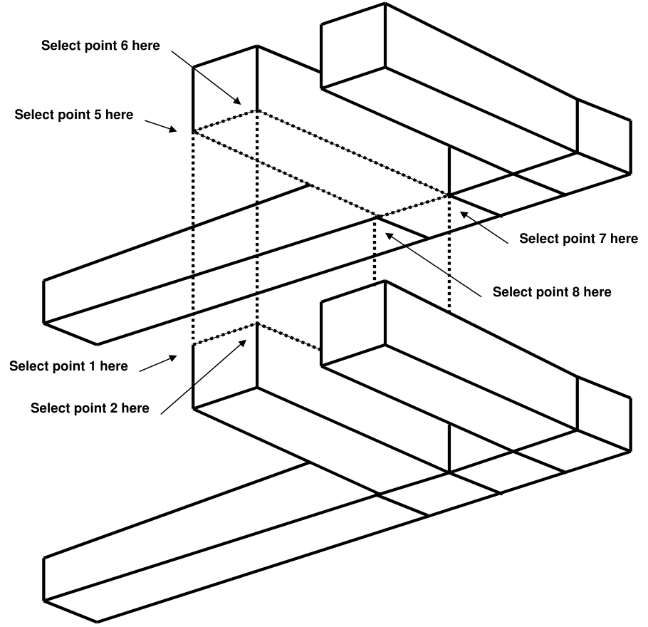

As before you will be prompted with the message

Loop complete: Start next loop.

To complete building the block select the build button from the Build Entity toolbar

Upon completion of block construction you will automatically be prompted to enter the block properties ( CAD > Build > FFLoop)

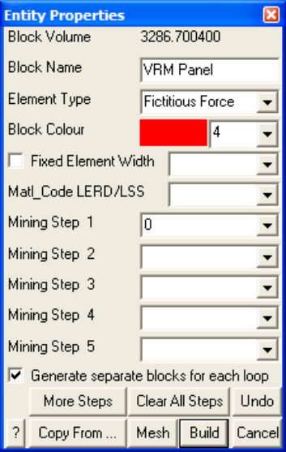

Enter the following:

Block Name: VRM Panel Element Type: Fictitious Force Block Colour: 4

We will leave this block unmined at step 1 and excavated at step 2. This is indicated by leaving

Mining Step 1: (leave this field blank) Mining Step 2: 0

We are now finished and can Build this block. The adjacent panel can be constructed using the same procedure giving the final geometry.

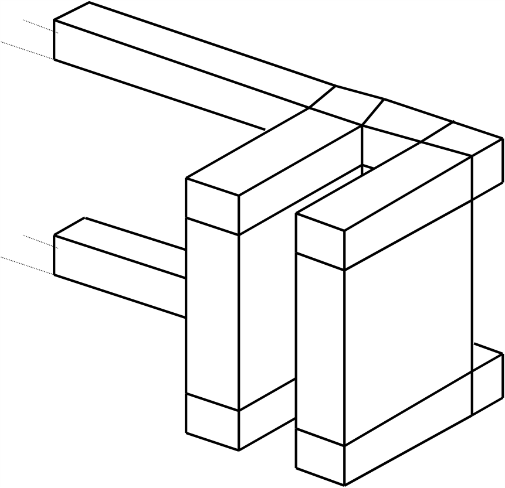

#### Saving the Geometry

At this point we have constructed the footwall access drifts and two VRM panels. Before proceeding further it would be a good idea to save the model as built so far. To do this we select

File > Save Model As

Let's save with the name "VRM.INP"

#### Building Grid Planes

We must now decide where we want results to be calculated. In this example we are interested in the stress in the pillar formed between the two VRM panels. We will therefore define a level grid plane that passes mid-height through the pillar.

We will be using the snap grid function. This can be set up now or after we start the build grid plane function. To set this up now, pick the button from the CAD toolbar

Since we are going to be freehand drawing we must set up the snap grid. This is done using CAD > Snap > Rectangular Grid Snap. This function can be selected from the Snap toolbar

To activate the snap grid select

#### CAD > Snap > Rectangular Grid Snap

(this only needs to be done if the grid snap button is not already highlighted ).

The coordinates of the current cursor location are indicated on the status bar. You will notice that the x and y values change as you move the cursor about, but not the z value. To set the current z value, click on click on CAD > Snap > Cursor/Grid Setup, you will be prompted as follows:

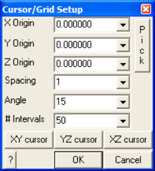

Let's pick this location graphically using the Pick function.

Since we want the snap base mid height on the VRM panels, change the snap mode to the midpoint of line

#### CAD > Snap > Midpoint of Line

Before proceeding, you must ensure that the correct snap mode has been set either by verifying that the CAD > Snap > Midpoint of Line menu item is checked, or the midpoint snap button is highlighted

Select the Cursor/Snap Base Origin on the vertical edge of the VRM panel.

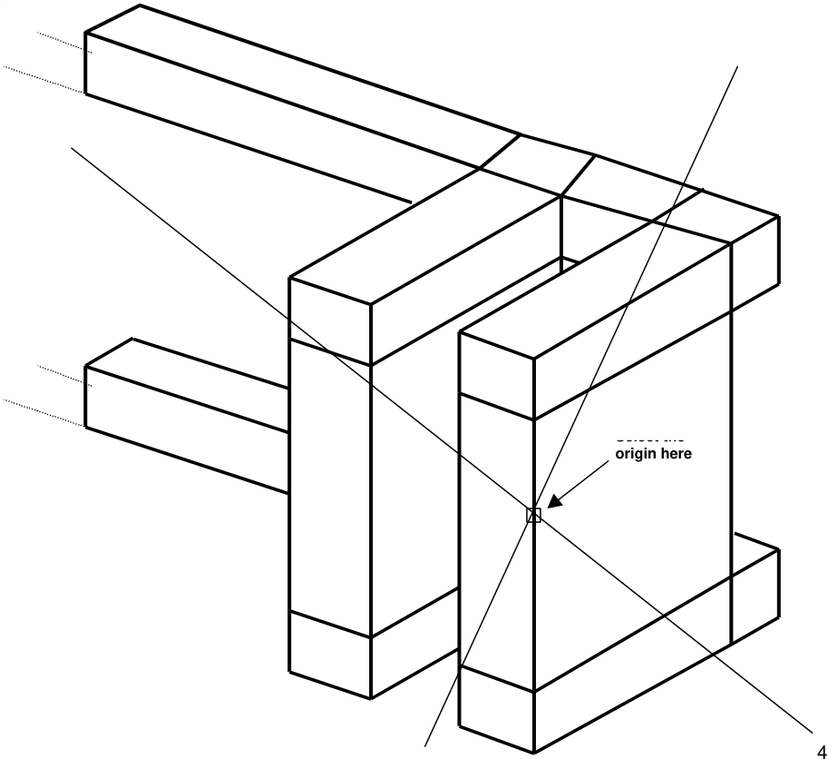

The point mid-height on this edge will be selected. The z value should read

Z Origin: 1012.5

We should also set

Snap Spacing: 10

for easier point selection.

If the cursor cross-hairs are not moving the x-y plane, select the

button.

Before beginning construction of the grid plane, we should first reorient the geometry to a plan view. This can be done using

#### View > View XY Plane

Now let's build the grid plane.

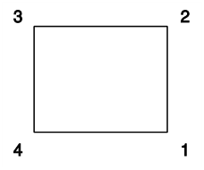

This will be constructed using a plane with 4 corners. To construct this plane, select the grid building menu function

#### CAD > Build > Grid Plane

This function can also be selected from the CAD toolbar as follows:

Select CAD > Build from the CAD toolbar

You will be presented with the sub-menu of build functions

Now select

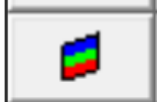

#### CAD > Build > Grid Plane

Since we are going to be freehand drawing we must make sure that CAD > Snap > Rectangular Grid Snap. This function can be selected from the Build Entity toolbar

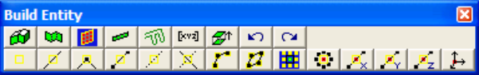

To activate the snap grid select

#### CAD > Snap > Rectangular Grid Snap

(this only needs to be done if the grid snap button is not already highlighted ).

You will see that the grid plane building routine is prompting you to enter the first corner of the plane

Input: Select Point 1

Select the four corners of the plane.

**3**

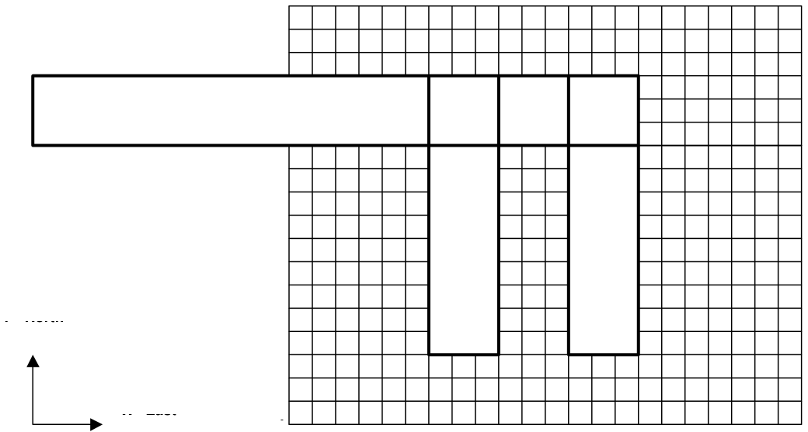

Upon selecting the 4th point, you will automatically be prompted to specify the grid plane properties (

#### CAD > Build > Grid Plane).

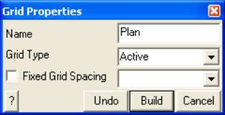

Enter a descriptive Name for the grid plane, make sure the Grid Type is Active and leave the Fixed Grid Spacing box unchecked.

#### Specifying Material Properties for the Host Rock mass

We must now specify properties for the host material. These are entered using the material properties function

#### CAD > Properties > Material Properties

Selecting this item opens a sub-menu of items associated with editing the material properties. Note that material number 1 is by definition the host material. Other material numbers are used to define alternate

material zones such as ore, fault gouge, backfill etc. The user is first prompted to enter the material number that is to be edited. First let's define properties for the host material

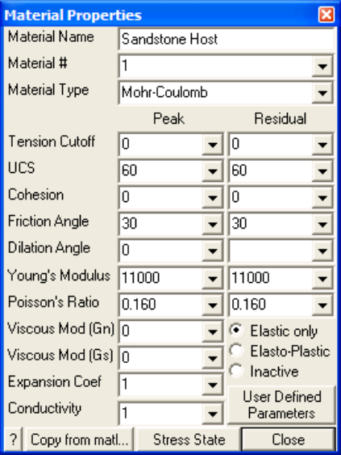

Enter the following:

Material Name: Sandstone Host Material # : 1 Young's (deformation) Modulus: 60000 MPa Poisson's Ratio: 0.25

The Viscous Moduli can be set to zero since they are only used to simulate creep response in nonlinear analysis.

We want to use the Mohr-Coulomb criterion here. To do this set

Material Type: Mohr-Coulomb UCS: 60 MPa

The cohesion parameter is not used in this case and hence can be set to zero.

Friction Angle: 30°

The dilation angle is not used in this case and hence can be set to zero.

The pre-mining stress state can now be specified

CAD > Properties > Material Properties > Stress State

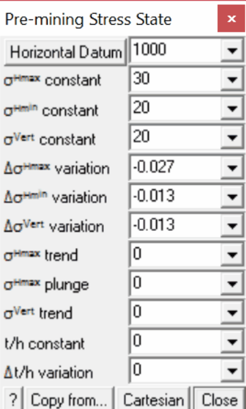

The appropriate far field stress state for this model is

sa constant:  30 MPa sb constant:  20 MPa sc constant:  20 MPa

We will set the variation of stress with depth to zero

Dsa variation:  -0.027 MPa/m Dsb variation:  -0.013 MPa/m Dsc variation:  -0.013 MPa/m

Also the stress orientations (trend and plunge) should be set to zero, thus defining sa and sb as horizontal and sc as vertical.

The Datum can be set to 1000 metres to define the variation with depth as

s + Ds ( _z_ - _Datum_ )

Defined in this way, the stress sa equals 30 MPa at depth z equals 1000m, and increases at a rate of 0.027 MPa/m of depth.

#### Specifying Control Parameters

We must now specify parameters to control model discretization and solution. These are entered using the control parameters function

#### CAD > Properties > Control Parameters

Selecting this item opens a dialogue box of items associated with the control parameters

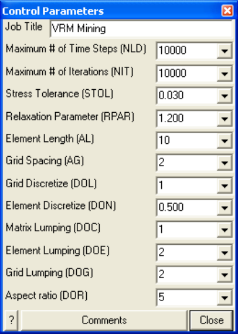

Enter the following:

Job Title: VRM Mining

All parameters can be left at there default values except the stress tolerance, element length and grid spacing.

Stress Tolerance: 0.03 MPa

should be set to approximately 0.1% of the far field stress state. This ensures that during solution, the surface stresses will be calculated with 0.03 MPa numerical accuracy.

#### Element Length: 10

should be set equal to twice the drift height or twice the pillar width. This parameter is used to control the minimum boundary element size that will be used at locations where narrow seams or pillars are located. This ensures that a well-conditioned, readily solvable problem will be formulated.

#### Grid Spacing: 2

should be set to approximately one half the pillar width. This parameter is used to control the minimum boundary element size and the minimum spacing on the grid plane that will be used at locations where it passes close to or intersects the model. Accurate results can be obtained as close as half this spacing from the model surfaces. This parameter also ensures that a sufficient number of stress points will be calculated within in the pillar to generate smooth contours.

The user is free to select a larger value for the grid spacing. This will result in smaller problem size and hence shorter run times. However, with larger boundary elements results will be less accurate, especially near the model surfaces, also with wider grid spacing, smooth contours cannot be generated.

Suggested values for the discretization and lumping parameters are as follows:

_DON_ =0.5, _DOL_ = _DOC_ =1, _DOE_ = _DOG_ =2 for 10-20% error

_DON_ =0.5, _DOL_ = _DOC_ =2, _DOE_ = _DOG_ =4 for 5-10% error _DON_ =1.0, _DOL_ =DOC=4, _DOE_ = _DOG_ =8 for &lt; 5% error

Coarse analysis results are recommended for all problems except those where increased accuracy is required. At this setting numerical errors of 10-20% in stress predictions can be expected. The settings for detailed analysis results provide 5-10% numerical error. The settings for high accuracy results provide less than 5% numerical error. The user is free to specify higher accuracy settings for these parameters, however this will result in larger problem size and hence longer run times.

#### Running a Map3D Analysis

At this point we have completed construction of the model and are ready to begin an analysis. If you are using Map3D Fault-Slip you will obtain an elastic solution to this problem. If you are using Map3D NonLinear, a complete non-linear analysis will be conducted.

Analysis is executed from the main menu.

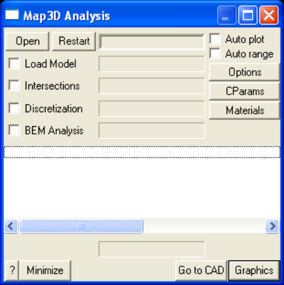

You can run through the complete analysis by selecting

#### BEM Analysis

Here we will do this in stages. So first select

#### Discretization

If you have modified the model in any way since the last time you saved, you will be prompted to save these modifications.

When the Intersections and Discretization analyzes are complete select

#### Analysis > Graphics

When in graphical mode, you should select the discretized view option

#### View > Render > Discretize

This will enable you to see how the block surfaces have been discretized into boundary elements. You must have set outlines on in order to see the individual elements

#### View > Render > Block Outlines

To see how the grid has been discretized (activate the Contour toolbar if it is not visible using Tools > CAD Toolbar), you must select

#### Plot > Grid Selection > Grid #1

from the contour toolbar

The discretization analysis can be repeated as many times as desired with different values specified for grid spacing, discretization and lumping parameters until the desired density of boundary elements and grids points is achieved.

Once you are satisfied, you can proceed to the BEM Analysis (matrix assembly and solution), by selecting

#### Analysis

from the main menu, then selecting

#### BEM Analysis

When the analysis is complete, select

#### Analysis > Graphics

When in graphical mode, you can contour any desired parameter. For example to display the major principal stress contours, select

#### Plot > Stress > S1 Major Principal Stress

This will generate a contour plot on the grid plane.

Interpretation of the results will not be discussed here.
