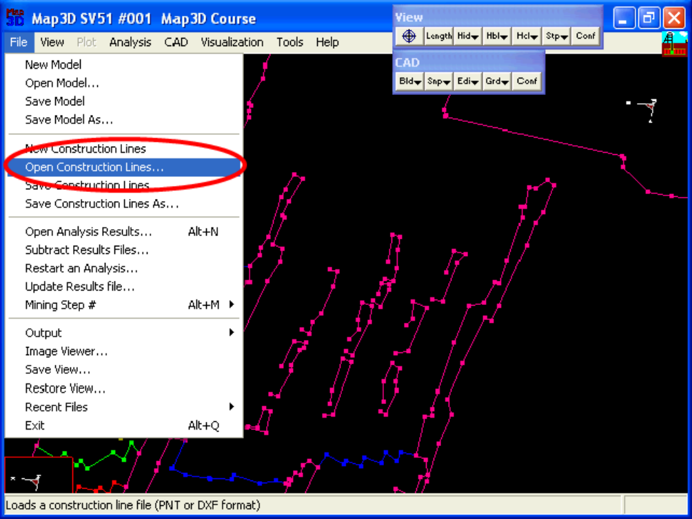
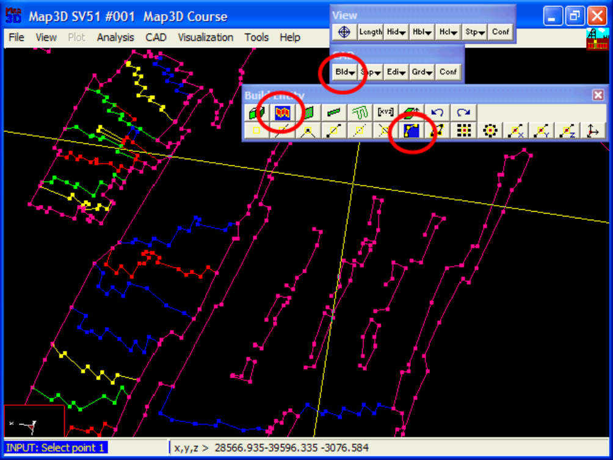
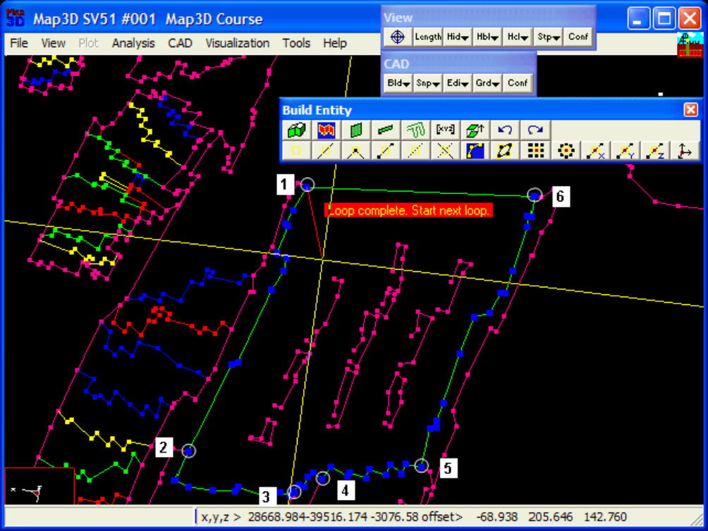
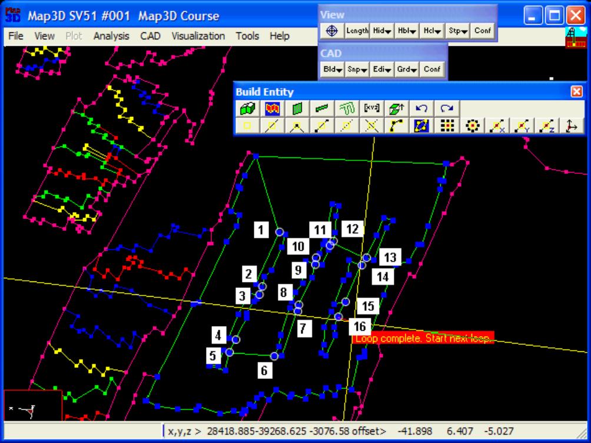
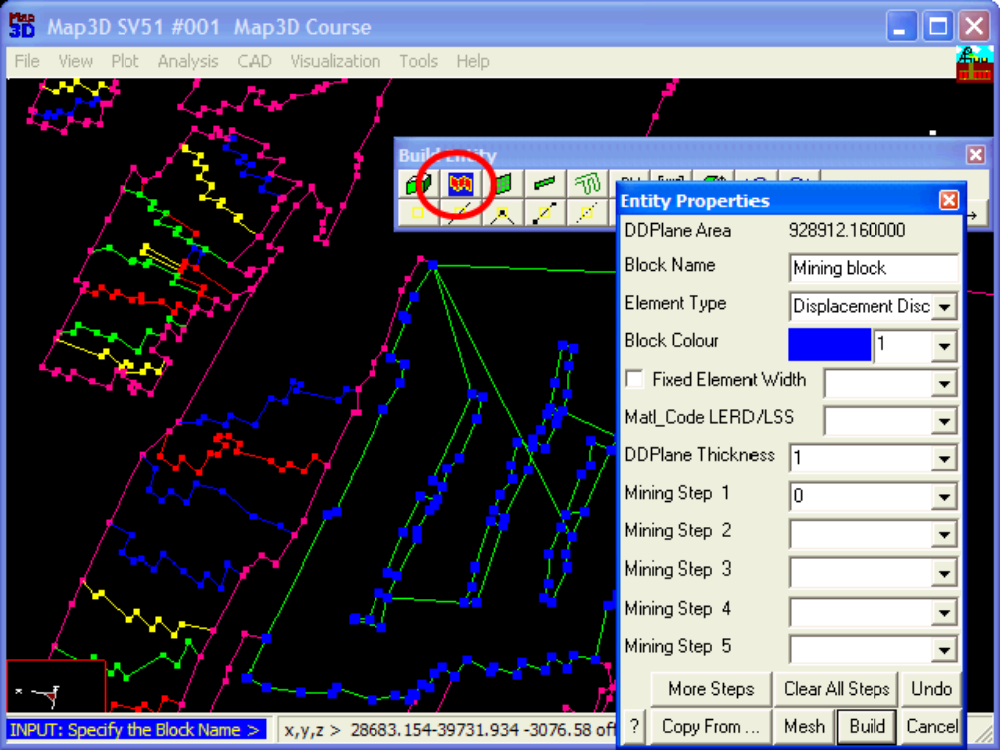
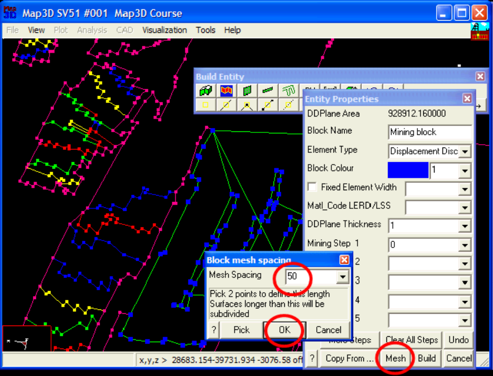
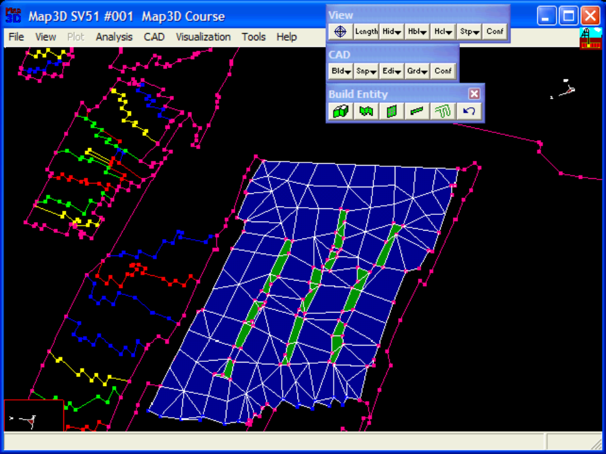

**Step 1: Import digitized mine plans.**

- The plans for this example are in a file called "t.pnt".

- These are imported using the File > Open Construction Lines command.

**Step 2: Next we start the DDLoop routine and set the Cline snap mode.**

- DDLoop can be started by selecting then (CAD > Build > DDLoop).

- Cline snap mode can be set by selecting (CAD > Snap > Trace Cline).

**Step 3: Build the outer loop.**

- The outer loop is built by selecting the end points of the desired construction line segments.

- Here we pick point 1-2-3-4-5-6-1

- Point 1 is picked at the end of this sequence to close the loop, thus completing construction of the outer loop.

**Step 4: Set the snap mode to CLoop then build the inner loops.**

- CLoop snap mode can be set by selecting (CAD > Snap > Trace CLoop).

- The inner loops are defined by picking the entry and exit points for each loop.

- The 1st loop is defined by points 1 and 2.

- The 2nd loop is defined by points 3 and 4.

- The 3rd loop is defined by point 5.

- The 4th loop is defined by points 6 and 7.

- The 5th loop is defined by points 8 and 9.

- The 6th loop is defined by points 10 and 11.

- The 7th loop is defined by point 12.

- The 8th loop is defined by point 13.

- The 9th loop is defined by points 14 and 15.

- The 10th loop is defined by point 16.

**Step 5: Signal completion of construction.**

- Now that all of the loops have been defined, we pick (CAD > Build > DDLoop) again to signal completion of construction.

- This can also be signalled by picking the last point (i.e. point 16) a second time.

**Step 6: Build the DDLoops.**

- Although we could build the DDLoops using the function, here we will use the function.

- This later function builds better shaped elements.

- You will be prompted for the desired mesh spacing.

- Set this to 50 metres.

#### Step 7: Construction Complete.

- This completes construction of the tabular mining complete with pillars.

- You will likely want to edit the entity properties of the pillars to assign appropriate properties and mining sequence.

