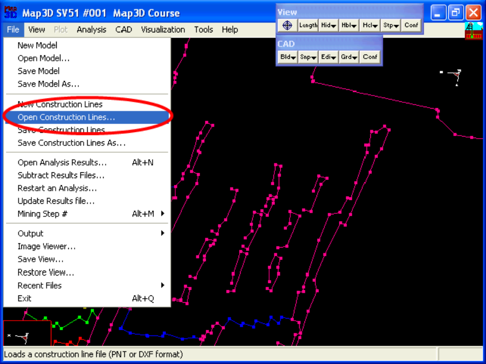
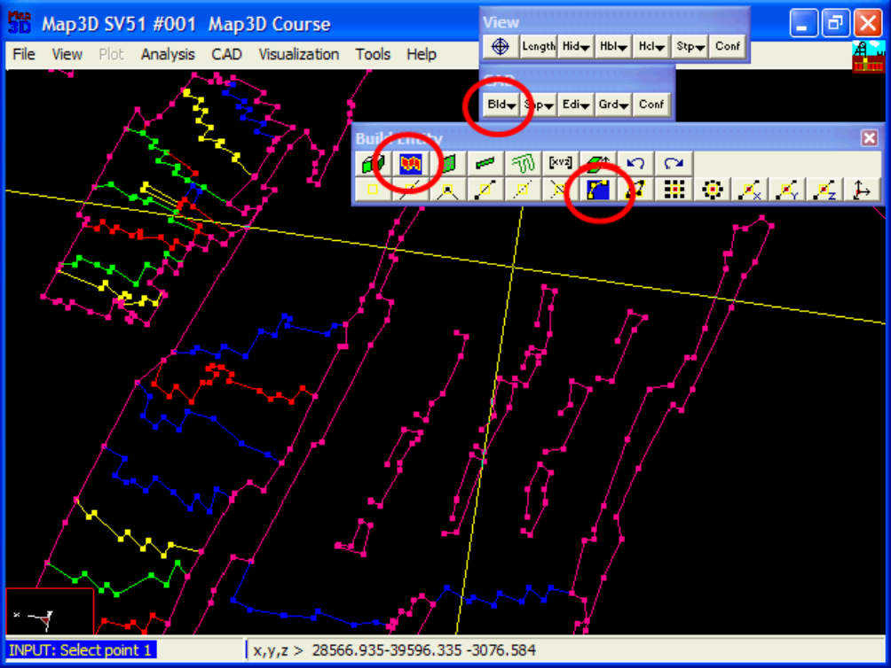
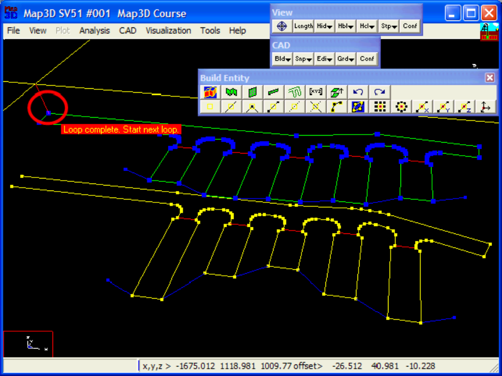
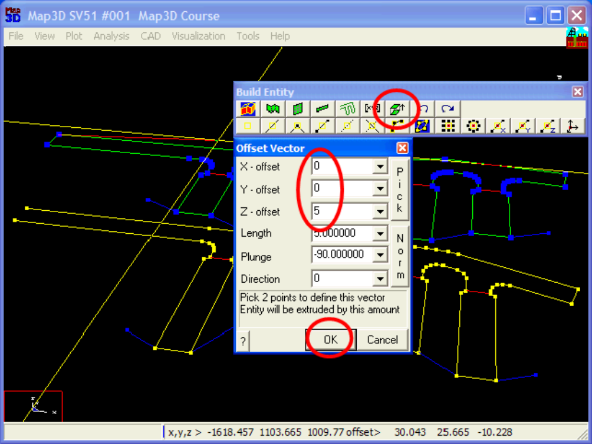
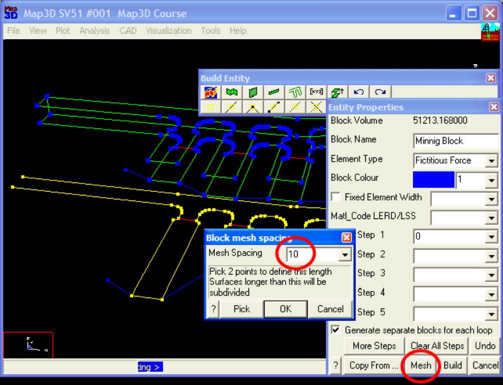
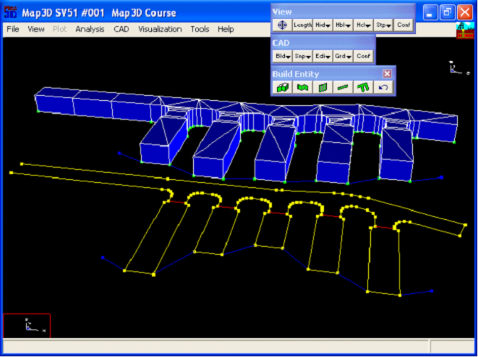

#### Step 1: Import digitized mine plans.

- The plans for this example are in a file called "bulk.dxf".

- These are imported using the File > Open Construction Lines command.

#### Step 2: Next we start the FFLoop routine and set the CLoop snap mode.

- FFLoop can be started by selecting then (CAD > Build > FFLoop).

- CLoop snap mode can be set by selecting (CAD > Snap > Trace CLoop).

**Step 3: Build the FFLoop.**

- The FFLoop is built by selecting one of the points on the desired construction line.

**Step 4: Extrude the floor plan into a 3D drift.**

- At this point we have constructed the floor plan of the drift.

- This can now be extruded into a 3D shape by picking (CAD > Build > Offset/Extrude).

- Set the offset vector to (0 0 5).

**Step 5: Build the drift.**

- The FFLoop can now be built using the function.

- Specify 10 as the Mesh Spacing, then press OK.

**Step 6: Construction Complete.**

- This completes construction of the drift.

