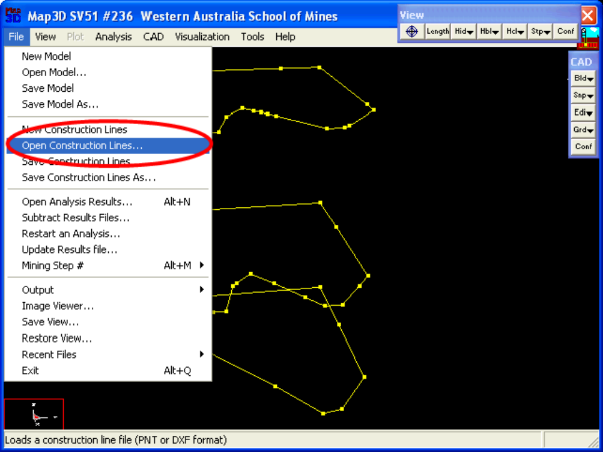
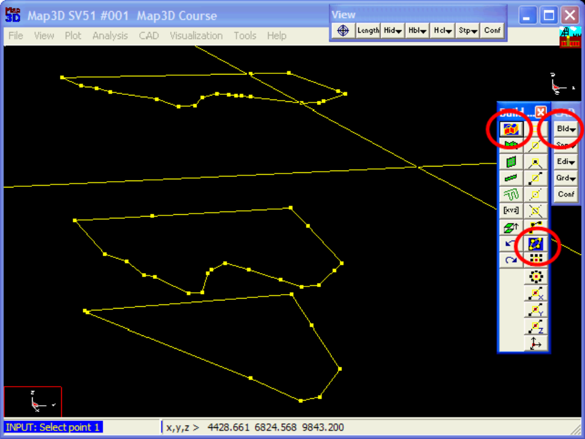
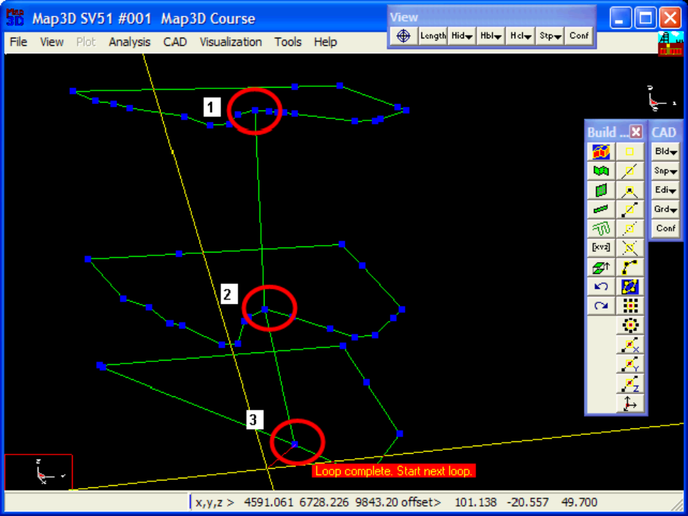
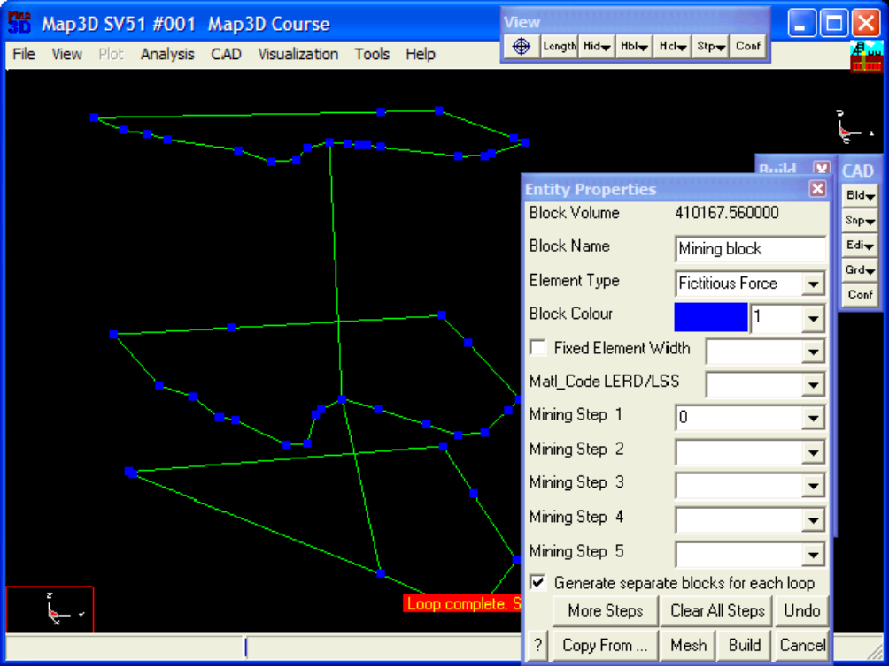
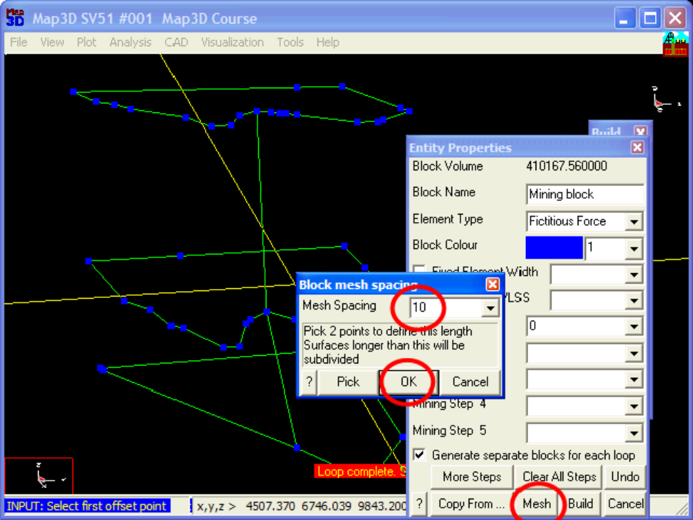
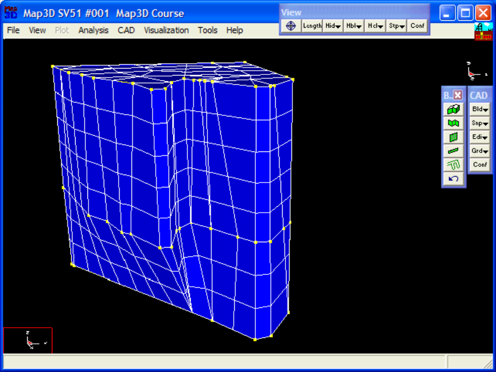

#### Step 1: Import digitized mine plans.

- The plans for this example are in a file called "bulk.dxf".

- These are imported using the File > Open Construction Lines command.

**Step 2: Next we start the FFLoop routine and set the CLoop snap mode.**

- FFLoop can be started by selecting then (CAD > Build > FFLoop).

- CLoop snap mode can be set by selecting (CAD > Snap > Trace CLoop).

#### Step 3: Build the FFLoop.

- The FFLoop is built by selecting one points on each construction line.

- Note that points are automatically be generated at 10m intervals along long sides

- It is best to pick points that are at sharp corners or bends as the line between the loops will guide the construction process.

#### Step 4: Signal completion of construction.

- Now that all of the loops have been defined, we pick (CAD > Build > FFLoop) again to signal completion of construction.

- This can also be signalled by picking the last point (i.e. point 3) a second time.

**Step 5: Build the stope.**

- The FFLoop can now be built using the function.

- Specify 10 for the Mesh Spacing then pick OK.

**Step 6: Construction Complete.**

- This completes construction of the stope.

