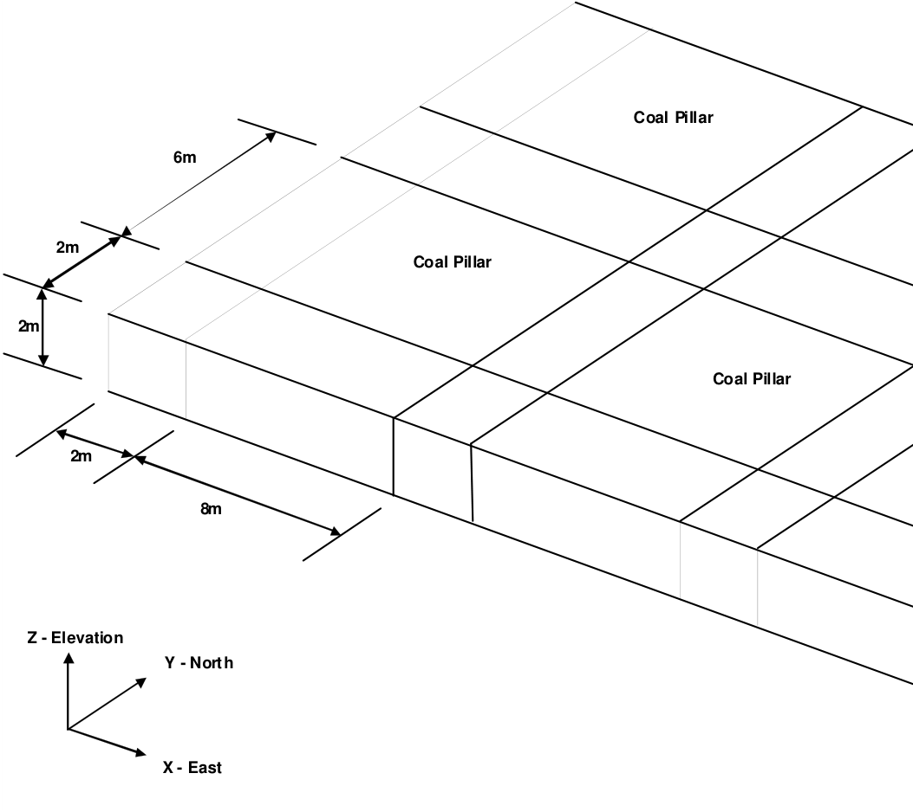

To demonstrate the freehand sketching technique, let's start by building a simple room and pillar coal mining geometry. The roadways measure 2m wide by 2m high, and the coal pillars measure 6m towards the East and 4m towards the West.

We want to start with a clean slate, so we will select

File > New Model

Before beginning please note that the user can hover over any button to obtain a tooltip identifying that buttons function. Also the use can right click on any item to obtain detailed help on that function.

#### Building the Intersection

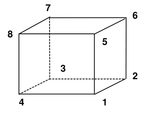

First let's construct an intersection. This will be constructed using blocks with 8 corners. To construct the first block, use CAD > Build > FFLoop. This function can be selected from the CAD toolbar as follows (activate the CAD toolbar if it is not visible using Tools > CAD Toolbar):

#### Select CAD > Build from the CAD toolbar

You will be presented with the sub-menu of build functions

Now select

#### CAD > Build > FFLoop

Since we are going to be freehand drawing we must set up the snap grid. This is done using CAD > Snap > Rectangular Grid Snap. This function can be selected from the Build Entity toolbar

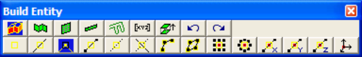

To activate the snap grid select

#### CAD > Snap > Rectangular Grid Snap

(this only needs to be done if the grid snap button is not already highlighted ).

The coordinates of the current cursor location are indicated on the status bar. You will notice that the x and y values change as you move the cursor about, but not the z value. To set the current z value, click on CAD > Snap > Cursor/Grid Setup, you will be prompted as follows:

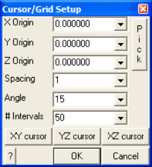

Set the origin and snap spacing as follows:

X-Origin > 0 Y-Origin > 0 Z-Origin > 0 Snap spacing > 1

If the cursor cross-hairs are not moving the x-y plane, select the

button.

This sets the snap mode to grid. In this mode, no pick-box will be displayed at the intersection of the cross-hairs and the movement of the cursor will be restricted to the specified grid spacing. As you move the cursor around the display the cursor will jump from location to location by the grid spacing amount (1 metre in this case).

You will see that the FFLoop building routine is prompting you to enter the first corner of the block on the status bar

Input: Select Point 1

Move the cursor about until you locate the first point

x,y,z >  0  0  0

Select this point by clicking the left mouse button once.

You will now be prompted for the next block corner

Input: Select Point 2

As you move the cursor about you will see that not only is the current cursor location indicated at the lower left hand corner of the display, but also the offset of the current point from the last one selected (i.e. the offset vector from point 1 to point 2). Select point 2 at

x,y,z >  2  0  0

Repeat this selection process for point 3

x,y,z >  2  2  0

and point 4

x,y,z >  0  2  0

If you select the wrong location for a point, simply undo that selection using the undo button

#### CAD > Build > Undo Point then try again.

Finally, reselect the first point

x,y,z >  0  0  0

When first point has been reselected, the base of the block has been completely formed. You will be prompted with the message

Loop complete: Start next loop.

To complete building the block you can either change the elevation and select the remaining 4 points (i.e. points 5, 6, 7 and 8), or generate them from the first 4 corners by adding an offset to them. To use this latter procedure, select the offset function from the build entity toolbar

#### CAD > Build > Extrude/Offset Remaining

You will be prompted for this offset vector as follows

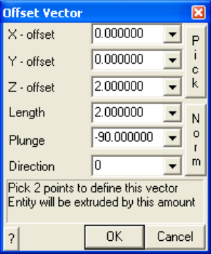

Enter the offset as:

X-offset > 0 Y-offset > 0 Z-offset > 2

Points 5, 6, 7 and 8 will be generated respectively from points 1, 2, 3 and 4 by adding the offset values to their coordinates.

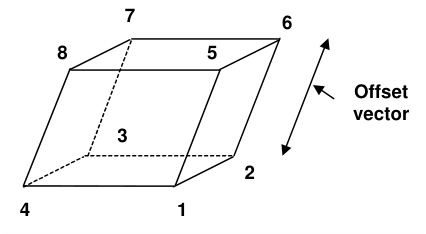

Upon completion of block construction you will automatically be prompted to enter the block properties ( CAD > Build > FFLoop)

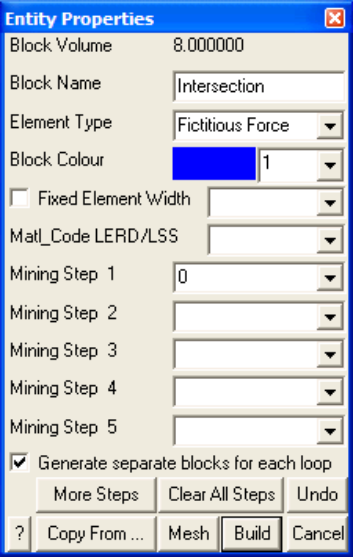

Enter the following:

Block Name: Intersection Element Type: Fictitious Force Block Colour: 1

This intersection block should be excavated at mining step 1. This is indicated by specifying

Mining Step 1: 0

We are now finished and can Build this block by pressing the

button.

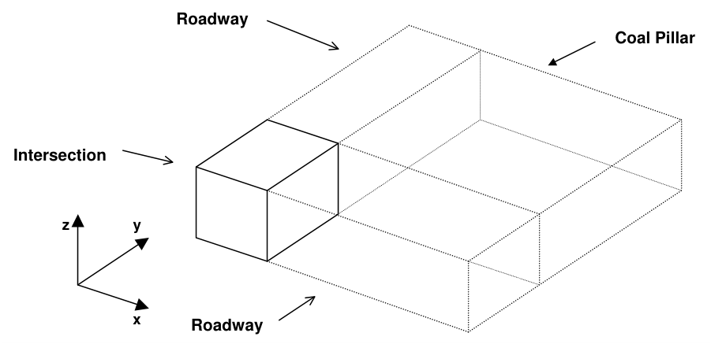

#### Repositioning The View

During block building or at any other time, the user is free to reposition (translate, rotate or zoom) the geometry to make visualization easier. This is readily accomplished by several means (refer to Rotating the Model and Translating the Model).

#### Building the Roadway 1

Additional blocks can now be constructed by selecting the FFLoop building function again

#### CAD > Build > FFLoop

Let's build the next block adjacent to the first one. Select point 1 at

x,y,z >  2  0  0

We would like to select point 2 at

x,y,z >  8  0  0

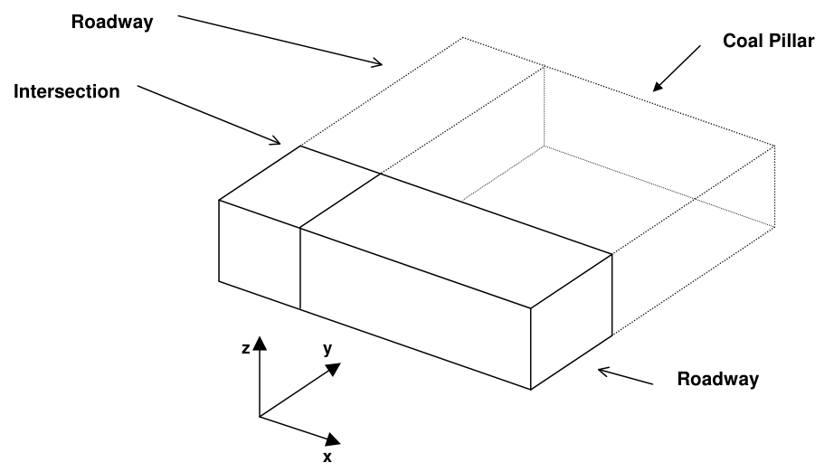

but this location is beyond the limits of the display. To overcome this problem, simply zoom out (Translating the Model).

Point 2 can now be readily selected.

Select point 3 at

x,y,z >  8  2  0

Select point 4 at

x,y,z >  2  2  0

Finally, reselect the first point

x,y,z >  2  0  0

When first point has been reselected, the base of the block has been completely formed. You will be prompted as before with the message

Loop complete: Start next loop.

Now offset the remaining points for this block using the offset function

#### CAD > Build > Extrude/Offset Remaining

You will be prompted for this offset vector as follows

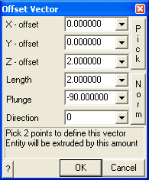

Enter the offset as:

X-offset > 0 Y-offset > 0 Z-offset > 2

Upon completion of block construction you will automatically be prompted to enter the entity properties ( CAD > Build > FFLoop)

Enter the following:

Block Name: Roadway

Element Type: Fictitious Force Block Colour: 1

This roadway block should be excavated at mining step 1. This is indicated by specifying Mining Step 1: 0

We are now finished and can build this block by pressing the button.

#### Building the Roadway 2

Let's construct a third block

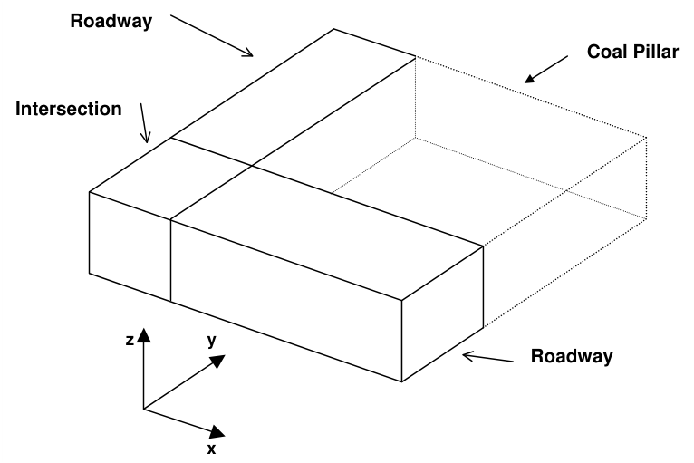

by selecting point 1 at

x,y,z >  2  2  0

Select point 2 at

x,y,z >  2  6  0

Select point 3 at

x,y,z >  0  6  0

Select point 4 at

x,y,z >  0  2  0

Reselect the first point to complete construction of the base

x,y,z >  2  0  0

then offset the remaining points as before

CAD > Build > Extrude/Offset Remaining

This will complete construction of the roadway.

#### Building the Coal Pillar

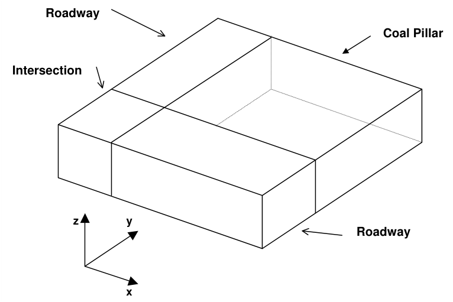

You should now have completed construction of an intersection and two roadways. Now let's construct a coal pillar.

#### CAD > Build > FFLoop

by selecting point 1 at

x,y,z >  2  2  0

Select point 2 at

x,y,z >  8  2  0

Select point 3 at

x,y,z >  8  6  0

Select point 4 at

x,y,z >  2  6  0

Reselect the first point to complete construction of the base

x,y,z >  2  2  0

then offset the remaining points as before

CAD > Build > Extrude/Offset Remaining

This will complete construction of the coal pillar.

Upon completion of block construction you will automatically be prompted to enter the block properties ( CAD > Build > FFLoop). We must specify that this block will be a coal pillar rather than an excavation (the default). You will be prompted as follows:

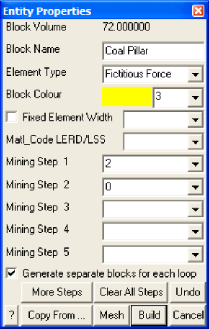

Enter the following:

Block Name: Coal Pillar Element Type: Fictitious Force Block Colour: 3

We must specify that this block has the material properties for coal. This is done by defining material number 2 for coal at mining step 1. This is indicated by specifying

Mining Step 1: 2

This same pillar could be excavated at step 2 by specifying a material code of

Mining Step 2: 0

We are now finished and can Build this block.

#### Saving the Geometry

At this point we have constructed one small corner of the desired mining geometry. Before proceeding further it would be a good idea to save the model as built so far. To do this we select

#### File > Save Model As

Let's save with the name "COAL.INP"

#### Expanding the Geometry

The model as constructed represents only a small part of the final model. It is easy to repeat this pattern by copying this pattern multiple times. To do this we must select the copy function

CAD > Edit > Copy Entities

This function can also be selected from the CAD toolbar as follows:

Select CAD > Edit from the CAD toolbar

You will be presented with the sub-menu of edit functions

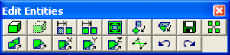

To activate the copy function select

#### CAD > Edit > Copy Entities

At this point you will be prompted to build a list of entities to copy

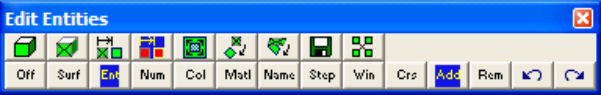

Hold down the Shift-key and drag out a selection window (alternatively you may select the crossing window function ).

**Second corner of window**

All entities within the selection window (i.e. the intersection, roadways and coal pillar) should be highlighted.

You can now copy the selected entities by picking the copy button

You will be prompted to enter the copy-offset vector as follows:

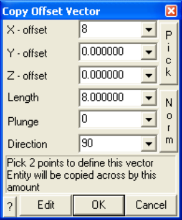

There are numerous ways to select the copy-offset vector. You can type in the desired offset as (8  0 0).

This is also readily accomplished graphically by picking two points to define the vector. First set the snap mode to

#### CAD > Snap > Rectangular Grid Snap

(this only needs to be done if the grid snap button is not already highlighted ).

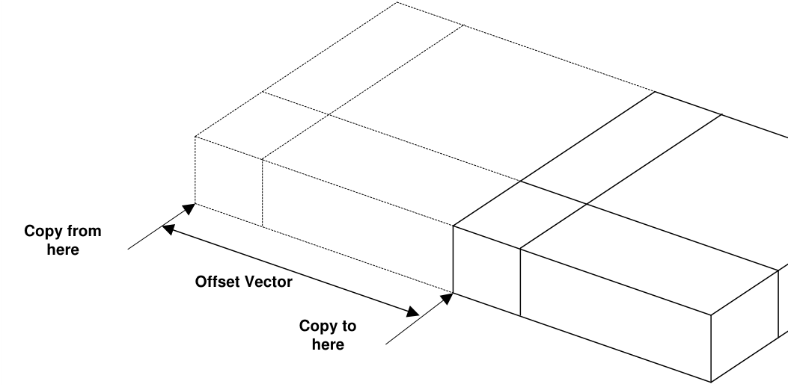

You will be prompted (at the top of the screen) to pick the first end of the offset vector

INPUT: Select first offset point

Select this point at

x,y,z >  0  0  0

You will then be prompted to pick the other end of the offset vector

INPUT: Select second offset point

Select this point at

x,y,z >  8  0  0

The offset (8  0  0) will now be displayed in the dialog box.

Now press OK, and the selected entities will be copied by adding the offset vector to all coordinates.

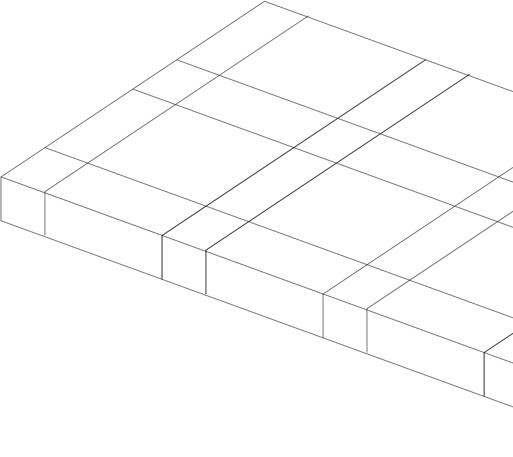

To repeat this copy operation, either rebuild the selection set, or select to restore the previous selection set, then copy the selected entities by picking the copy function again

#### CAD > Edit > Copy Entities

If desired, this copy procedure can be repeated as many times as desired to duplicate the mining pattern in the x and y directions.

At this point the geometry can be considered complete. We must now define the location of grid planes where results will be calculated and specify the material properties.

#### Building Grid Planes

**3 2 4 1**

We must now decide where we want results to be calculated. In this example we are interested in the stress in the coal pillars. We will therefore define a cross-sectional grid plane that passes through the centre of one of the pillars. This will be constructed using a plane with 4 corners. To construct this plane, select the grid building menu function

#### CAD > Build > Grid Plane

This function can also be selected from the CAD toolbar as follows:

Select CAD > Build from the CAD toolbar

You will be presented with the sub-menu of build functions

Now select

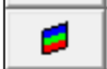

#### CAD > Build > Grid Plane

Since we are going to be freehand drawing we must set up the snap grid. This is done using CAD > Snap > Rectangular Grid Snap. This function can be selected from the Build Entity toolbar

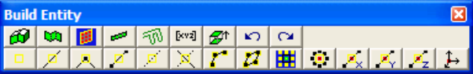

To activate the snap grid select

#### CAD > Snap > Rectangular Grid Snap

(this only needs to be done if the grid snap button is not already highlighted ).

The coordinates of the current cursor location are indicated on the status bar. To set the current z value, click on CAD > Snap > Cursor/Grid Setup, you will be prompted as follows:

Set the origin and snap spacing as follows:

X-Origin > 0 Y-Origin > 0 Z-Origin > -2 Snap spacing > 1

If the cursor cross-hairs are not moving the x-y plane, select the

button.

You will see that the grid plane building routine is prompting you to enter the first corner of the plane

INPUT: Select point 1

Move the cursor about until you locate the desired point

x,y,z >  9  4  -2

Select this point by clicking the left mouse button once.

You will now be prompted for the next block corner

INPUT: Select point 2

Select point 2 at

x,y,z >  17  4  -2

If you select the wrong location for a point, simply undo that selection

CAD > Build > Undo Point

then try again.

When point 2 has been selected, one edge of the plane has been completely formed. To complete building the plane you can either change the elevation and select the remaining 2 points (i.e. points 3 and 4), or generate them from the first 2 corners by adding an offset to them. To use this latter procedure, select the offset function from the build entity toolbar

CAD > Build > Offset Remaining

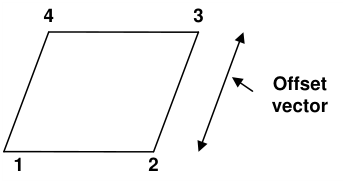

You will be prompted for this offset vector as follows

Enter the offset as:

X-offset > 0 Y-offset > 0 Z-offset > 6

Points 3 and 4 will be generated respectively from points 2 and 1 by adding the offset values to their coordinates.

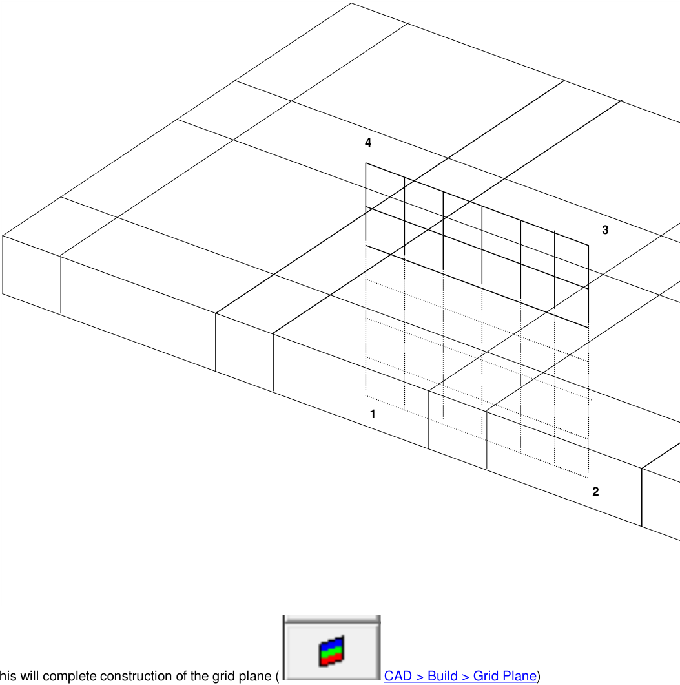

This will complete construction of the grid plane (

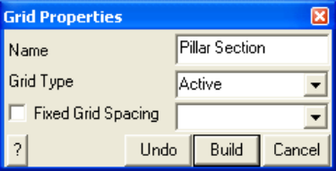

Enter a descriptive name for the grid plane and leave the Fixed Grid Spacing check box unchecked.

#### Specifying Material Properties for the Sandstone Host

We must now specify properties for the host material. These are entered using the material properties function

#### CAD > Properties > Material Properties.

Selecting this item opens a sub-menu of items associated with editing the material properties. Note that material number 1 is by definition the host material. Other material numbers are used to define alternate material zones such as the coal, fault gouge, backfill etc. The user is first prompted to enter the material number that is to be edited. First let's define properties for the host material

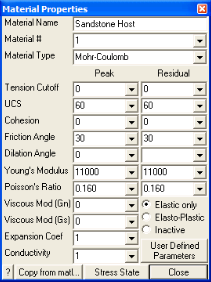

Enter the following:

Material Name: Sandstone Host Material # : 1 Young's (deformation) Modulus: 11000 MPa Poisson's Ratio: 0.16

The Viscous Moduli can be set to zero since they are only used to simulate creep response in nonlinear analysis.

We want to use the Mohr-Coulomb criterion here. To do this set

Material Type: Mohr-Coulomb UCS: 60 MPa

The cohesion parameter is not used in this case and hence can be set to zero.

Friction Angle: 30°

The dilation angle is not used in this case and hence can be set to zero.

The pre-mining stress state can now be specified

CAD > Properties > Material Properties > Stress State

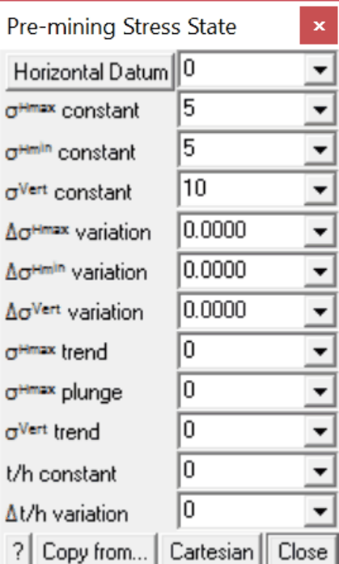

The appropriate far field stress state for this model is

sHmax constant:  5 MPa sHmin constant:  5 MPa sVert constant: 10 MPa

We will set the variation of stress with depth to zero

DsHmax variation:  0 MPa/m DsHmin variation:  0 MPa/m DsVert variation:  0 MPa/m

Also the stress orientations (trend and plunge) should be set to zero, thus defining sa and sb as horizontal and sc as vertical.

The Datum can also be set to zero since this is only used to define the variation with depth.

#### Specifying Material Properties for the Coal Seam

We must now specify properties for the coal seam. These are entered using the material properties function

#### CAD > Properties > Material Properties

Selecting this item opens a sub-menu of items associated with editing the material properties. Recall that when building the coal pillar, we specified that material number 2 was to be used for that block.

Let's set Material # to 2.

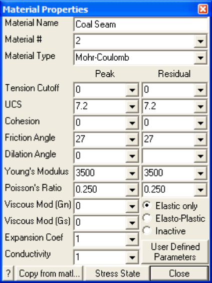

Enter the following:

Material Name: Coal Seam Young's  (deformation) Modulus: 3500 MPa Poisson's Ratio: 0.25

The Viscous Moduli can be set to zero since they are only used to simulate creep response in nonlinear analysis.

We want to use the Mohr-Coulomb criterion here. To do this set

Material Type: Mohr-Coulomb UCS: 7.2 MPa

The cohesion parameter is not used in this case and hence can be set to zero.

Friction Angle: 27°

The dilation angle is not used in this case and hence can be set to zero.

The pre-mining stress state can now be specified

#### CAD > Properties > Material Properties > Stress State

We want the initial stress in the coal to be the same as in the sandstone host, so lets Copy from material 1.

#### Specifying Control Parameters

We must now specify parameters to control model discretization and solution. These are entered using the control parameters function

#### CAD > Properties > Control Parameters

Selecting this item opens a dialog box of items associated with the control parameters

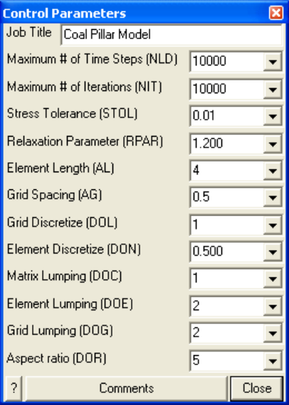

Enter the following:

Job Title: Coal Pillar Model

All parameters can be left at there default values except the stress tolerance, element length and grid spacing.

Stress Tolerance: 0.01 MPa

should be set to approximately 0.1% of the far field stress state. This ensures that during solution, the surface stresses will be calculated with 0.01 MPa numerical accuracy.

Element Length: 4

should be set equal to twice the thickness of the coal seam This parameter is used to control the minimum boundary element size that will be used at locations where narrow seams or pillars are located. This ensures that a well-conditioned, readily solvable problem will be formulated.

Grid Spacing: 0.5

should be set to approximately one quarter of the seam thickness. This parameter is used to control the minimum boundary element size and the minimum spacing on the grid plane that will be used at locations where it passes close to or intersects the model. Accurate results can be obtained as close as half this spacing from the model surfaces. This parameter also ensures that a sufficient number of stress points will be calculated within in the pillar to generate smooth contours.

The user is free to select a larger value for the grid spacing. This will result in smaller problem size and hence shorter run times. However, with larger boundary elements results will be less accurate, especially near the model surfaces, also with wider grid spacing, smooth contours cannot be generated.

Suggested values for the discretization and lumping parameters are as follows:

_DON_ =0.5, _DOL_ = _DOC_ =1, _DOE_ = _DOG_ =2 for 10-20% error _DON_ =0.5, _DOL_ = _DOC_ =2, _DOE_ = _DOG_ =4 for 5-10% error _DON_ =1.0, _DOL_ =DOC=4, _DOE_ = _DOG_ =8 for &lt; 5% error

Coarse analysis results are recommended for all problems except those where increased accuracy is required. At this setting numerical errors of 10-20% in stress predictions can be expected. The settings for detailed analysis results provide 5-10% numerical error. The settings for high accuracy results provide less than 5% numerical error. The user is free to specify higher accuracy settings for these parameters, however this will result in larger problem size and hence longer run times.

#### Running a Map3D Analysis

At this point we have completed construction of the model and are ready to begin an analysis. If you are using Map3D Fault-Slip you will obtain an elastic solution to this problem. If you are using Map3D NonLinear, a complete non-linear analysis will be conducted.

Analysis is executed from the main menu.

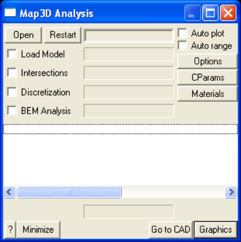

You can run through the complete analysis by selecting

#### BEM Analysis

Here we will do this in stages. So first select

#### Discretization

If you have modified the model in any way since the last time you saved, you will be prompted to save these modifications.

When the Intersections and Discretization analyzes are complete select

#### Analysis > Graphics

When in graphical mode, you should select the discretized view option

#### View > Render > Discretize

This will enable you to see how the block surfaces have been discretized into boundary elements. You must have set outlines on in order to see the individual elements

#### View > Render > Block Outlines

To see how the grid has been discretized (activate the Contour toolbar if it is not visible using Tools > CAD Toolbar), you must select

#### Plot > Grid Selection > Grid #1

from the contour toolbar

The discretization analysis can be repeated as many times as desired with different values specified for grid spacing, discretization and lumping parameters until the desired density of boundary elements and grids points is achieved.

Once you are satisfied, you can proceed to the BEM Analysis (matrix assembly and solution), by selecting

#### Analysis

from the main menu, then selecting

#### BEM Analysis

When the analysis is complete, select

#### Analysis > Graphics

When in graphical mode, you can contour any desired parameter. For example to display the major principal stress contours, select

Plot > Stress > S1 Major Principal Stress

This will generate a contour plot on the grid plane.

Interpretation of the results will not be discussed here.
