This example demonstrates model building for a multi-step tabular mining example.

Construction lines are used to define detailed locations of underground features such as excavations, contacts structure etc. A Map3D model is normally built on top of this construction line data.

The mine plans have been previously digitized using Map3D

#### CAD > Digitizer Setup

or some other CAD program. These plans can be saved in either:

Point file format is a universal ASCII data file with the extension ".PNT". This format is useful for exchanging raw construction line data with other CAD software.

AutoCAD-DXF format is a popular drawing exchange file with the extension ".DXF". This format is useful for exchanging construction line data with other CAD software.

We want to start with a clean slate, so we will select

#### File > New Model

Before beginning please note that the user can hover over any button to obtain a tooltip identifying that buttons function. Also the use can right click on any item to obtain detailed help on that function.

#### Importing digitized mine plans

First we must open a file containing the digitized mine plans. This is done using

#### File > Open Construction Lines

In this case the construction lines have been saved in PNT format. The file "TAB.pnt" is included with the Map3D installation and should be available to import.

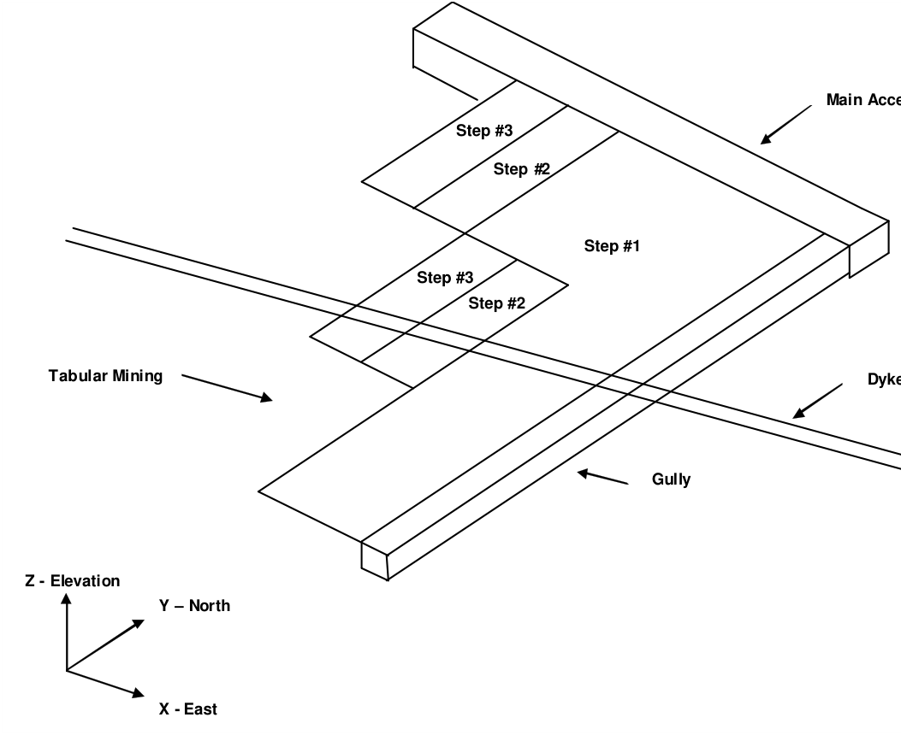

#### Repositioning The View

During block building or at any other time, the user is free to reposition (translate, rotate or zoom) the geometry to make visualization easier. This is readily accomplished by several means (refer to Rotating the Model and Translating the Model). The easiest way is to rotate is simply hold down the left mouse button will dragging the cursor across the screen. Translation is achieved by holding down the right mouse button. The model can be zooming in or out by holding down both mouse buttons.

Position the view so that the construction lines are readily visible.

#### Building Mining Step #1

Let's now construct the tabular mining step #1. This will be constructed using displacement discontinuity elements, which are defined by the perimeter of the mining zone.

To construct the first block, use CAD > Build > DDLoop. This function can be selected from the CAD toolbar as follows (activate the CAD toolbar if it is not visible using Tools > CAD Toolbar):

Select CAD > Build from the CAD toolbar

You will be presented with the sub-menu of build functions

Now select

#### CAD > Build > DDLoop

Since we want to snap to construction lines we must set the snap mode. This is done using CAD > Snap > Nearest Edge. This function can be selected from the Build Entity toolbar

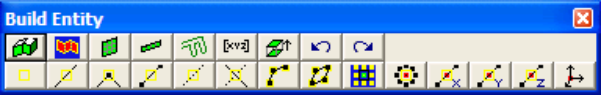

To activate the nearest edge snap select

#### CAD > Snap > Nearest Edge

(this only needs to be done if the nearest edge snap button is not already highlighted ).

In this mode, a pick-box will be displayed at the intersection of the cross-hairs. Although the coordinates of the current cursor location are indicated on the status bar, if the pick-box is located over the corner of a construction line, that corner will be selected, otherwise, the nearest point on the edge of the construction line under the pick-box will be selected. In either case all 3 coordinate values (x, y and z) are uniquely specified.

You will see that the DDLoop building routine is prompting you to enter the first corner of the block on the status bar

Input: Select Point 1

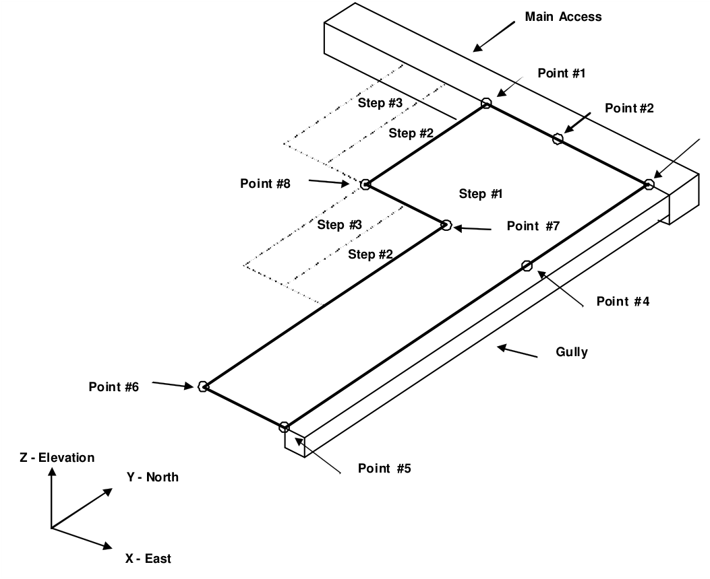

Select the points 1 through 8 as shown.

Note that we could actually use corner snap mode here

#### CAD > Snap > Nearest Corner

for all points except number 2 and 4.

If you select the wrong location for a point, simply undo that selection

#### CAD > Build > Undo Point

then try again.

Points 2 and 4 are optional and have only been selected to generate a neater looking model.

When point #8 has been selected, the floor plan is complete. To complete building the DDLoop, select point #1 again or pick the button.

You will automatically be prompted to enter the block properties ( CAD > Build > DDLoop)

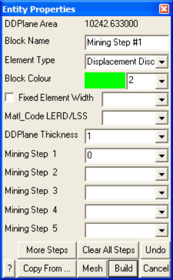

Enter the following:

Block Name: Mining Step #1 Element Type: Displacement Discontinuity Block Colour: 2 DDPlane Thickness: 1

DDPlane Thickness should be set to the mining thickness.

This tabular mining should be excavated at mining step 1. This is indicated by specifying

Mining Step 1: 0

We are now finished and can Build this block by pressing the button.

#### Building Mining Step #2

Let's now construct the tabular mining step #2. This will also be constructed using displacement discontinuity elements, which are defined by the perimeter of the mining zone. To start building select

CAD > Build > DDLoop

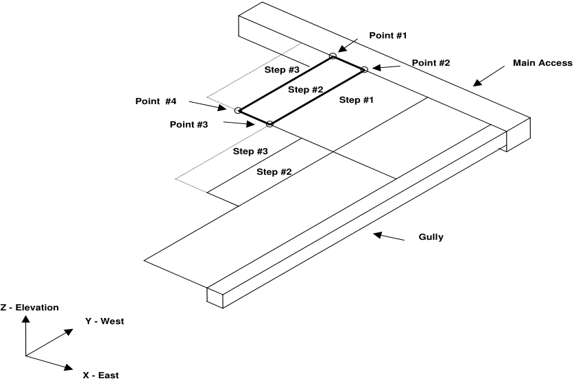

Select the 4 points as shown.

When point 4 has been selected, the floor plan is complete.  To complete building the DDLoop, select point #1 again or pick the button.

You will automatically be prompted to enter the block properties (

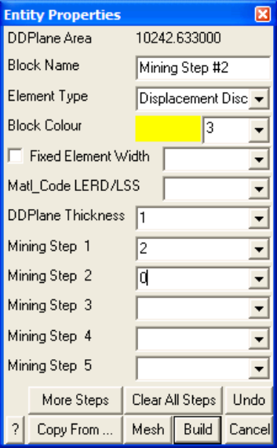

Enter the following:

Block Name: Mining Step #2 Element Type: Displacement Discontinuity Block Colour: 3 DDPlane Thickness: 1

DDPlane Thickness should be set to the mining thickness.

This tabular mining should be assigned the properties of ore (material #2) at mining step 1, then excavated at mining step 2. This is indicated by specifying

Mining Step 1: 2 Mining Step 2: 0

We are now finished and can Build this block by pressing the button.

Now build the other part of step 2 using this same procedure.

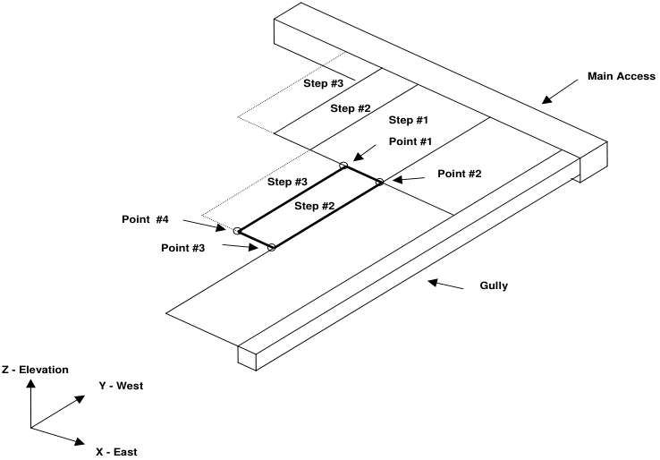

#### Building Mining Step #3

This mining can be built the same way as the step 2 mining, except

this tabular mining should be assigned the properties of ore (material #2) at both mining step 1 and 2, then excavated at mining step 3.

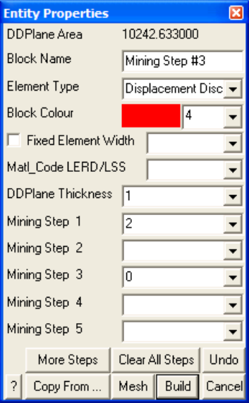

#### Getting Results

Even though we have defined the mining geometry, we must still specify where we want to obtain stress predictions. By default, we will get these at all unmined DD planes. If we also want stresses off-reef, or out ahead of the mining zone, we must place either DD planes or grid planes at those locations. Grid planes provide a much more economical (in terms of analysis time) alternative.

In this case we choose to only obtain results on DD planes. We will want to force the discretization on these planes to a suitable element size using the Fixed Element Width parameter. To do this, use CAD > Edit > Properties > Entity Properties. This function can be selected from the CAD toolbar as follows (activate the CAD toolbar if it is not visible using Tools > CAD Toolbar):

Select CAD > Edit from the CAD toolbar

You will be presented with the sub-menu of edit functions

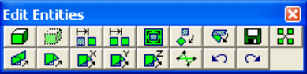

Now select

CAD > Edit > Entity Properties

This will open the edit entities toolbar

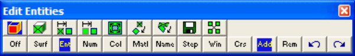

When you initiate this routine you will first be prompted to build a list of entities that you wish to edit. Hold the shift key down and pick all of the DD planes that represent the mining steps.

When you have selected all of the mining, you can pick

#### CAD > Edit > Entity Properties

again, or double click on any entity to open the Entity Properties dialogue box.

If any of the fields in the dialogue box read "Variable" it is because some of the blocks you have selected have different properties for that field. If you wish to leave these properties as they are (i.e. different for each block), leave the field as "Variable". If you wish to change the value of that field for all selected blocks, enter the desired value.

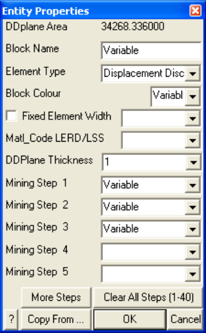

In this case the only field we want to change is the

Fixed Element Width:  20

Set this value to 20, then select OK.

This will force Map3D to subdivide the mining zone into uniform elements with width 20 metres during the discretization process. This parameter can be set smaller later if a finer discretization is desired.

#### Saving the Geometry

For this example it will be assumed that the geometry as defined thus far is satisfactory. Since both the final geometry and mining sequence are now complete, we should save the model. To do this we select

#### File > Save Model As

Let's save with the name "TAB.INP"

#### Building The Dyke

As an added complication, let's now build the dyke. o construct the dyke, use CAD > Build > FFLoop. This function can be selected from the CAD toolbar as follows (activate the CAD toolbar if it is not visible using Tools > CAD Toolbar):

Select CAD > Build from the CAD toolbar

You will be presented with the sub-menu of build functions

Now select

#### CAD > Build > FFLoop

Since we want to snap to the corners of the construction lines we must set the snap mode. This is done using CAD > Snap > Nearest Corner. This function can be selected from the Build Entity toolbar

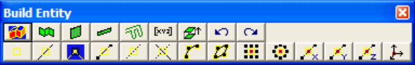

To activate the nearest edge snap select

#### CAD > Snap > Nearest Corner

(this only needs to be done if the Nearest Corner Snap button is not already highlighted ).

We could actually use edge snap mode here

#### CAD > Snap > Nearest Edge

since the corners of the construction lines would be selected anyway (as long as the corner is located within the pick box). However, using corner snap allows us to be sloppier with our selection since only corners will be selected.

Pick all four points as shown in the figure.

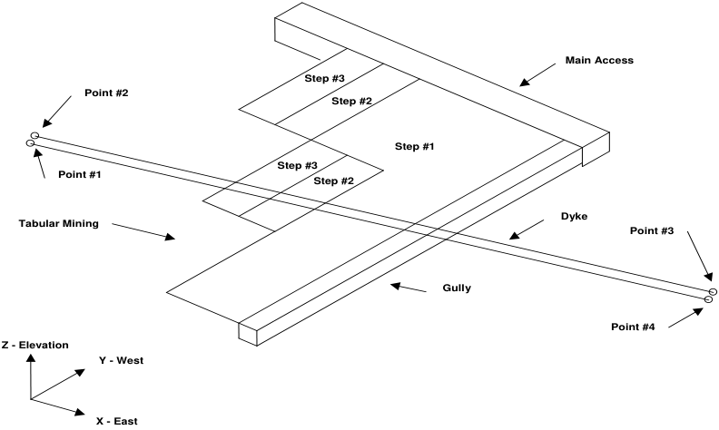

If you select the wrong location for a point, simply undo that selection using the undo button

#### CAD > Build > Undo Point then try again.

Finally, reselect the first point (i.e. point #1).

When first point has been reselected, the base of the block has been completely formed. You will be prompted with the message

#### Loop complete: Start next loop.

To complete building the block we will generate the remaining 4 points from the first 4 corners by adding an offset to them. To use this latter procedure, select the offset function from the Build Entity toolbar

#### CAD > Build > Extrude/Offset Remaining

You will be prompted for this offset vector as follows

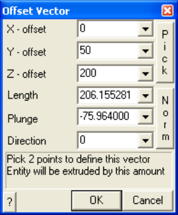

Enter the offset as:

X-offset > 0 Y-offset > 50 Z-offset > 200

Points 5, 6, 7 and 8 will be generated respectively from points 1, 2, 3 and 4 by adding the offset values to their coordinates.

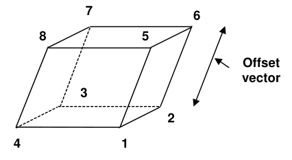

Upon completion of block construction you will automatically be prompted to enter the block properties ( CAD > Build > FFLoop)

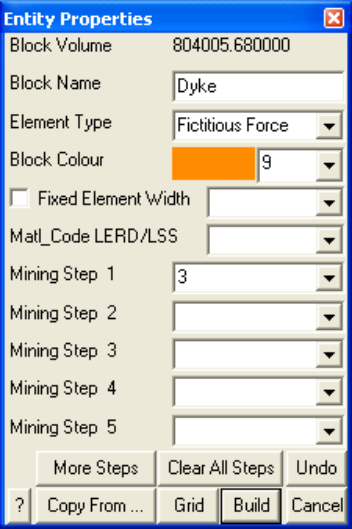

Enter the following:

Block Name: Dyke Element Type: Fictitious Force Block Colour: 9

The Fixed Element Width should be unchecked to disable this feature

This dyke should be assigned material #3 at mining step 1. This is indicated by specifying

Mining Step 1: 3

We are now finished and can Build this block by pressing the

button.

We need to extend the dyke below the mining as well. To do this we can copy this block below the mining. To do this, select

CAD > Edit from the CAD toolbar

This will open the edit toolbar

To copy entities, select

CAD > Edit > Copy Entities

This will open the copy entities toolbar

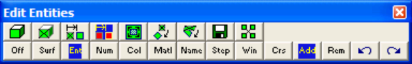

When you initiate this routine you will first be prompted to build a list of entities that you wish to edit. Click on the dyke. This will open the copy offset vector dialogue box

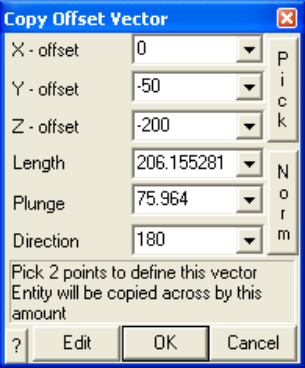

Let's pick this location graphically using the Pick function.

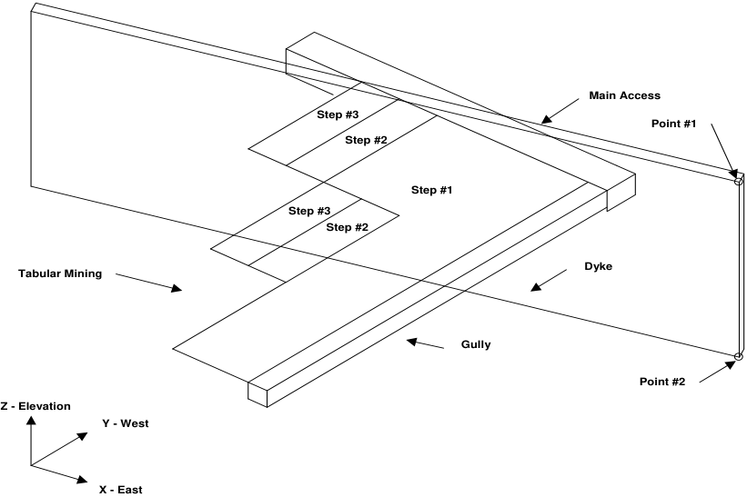

This will define the offset vector

X - offset: 0

Y - offset: -50

Z - offset: -200

Now pick OK. This will copy the dyke below the mining.

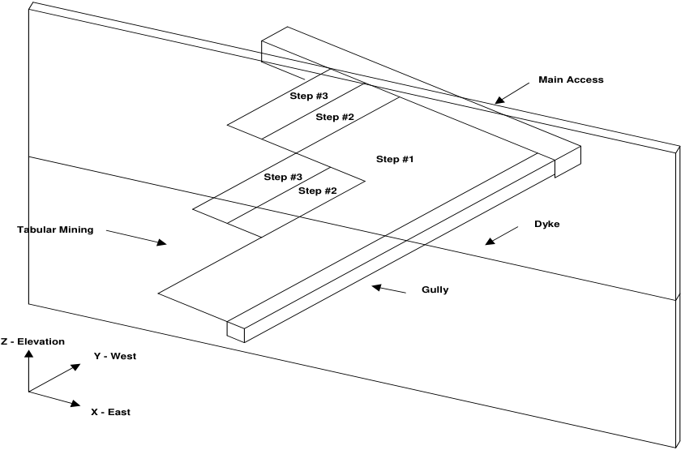

This completes the model construction.

#### Specifying Material Properties for the Host Rock mass

We must now specify properties for the host material. These are entered using the material properties function

#### CAD > Properties > Material Properties

Selecting this item opens a sub-menu of items associated with editing the material properties. Note that material number 1 is by definition the host material. Other material numbers are used to define alternate material zones such as ore, fault gouge, backfill etc. The user is first prompted to enter the material number that is to be edited. First let's define properties for the host material

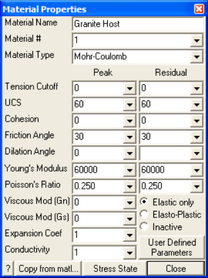

Enter the following:

Material Name: Granite Host Material #: 1 Young's (deformation) Modulus: 60000 MPa Poisson's Ratio: 0.25

The Viscous Moduli can be set to zero since they are only used to simulate creep response in nonlinear analysis.

We want to use the Mohr-Coulomb criterion here. To do this set

Material Type: Mohr-Coulomb UCS: 60 MPa

The cohesion parameter is not used in this case and hence can be set to zero.

Friction angle: 30°

The dilation angle is not used in this case and hence can be set to zero.

Pick Stress State to open the stress state dialog box

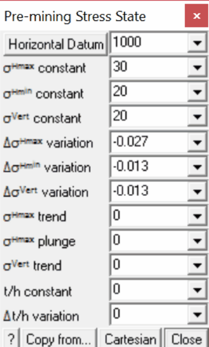

The appropriate far field stress state for this model is

sa constant:  30 MPa sb constant:  20 MPa sc constant:  20 MPa

We will set the variation of stress with depth to zero

Dsa variation:  -0.027 MPa/m Dsb variation:  -0.013 MPa/m Dsc variation:  -0.013 MPa/m

Also the stress orientations (trend and plunge) should be set to zero, thus defining sa and sb as horizontal and sc as vertical.

The Datum can be set to 1000 metres to define the variation with depth as

s + Ds ( _z_ - _Datum_ )

Defined in this way, the stress sa equals 30 MPa at depth z equals 1000m, and increases at a rate of 0.027 MPa/m of depth.

#### Specifying Material Properties for the Ore

We must now specify properties for the ore. These are entered using the material properties function

#### CAD > Properties > Material Properties

Selecting this item opens a sub-menu of items associated with editing the material properties. Note that material number 1 is by definition the host material. Other material numbers are used to define alternate material zones such as ore, fault gouge, backfill etc. The user is first prompted to enter the material number that is to be edited. First let's define properties for the host material

Let's set Material # to 2.

All parameters can be set as desired. The user should take special care in this case since this material is inserted into DD planes. These features can behave non-linearly yielding in compression and shearing (refer to the section on Mohr-Coulomb in DD Planes).

Pick Stress State to open the stress state dialog box

We want the initial stress in the ore to be the same as in the host, so lets Copy from material 1.

#### Specifying Material Properties for the Dyke

We must now specify properties for the dyke. These are entered using the material properties function

#### CAD > Properties > Material Properties

Selecting this item opens a sub-menu of items associated with editing the material properties. Note that material number 1 is by definition the host material. Other material numbers are used to define alternate material zones such as ore, fault gouge, backfill etc. The user is first prompted to enter the material number that is to be edited. First let's define properties for the host material

Let's set Material # to 3.

All parameters can be set as desired. If Map3D Non-Linear is being used, the user should take special care in this case since this feature can behave non-linearly yielding in compression and shearing (refer to the section on Mohr-Coulomb in 3D FF Blocks).

Be sure to Pick Stress State to open the stress state dialog box, as set the stress state in the dyke to be the same as in the host (Copy from material 1).

#### Specifying Control Parameters

We must now specify parameters to control model discretization and solution. These are entered using the control parameters function

#### CAD > Properties > Control Parameters

Selecting this item opens a dialog box of items associated with the control parameters

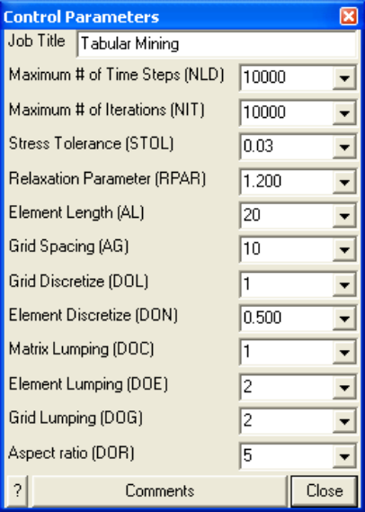

Enter the following:

Job Title: Tabular Mining

All parameters can be left at their default values except the stress tolerance, element length and grid spacing.

Stress Tolerance: 0.03 MPa

should be set to approximately 0.1% of the far field stress state. This ensures that during solution, the surface stresses will be calculated with 0.03 MPa numerical accuracy.

Element Length: 20

should be set equal to twice the thickness of the Dyke (the dyke is 10 metres thick) since this is the narrowest feature used in this model. This parameter is used to control the minimum boundary element size that will be used at locations where narrow seams or pillars are located. This ensures that a wellconditioned, readily solvable problem will be formulated.

The Grid Spacing is not used since we have not defined any field point grids.

Suggested values for the discretization and lumping parameters are as follows:

_DON_ =0.5, _DOL_ = _DOC_ =1, _DOE_ = _DOG_ =2 for 10-20% error _DON_ =0.5, _DOL_ = _DOC_ =2, _DOE_ = _DOG_ =4 for 5-10% error _DON_ =1.0, _DOL_ =DOC=4, _DOE_ = _DOG_ =8 for &lt; 5% error

Coarse analysis results are recommended for all problems except those where increased accuracy is required. At this setting numerical errors of 10-20% in stress predictions can be expected. The settings for detailed analysis results provide 5-10% numerical error. The settings for high accuracy results provide less than 5% numerical error. The user is free to specify higher accuracy settings for these parameters, however this will result in larger problem size and hence longer run times.

#### Running a Map3D Analysis

At this point we have completed construction of the model and are ready to begin an analysis. If you are using Map3D Fault-Slip you will obtain an elastic solution to this problem. If you are using Map3D NonLinear, a complete non-linear analysis will be conducted.

Analysis is executed from the main menu.

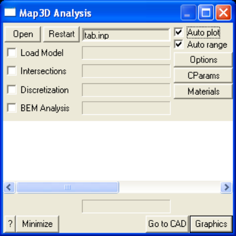

You can run through the complete analysis by selecting

#### BEM Analysis

here we will do this in stages. So first select

#### Discretization

If you have modified the model in any way since the last time you saved, you will be prompted to save these modifications.

When the Intersections and Discretization analyzes are complete select

#### Analysis > Graphics

When in graphical mode, you should select the discretized view option

#### View > Render > Discretize

This will enable you to see how the block surfaces have been discretized into boundary elements. You must have set outlines on in order to see the individual elements

#### View > Render > Block Outlines

To see how the grid has been discretized, you must select the

#### Plot > Grid Selection > Grid #1

If everything is satisfactory, you can now proceed to the BEM Analysis (matrix assembly and solution), by selecting

#### Analysis

from the main menu, then selecting

#### BEM Analysis

When the analysis is complete, select

#### Analysis > Graphics

When in graphical mode, you can contour any desired parameter. For example to display the normal displacement (closure) on the tabular mining, select

#### Plot > Surface Components > Dn Normal Displacement (Closure)

This will generate a contour plot on the DD planes.

#### Building The Main Access

This will be built by drawing a floor plan with DDLoop then extruding this into a 3D block.

To do this we must return to the CAD stage of the Map3D analysis by selecting

#### Analysis > Go to CAD

from the analysis dialogue box. Then select

#### Analysis > Graphics

To begin, select the DDLoop building menu function

#### CAD > Build > DD Loop

Set the snap mode to nearest edge (or nearest corner)

#### CAD > Snap > Nearest Edge

this only needs to be done if the edge snap button is not already highlighted

).

You will see that the DDLoop building routine is prompting you to enter the first corner of the block on the status bar

Input: Select Point 1

Pick the first two points as shown in the figure.

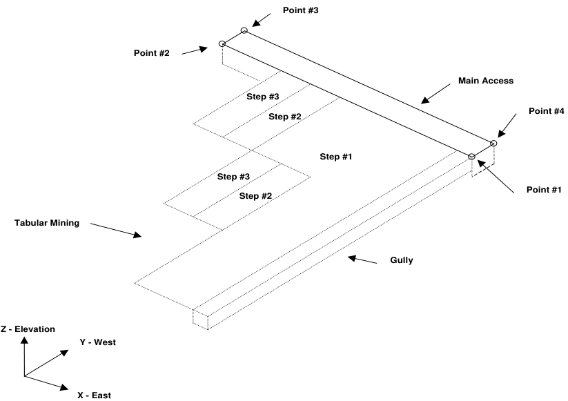

Points 3 and 4 will be generated by offsetting them from the line defined by points 1 and 2. To do this select

#### CAD > Build > Offset Remaining

from either the build toolbar.

You will be prompted to enter the offset vector.

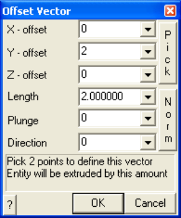

Enter the offset as

X - offset: 0

Y - offset: 2

#### Z - offset: 0

This will generate points 3 and 4 and complete building the DDLoop.

You will automatically be prompted to enter the block properties

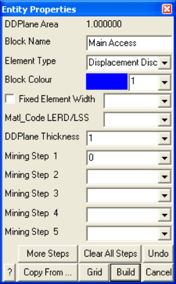

Enter the following:

#### Block Name: Main Access

#### Element Type: Fictitious Force

When you do this you will be prompted to enter the offset vector that will be used to extrude the block.

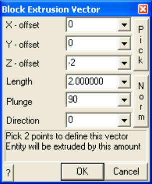

Enter the offset as:

X - offset: 0 Y - offset: 0 Z - offset: -2

Block Colour: 1 Fixed Element Width:   (leave this unchecked)

This access should be excavated at mining step 1. This is indicated by specifying

Mining Step 1: 0

We are now finished and can Build this block.

#### Building The Gully

Now build the gully using the same procedure as described above.

Pick the first two points as shown in the figure.

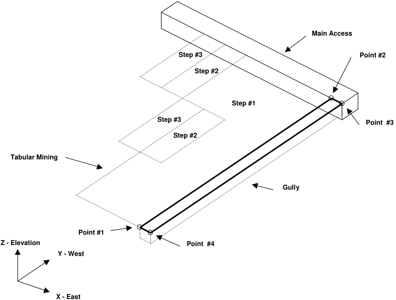

Points 3 and 4 will be generated by offsetting them from the line defined by points 1 and 2. To do this select

CAD > Build > Offset Remaining

from either the build toolbar.

You will be prompted to enter the offset vector.

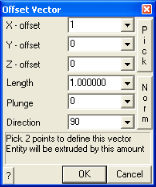

Enter the offset as:

- X - offset: 1

- Y - offset: 0

- Z - offset: 0

This will generate points 3 and 4 and complete building the DDLoop.

You will automatically be prompted to enter the block properties

#### Enter the following:

#### Block Name: Gully

#### Element Type: Fictitious Force

When you do this you will be prompted to enter the offset vector that will be used to extrude the block.

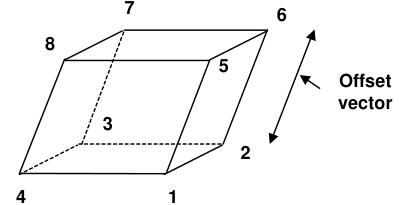

Enter the offset as:

X - offset: 0 Y - offset: 0 Z - offset: -1

Block Colour: 1

Fixed Element Width:   (leave this unchecked)

This access should be excavated at mining step 1. This is indicated by specifying

Mining Step 1: 0

We are now finished and can Build this block.

#### Discussion

Before proceeding with the analysis we must modify the Element Length ( _AL_ ) control parameter to accommodate these new additions to our model properly

#### CAD > Properties > Control Parameters

AL should be set equal to twice the thickness of the gully (the gully is 1 metres thick) since this is the narrowest feature used in this model.

If we now discretize the model

#### Analysis > Discretization

a careful look illustrates that a large number of boundary elements are used in discretizing the areas adjacent to the gully and main access. These features are clearly going to be expensive in terms of analysis time. If these features are not important contributing factors considerable saving in analysis effort can be achieved by removing them from the analysis. This can be achieved by making these features inactive.

To do this select

#### Analysis > Go to CAD

from the analysis dialogue box. Then select

Analysis > Graphics

Now select

from the CAD toolbar

This will open the edit toolbar

To edit entities, select

CAD > Edit > Entity Properties

This will open the edit entities toolbar

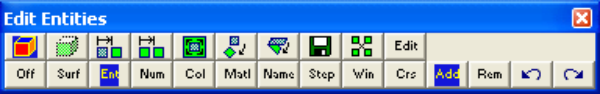

When you initiate this routine you will first be prompted to build a list of entities that you wish to edit. Hold down the Shift key then pick the Gully and Main Access. Do not pick the tabular mining or dyke.

When you have selected these features, you can pick

CAD > Edit > Entity Properties

again, or double click on the Gully or Main Access to open the Entity Properties dialogue box.

If any of the fields in the dialogue box read "Variable" it is because some of the blocks you have selected have different properties for that field. If you wish to leave these properties as they are (i.e. different for each block), leave the field as "Variable". If you wish to change the value of that field for all selected blocks, enter the desired value.

In this case the only field we want to change is the Element Type parameter. Set this to Inactive Fictitious Force

Element Type: Inactive Fictitious Force

then select OK.

You can now start the BEM analysis again by selecting

BEM Analysis

