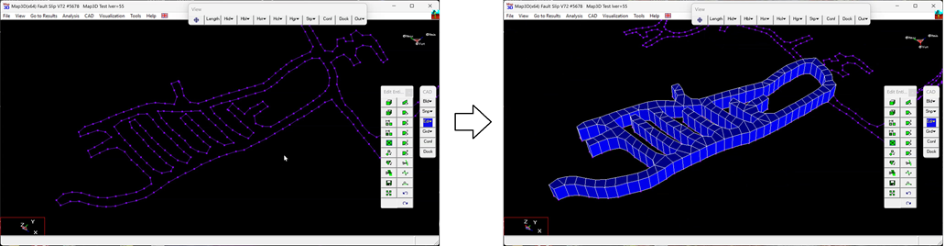

This example demonstrates how to use the Map3D DDLoop function to build a complex drive layout. The layout contains complicated interior pillar shapes.

The construction lines used in this video are included with the demo version of Map3D and/or can be downloaded from z305_floor_plan-a.dxf

**Video demonstration of DDLoop model building using interior loops**
