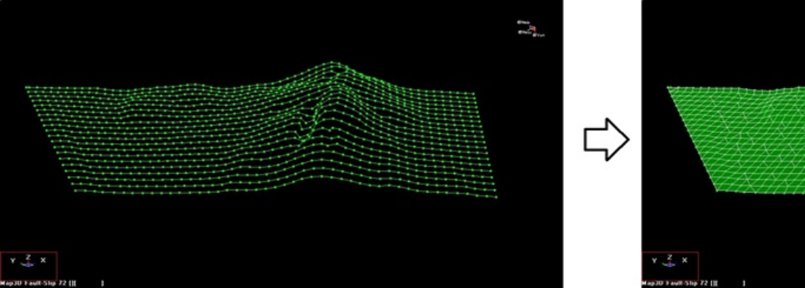

This example demonstrates how to use the Map3D DDLoop Model Building Using "Snap > Window" Option.

The layout contains multiple sub-parallel construction lines.

The construction lines used in this video are included with the demo version of Map3D and/or can be downloaded from lines3a.dxf

**Video demonstration of DDLoop Model Building Using Window Option (lines3a.dxf)**
