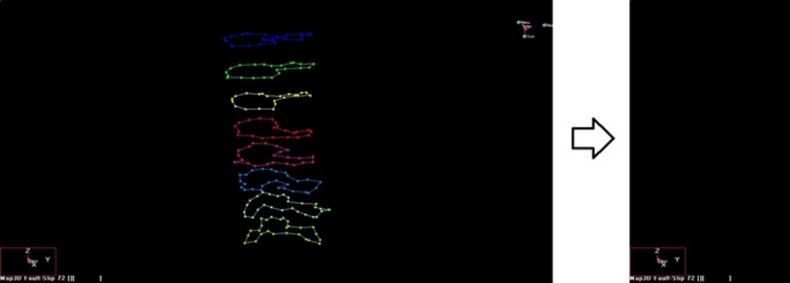

This example demonstrates how to use the Map3D FFLoop function with the new "Snap > Window" option.

The layout contains multiple construction line loops.

This video demonstrates FFLoop construction from a set of construction line loops. The construction lines used in this video are included with the demo version of Map3D and/or can be downloaded from 7a.pnt

**Video demonstration of FFLoop model building using the new "Win > Snap" option**
