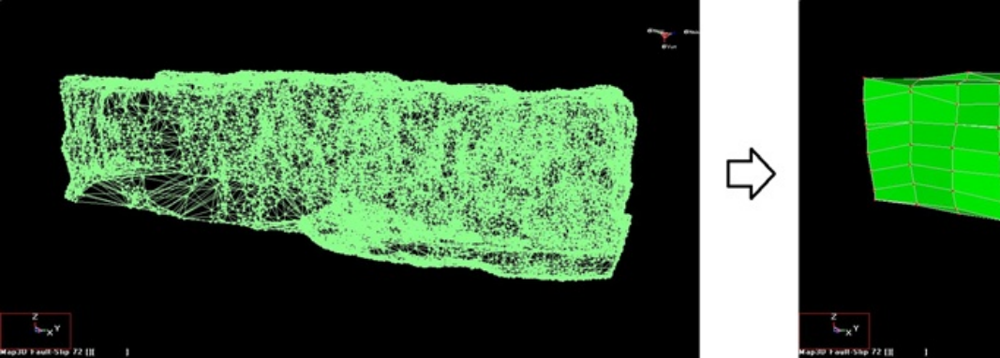

This example demonstrates how to use the Map3D Model Simplification Using Slicing. The layout contains an excessively complex excavation shape.

This video demonstrates simplification of a complex geometry by "Slicing", "Smoothing" then "FFLoop" construction.

The construction lines used in this video are included with the demo version of Map3D and/or can be downloaded from Skivpall.dxf

**Video demonstration of Model Simplification Using Slicing (Skivpall.dxf)**
