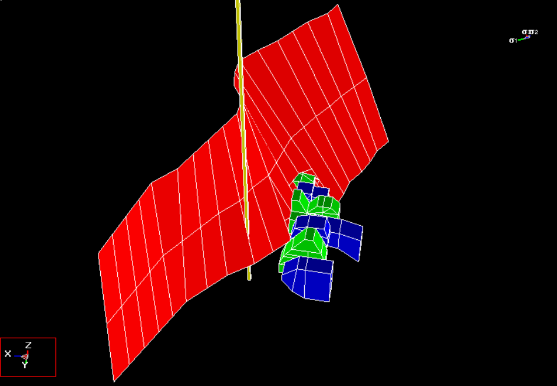

In this example, several alternative methods of modelling fault slip failure are examined in order to assess the pseudo-static fault slip behaviour. Numerical modelling results are used to compare these approaches in an attempt to demonstrate that these results are valid and reliable.

Fault Slip Example

