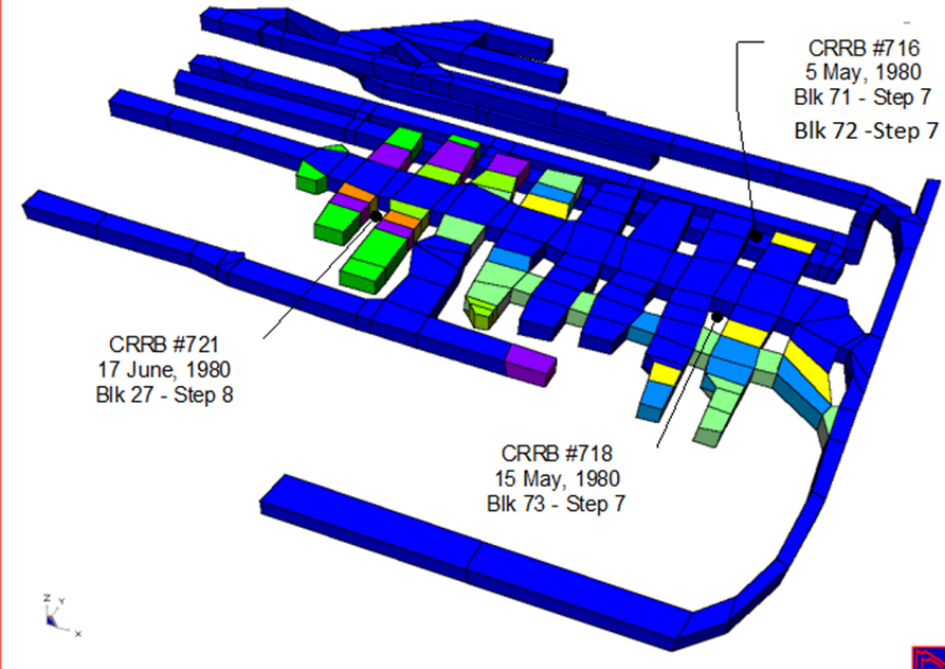

In this example, multiple pillar failures occurred during the silling out stage on 3 different levels. These are used to calibrate a model to make predictions of expected behaviour for mining a subsequent crown pillar.

#### CR Example

