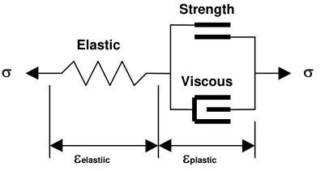

Realiza a análise de fluência elasto-viscoplástica.

Este recurso é usado apenas em análises não lineares (blocos FF 3D no Map3D Non-Linear e planos DD no Map3D Fault-Slip). O modelo de fluência pode ser usado simplesmente como uma técnica para amortecer as deformações não lineares ou, se esta opção de fluência for ativada, para a simulação de fluência dependente do tempo real.

Em cada passo de fluência, o estado de tensão em todos os elementos em escoamento (elementos nos quais a tensão excede a resistência) é calculado como a resistência mais a resistência à fluência. Isso limita o tamanho do incremento de fluência plástica Deplastic em cada elemento em escoamento

s = _Strength_ + _C_ Deplastic /D _t_

_C_ = _G_ D _t_

em que a resistência à fluência é determinada como o coeficiente de fluência _C_ multiplicado pela taxa de deformação plástica Deplastic /D _t_ . Observe que o usuário deve selecionar tanto o coeficiente de fluência _C_ quanto o tamanho do passo de tempo D _t_ e, em seguida, especificar o quociente entre eles como o módulo viscoso _G_ . A contribuição para a tensão s feita pelo incremento de fluência é a tensão excedente dada por

Ds  = _C_ Deplastic /D _t_

A tensão excedente máxima de todos os elementos em escoamento é indicada por Plot > Surface Components > Ferr

Se esta opção de fluência for ativada, o Map3D executará apenas um incremento de fluência para cada passo de lavra. Assim, o tempo decorrido pode ser determinado como o produto do número do passo de tempo atual _is_ (Analysis Dialogue) pelo tamanho do passo de tempo D _t_ definido pelo usuário.

Tempo total decorrido = _is_ D _t_

O usuário pode querer repetir vários passos de lavra sem adicionar nenhuma lavra nova, simplesmente para permitir que o modelo sofra fluência por um número controlado de passos.

Se esta opção de fluência não for ativada, o Map3D executará quantos incrementos de fluência forem necessários para reduzir _fer_ abaixo da tolerância de tensão _STOL_ antes de passar para o próximo passo de lavra.

Em ambos os casos, a deformação plástica acumulada eplastic é determinada como a soma dos incrementos de fluência plástica Deplastic de todos os passos de fluência.

Tópicos relacionados:

Plot > Surface Components > DTs Excess Shear Stress

Plot > Surface Components > DEs Incremental Shear Strain

Plot > Surface Components > Ts Shear Stress

Plot > Surface Components > Es Shear Strain

Esta função deve ser marcada antes de realizar a análise BEM do Map3D

Analysis > BEM Analysis
