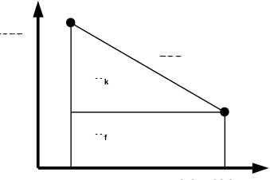
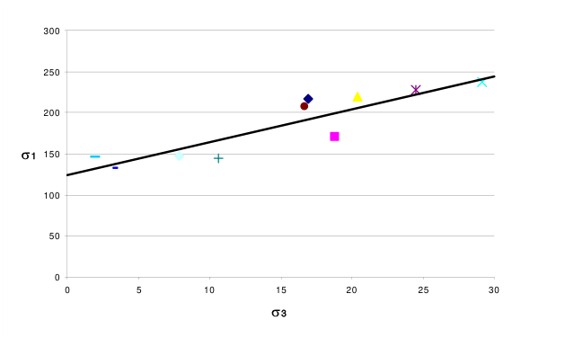
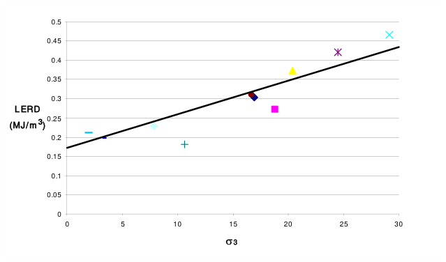
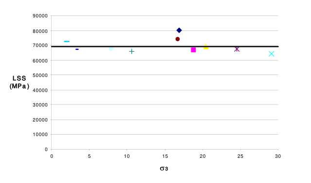

Calcula a taxa de liberação de energia e a rigidez do sistema de carregamento durante a análise BEM do Map3D.

Esta rotina permite ao usuário calcular a taxa de liberação de energia ( _ERR_ ) em qualquer local desejado e oferece ampla flexibilidade para controlar como o cálculo é conduzido. Há um método alternativo,

em que a _ERR_ é calculada apenas à frente da face de uma escavação: Plot > Surface Components > ERR

Ao selecionar LERD/LSS, será solicitado um nome de arquivo de dados no qual os resultados dos cálculos de LERD/LSS serão gravados. A extensão padrão desse arquivo é ".ERR".

Os resultados serão gravados nesse arquivo no seguinte formato:

Se o bloco de teste for construído como um bloco 3D (usando elementos FF)

**Block# Volume Area   Wk  Wf  Ev  LSS   x y z** s **1  t1  p1** s **2  t2  p2** s **3  t3  p3**

em que s **i  ti  pi** representam um componente de tensão principal, sua direção (trend) e seu mergulho (plunge).

Se o bloco de teste for construído como uma feição planar (usando elementos DD)

**Block# Volume Area   Wk  Wf  Ev  LSS   x y z** t **s  ts  ps** s **n  tn  pn**

em que t **s  ts  ps** representam a tensão de cisalhamento máxima no plano, sua direção (trend) e seu mergulho (plunge), e s **n  tn  pn** representam a tensão normal, sua direção (trend) e seu mergulho (plunge).

Em ambos os casos, **x y z** são as coordenadas do centro do bloco de teste onde as tensões são calculadas.

**Wk  Wf** e **LSS** são definidos a seguir.

**Ev** é a variação de volume que ocorre durante o cálculo de LERD/ERR.

Além disso, também será calculada a liberação total de energia associada às novas escavações feitas durante a etapa de lavra atual. Observe que não é necessário especificar blocos de teste para que esse cálculo seja realizado. Os resultados serão informados da seguinte forma:

#### Stp# Volume Area Wk Wf Ev LSS

Indicadores úteis da natureza da resposta esperada durante o escoamento são a rigidez do sistema de carregamento ( _LSS_ ) e a densidade local de liberação de energia ( _LERD_ ). Em diferentes locais de um modelo, é possível

esperar que esses indicadores mudem devido a efeitos geométricos. Nos locais em que a _LSS_ é mais rígida que a resposta pós-pico da rocha em escoamento, pode-se esperar uma ruptura controlada, que progride em sequência com o avanço da lavra. No entanto, nos locais em que a _LSS_ é mais branda que a resposta pós-pico da rocha em escoamento, pode-se esperar rupturas não controladas. A quantidade de energia excedente disponível deve se correlacionar com a magnitude do evento.

Para determinar a _LSS_ ou a _LERD_ em um modelo numérico, é necessário flexionar o modelo e observar a resposta do sistema de carregamento. Isso é feito especificando o Código de Material para o cálculo de LERD/LSS em

#### CAD > Edit > Entity Properties > Matl Code LERD/LSS

Esse Código de Material especial é usado para alterar temporariamente as propriedades do material ou as condições de contorno na área de teste, fazendo o modelo se deformar de alguma maneira.

Como se espera que a _LSS_ mude de um local para outro, é necessário fazer isso em todos os locais de interesse. Monitorando cuidadosamente a resposta do sistema de carregamento durante essa deformação, é possível calcular a _LSS_ e as diversas quantidades de energia transferida.

Considere o exemplo simples de um plano de falha que atravessa uma zona de lavra e faça a pergunta: "Como essa falha responderia se entrasse em escoamento?". Poderia-se simplesmente substituir por um ângulo de atrito menor e observar como o maciço rochoso se deformou. Vamos chamar de "Estágio I" o modelo com a falha em seu ângulo de atrito normal e de "Estágio II" o mesmo modelo, mas com a falha em algum ângulo de atrito reduzido. Em algum ponto do plano de falha, podemos esperar o seguinte tipo de resposta.

A _LSS_ é simplesmente a inclinação da curva de resposta carga-deformação. A quantidade máxima de energia que pode ser liberada como energia cinética é a área do triângulo superior, rotulada como Wk (espera-se que ela se correlacione com a magnitude do evento observado). A quantidade mínima de energia que pode ser dissipada na deformação por atrito da falha é a área do retângulo inferior, rotulada como Wf (espera-se que ela se correlacione com a quantidade de dano observada na fonte do evento). Esse cálculo deve ser realizado em todos os locais do plano de falha para obter a energia total transferida em decorrência da redução do ângulo de atrito. Observe que, dependendo de como as propriedades do material são definidas, pode haver deformações normais (dilatação ocorrendo com a resposta ao cisalhamento) que devem ser incluídas nos cálculos de energia.

Os mesmos cálculos podem ser feitos para um pilar entre duas galerias. Nesse caso, vamos chamar de "Estágio I" o modelo com o pilar intacto. Para flexionar o modelo, poderíamos substituir o pilar por um material diferente e chamar isso de "Estágio II". Todos os cálculos e interpretações acima para Wk e Wf podem então ser retomados. Observe que, como acima, haverá contribuições dos componentes normal e de cisalhamento incluídas nos cálculos de energia.

Como o Map3D calcula as tensões que atuam nos elementos de contorno, a transferência total de energia pode ser calculada como a integral das tensões ao longo de suas deformações sobre todos os elementos. No caso do exemplo do pilar acima, se realmente escavarmos o pilar para obter o estágio II e dividirmos Wk pelo volume do pilar, obtemos a densidade local de liberação de energia ( _LERD_ ). Constatou-se que ela se correlaciona muito bem com episódios de ruptura violenta. (Observe que, no caso de lavra tabular, se você dividir Wk pela área (no plano de lavra), obtém a taxa clássica de liberação de energia, _ERR_ ).

Para reforçar esse conceito, vamos considerar um exemplo real. Considere vários estouros de pilares que ocorreram ao longo de vários anos de lavra. Para cada ruptura, um modelo numérico foi executado para determinar o estado de tensão no momento e no local da ruptura. Se plotarmos todas essas previsões de tensão em um conjunto de eixos s **1** versus s **3**, obtemos o seguinte:

Esta figura ilustra que há uma forte correlação entre o estado de tensão no momento de cada estouro e um critério de resistência linear. O coeficiente de correlação desses dados é 0,90. Dito de outra forma, o erro médio na previsão de s **1** é de aproximadamente 17 MPa. Isso resulta em um coeficiente de variação de apenas 9%.

A _LERD_ no momento do estouro em cada local também mostra uma forte correlação entre o estado de tensão no momento de cada estouro e um critério linear. O coeficiente de correlação desses dados é 0,88.

Dito de outra forma, o erro médio na previsão da _LERD_ é de aproximadamente 0,045 MPa/mª. Isso resulta em um coeficiente de variação de apenas 14%.

Embora os componentes Wk e Wf sejam facilmente calculados dessa maneira, a definição da _LSS_ não é tão direta. No entanto, uma _LSS_ representativa pode ser determinada da seguinte forma:

Identifique uma área representativa para a qual a _LSS_ deve ser determinada. Isso é feito construindo um bloco de teste que deve abranger a zona de escoamento prevista.

Você constrói o bloco de teste como qualquer outra feição, mas o identifica como "bloco de teste" especificando o Código de Material desejado para o cálculo de LERD/LSS em

#### CAD > Edit > Entity Properties > Matl Code LERD/LSS

O Código de Material das Etapas de Lavra deve ser definido de acordo com a forma como você deseja que essa zona seja tratada durante a sequência de lavra. Esses blocos podem ser usados como zonas de materiais alternativos e escavados, se desejado.

Supondo que esse bloco de teste seja preenchido com um material fictício cuja rigidez pós-pico corresponde exatamente à resposta do sistema de carregamento, e que o comportamento do bloco de teste possa ser descrito por

s **1 =** **_LSS_** e **1** s **2 =** **_LSS_** e **2** s **3 =** **_LSS_** e **3**

A densidade de energia pode ser calculada como

**½ (** s **1** e **1 +** s **2** e **2 +** s **3** e **3 )**

A densidade média de energia pode ser estimada como

**( Wk + Wf ) /** **_Volume_**

Portanto, a rigidez do sistema de carregamento pode ser determinada a partir de

**_LSS_ = ½ (** s **1² +** s **2² +** s **3² )** **_Volume_ / ( Wk + Wf )**

Se fizermos esse cálculo com os dados apresentados acima, obtemos o seguinte gráfico.

A _LSS_ no momento do estouro em cada local mostra um valor fortemente independente da tensão. O erro médio na previsão da _LSS_ é de aproximadamente 4730 MPa. Isso resulta em um coeficiente de variação de apenas 7%.

Este cálculo de _LSS_ só é representativo se as tensões estiverem distribuídas uniformemente por todo o bloco de teste. Nos casos em que isso não ocorre, constata-se uma correlação ruim com a _LSS_.

#### Notas

Esta função deve ser marcada antes de executar a análise de discretização

Análise > Discretização
