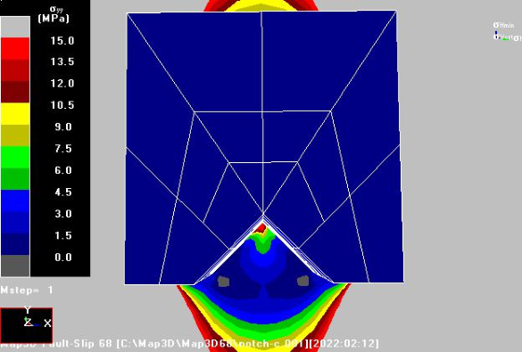

Usa elementos de contorno de ordem superior durante a análise BEM do Map3D.

O Método dos Elementos de Contorno utiliza uma aproximação numérica de como a intensidade dos componentes superficiais de tensão ou de descontinuidade de deslocamento é distribuída pelos contornos. A hipótese mais simples é supor que esses componentes superficiais sejam distribuídos uniformemente em cada elemento de contorno. A experiência com o Map3D mostrou que essa aproximação produz resultados precisos para todos os problemas, exceto para uma classe limitada em que há efeitos significativos de flexão. Mesmo nesse segundo tipo de problema, ainda se obtêm resultados precisos em todos os locais, exceto próximo às superfícies de contorno.

Para obter resultados precisos perto dos contornos de problemas com efeitos de flexão significativos, é necessário implementar elementos de contorno de ordem superior. Os efeitos de flexão normalmente se tornam importantes em problemas com grandes vãos de formato irregular. Isso é particularmente importante perto de quinas no contorno, que podem surgir devido a interseções entre diversas feições.

Quando nem **linear** nem **quad** estão marcadas, a intensidade dos componentes superficiais de tensão ou de descontinuidade de deslocamento é distribuída como valores **constantes**.

Quando a opção **linear** está marcada, a intensidade dos componentes superficiais de tensão ou de descontinuidade de deslocamento é distribuída pelos elementos de contorno por meio de uma distribuição polinomial de primeira ordem. Para triângulos, usa-se a seguinte distribuição

_a + b x + c y_

Para quadriláteros, usa-se a seguinte distribuição

_a + b x + c y + d xy_

Quando a opção **quad** está marcada, a intensidade dos componentes superficiais de tensão ou de descontinuidade de deslocamento é distribuída pelos elementos de contorno por meio de uma distribuição polinomial de segunda ordem. Para triângulos, usa-se a seguinte distribuição

_a + b x + c y + d x_ ² _+ e xy + f y_ ²

Para quadriláteros, usa-se a seguinte distribuição

_a + b x + c y + d x_ ² _+ e xy + f y_ ² _+ g x_ ²y _+ h x_ ² _y_ ² _+ i y_ ²x

Notas:

Esta função deve ser marcada antes de executar a análise BEM do Map3D

#### Análise > Análise BEM

Esta opção aumenta o tamanho do problema e, portanto, o tempo de análise, pois elementos de ordem superior exigem mais nós de interpolação nas superfícies de contorno.

Se você não tiver certeza da sensibilidade do seu modelo a essa aproximação, sugere-se executar algum subconjunto do modelo real com e sem elementos lineares para comparação.

No exemplo a seguir, é ilustrada uma escavação com um entalhe. A tensão vertical é traçada em contornos para os três casos: nem **linear** nem **quad**, depois **linear** e depois **quad**. Observe a concentração de tensão anômala na ponta do entalhe com a distribuição constante. Esse efeito é eliminado com a distribuição **linear** e reduzido ainda mais com a distribuição **quad**.

#### Distribuição linear

Distribuição **quad**

