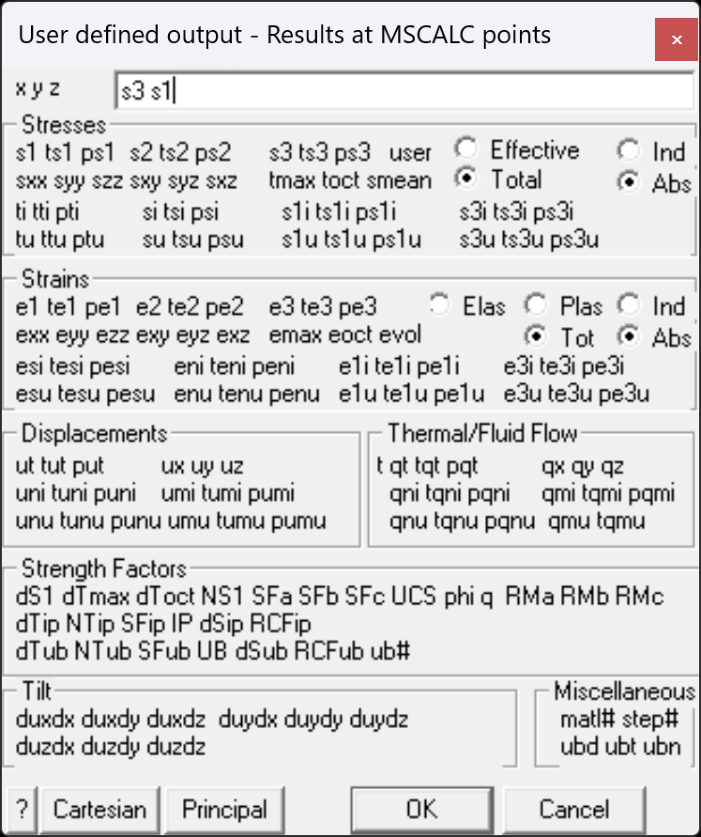

Calcula resultados em pontos definidos pelo usuário durante a análise BEM do Map3D.

Os resultados da análise podem ser calculados em locais de coordenadas definidos pelo usuário.

Ao selecionar MSCALC, serão solicitados um nome de arquivo de dados e o formato de saída desejado, da seguinte forma.

#### Formato do arquivo de dados:

O arquivo de dados é simplesmente um arquivo de texto (*.txt) com uma lista dos locais de coordenadas onde os resultados devem ser calculados.

O formato desse arquivo exige um conjunto de coordenadas por linha

x1 y1 z1 x2 y2 z2 x3 y3 z3 x4 y4 z4 ...

em que x y z representam as coordenadas de cada ponto.

Se desejar, você pode especificar x y z dipub ddrub E, além disso, também pode especificar x y z dipub ddrub so phi

Aqui, dipub e ddrub representam, respectivamente, o mergulho e a direção de mergulho do plano UB desejado

- eles só seriam usados se você estiver calculando alguns componentes UB, como su tu

so e phi representam, respectivamente, a coesão e o ângulo de atrito

- eles só seriam usados se você estiver calculando alguns parâmetros de resistência UB, como sfu rcfu dsu ntu

#### Formato do arquivo de saída:

Os resultados são gravados de volta no mesmo arquivo de dados, com as coordenadas x y z seguidas dos parâmetros especificados pelo usuário.

#### Tensões:

s1 ts1 ps1 tensão principal maior s1, sua direção (trend) e seu mergulho (plunge). s2 ts2 ps2 tensão principal intermediária s2, sua direção (trend) e seu mergulho (plunge). s3 ts3 ps3 tensão principal menor s3, sua direção (trend) e seu mergulho (plunge). user Valor definido pelo usuário. sxx syy szz sxy syz sxz Componentes cartesianos de tensão. tmax tensão de cisalhamento máxima tmax=½ ( s1 - s3 ) toct tensão de cisalhamento octaédrica toct=¹/3 [( s1 - s2 )² + ( s2 - s3 )² +( s3 - s1 )²]1/2 smean tensão média smean=¹/3 ( s1 + s2 + s3 ) ti tti pti tensão de cisalhamento máxima no plano da grade, sua direção (trend) e seu mergulho (plunge). si tsi psi tensão normal ao plano da grade, sua direção (trend) e seu mergulho (plunge). s1i ts1i ps1i tensão máxima tangencial ao plano da grade, sua direção (trend) e seu mergulho (plunge). s3i ts3i ps3i tensão mínima tangencial ao plano da grade, sua direção (trend) e seu mergulho (plunge). tu ttu ptu tensão de cisalhamento máxima no plano ubíquo, sua direção (trend) e seu mergulho (plunge). su tsu psu tensão normal ao plano ubíquo, sua direção (trend) e seu mergulho (plunge). s1u ts1u ps1u tensão máxima tangencial ao plano ubíquo, sua direção (trend) e seu mergulho (plunge). s3u ts3u ps3u tensão mínima tangencial ao plano ubíquo, sua direção (trend) e seu mergulho (plunge). A orientação do plano ubíquo é especificada em

Plot > Strength Factors > Ubiquitous Parameters Effective/Total Componentes de tensão efetiva ou de tensão total. Essas opções só são usadas no Map3D Thermal-Fluid Flow, pois esse código permite o cálculo de distribuições de poropressão em regime permanente. Induced/Absolute A tensão induzida é a tensão sem a contribuição da tensão pré-lavra. Representa a variação de tensão desde a condição pré-lavra. A tensão absoluta é a tensão que inclui a contribuição da tensão pré-lavra.

#### Deformações:

e1 te1 pe1 deformação principal maior e1, sua direção (trend) e seu mergulho (plunge). e2 te2 pe2 deformação principal intermediária e2, sua direção (trend) e seu mergulho (plunge). e3 te3 pe3 deformação principal menor e3, sua direção (trend) e seu mergulho (plunge). exx eyy ezz exy eyz exz Componentes cartesianos de deformação. emax deformação de cisalhamento máxima emax=½ ( e1 - e3 ) eoct deformação de cisalhamento octaédrica eoct=¹/3 [( e1 - e2 )² + ( e2 - e3 )² +( e3 - e1 )²]1/2 evol deformação volumétrica evol=( e1 + e2 + e3 ) esi tesi pesi deformação de cisalhamento máxima no plano da grade, sua direção (trend) e seu mergulho (plunge). eni teni peni deformação normal ao plano da grade, sua direção (trend) e seu mergulho (plunge). e1i te1i pe1i deformação máxima tangencial ao plano da grade, sua direção (trend) e seu mergulho (plunge). e3i te3i pe3i deformação mínima tangencial ao plano da grade, sua direção (trend) e seu mergulho (plunge). esu tesu pesu deformação de cisalhamento máxima no plano ubíquo, sua direção (trend) e seu mergulho (plunge). enu tenu penu deformação normal ao plano ubíquo, sua direção (trend) e seu mergulho (plunge). e1u te1u pe1u deformação máxima tangencial ao plano ubíquo, sua direção (trend) e seu mergulho (plunge). e3u te3u pe3u deformação mínima tangencial ao plano ubíquo, sua direção (trend) e seu mergulho (plunge). Elastic/Plastic/Total Componentes de deformação elástica, plástica ou total. Essas opções só são usadas no Map3D Non-Linear, pois esse código permite o cálculo de deformações não lineares. Induced/Absolute A deformação induzida é a deformação sem a contribuição pré-lavra. Representa a variação de deformação desde a condição pré-lavra. A deformação absoluta é a deformação que inclui a contribuição pré-lavra.

#### Deslocamentos:

ut tut put deslocamento total, sua direção (trend) e seu mergulho (plunge). ux uy uz Componentes cartesianos de deslocamento. uni tuni puni deslocamento normal ao plano da grade, sua direção (trend) e seu mergulho (plunge). umi tumi pumi deslocamento máximo tangencial ao plano da grade, sua direção (trend) e seu mergulho (plunge). unu tunu punu deslocamento normal ao plano ubíquo, sua direção (trend) e seu mergulho (plunge). umu tumu pumu deslocamento máximo tangencial ao plano ubíquo, sua direção (trend) e seu mergulho (plunge).

#### Fluxo:

t temperatura/carga hidráulica.

qt tqt pqt fluxo total, sua direção (trend) e seu mergulho (plunge). qx qy qz Componentes cartesianos de fluxo.

qni tqni pqni deslocamento normal ao plano da grade, sua direção (trend) e seu mergulho (plunge).

qmi tqmi pqmi deslocamento máximo tangencial ao plano da grade, sua direção (trend) e seu mergulho (plunge). qnu tqnu pqnu deslocamento normal ao plano ubíquo, sua direção (trend) e seu mergulho (plunge). qmu tqmu pqmu deslocamento máximo tangencial ao plano ubíquo, sua direção (trend) e seu mergulho (plunge).

#### Resistência:

- ds1 excesso de tensão principal maior Ds1 = s1 - ( _UCS_ + _q_ s3 )

- dtmax excesso de tensão de cisalhamento máxima Dtmax = ½(s1 - s3) - [ _UCS_ + ½(s1+s3) ( _q_ -1) ]/( _q_ +1) = [s1 - ( _UCS_ + _q_ s3) ]/( _q_ +1)

- dtoct excesso de tensão de cisalhamento octaédrica Dtoct = toct - [ _UCS_ + ( _q_ –1) smean ] Ö(2) /( _q_ +2)

- NS1 probabilidade usando a distribuição Normal N(Ds1 /std)

- SF-A Resistência/Tensão pode ser determinada como ( _UCS_ + _q_ s3 )/ s1

- SF-B Resistência/Tensão pode ser determinada como ( _UCS_ + _q_ s3 - s3 )/(s1 - s3)

- SF-C Resistência/Tensão pode ser determinada como [ _UCS_ + ½(s1+s3) ( _q_ -1) ]/[ ½(s1 - s3)( _q_ +1) ]

- dTip excesso de tensão de cisalhamento no plano Dtip = tip - [ Cohesion + sip tan(j) ]

- NTip probabilidade usando a distribuição Normal N(Dtip /std)

- SFip Resistência/Tensão pode ser determinada como [ Cohesion + sip tan(j) ] / tip

- dSip excesso de tensão na parede no plano Dsip = [ 3 s1i - s3i ] - UCS

- RCFip Fator de Condição da Rocha para a tensão na parede no plano RCFip = [ 3 s1i - s3i ]/UCS

- dTub excesso de tensão de cisalhamento no plano ubíquo Dtub

- NTub probabilidade usando a distribuição Normal N(Dtub /std)

- SFub Resistência/Tensão pode ser determinada como [ Cohesion + sub tan(j) ] / tub

- dSub excesso de tensão na parede no plano ub Dsub = [ 3 s1ub - s3ub ] - UCS

- RCFub Fator de Condição da Rocha para a tensão na parede no plano ub RCFip = [ 3 s1ub - s3ub ]/UCS

- UB# Plota o número do conjunto UB (1, 2 ou 3) que tem o maior valor de Dtub

#### Diversos:

matl# o número do material no qual o ponto está localizado. O material hospedeiro é o material número 1. Em problemas em que são usados vários materiais, os resultados podem ser calculados em uma zona de material alternativo.

step# o número da etapa de lavra.

ubd, ubt, ubn representam, respectivamente, o mergulho, a direção de mergulho e a normal do plano ubíquo.

#### Outros:

Cartesian   configura a saída de componentes cartesianos de tensão. Principal   configura a saída de componentes principais de tensão.

#### Notas:

Esta função deve ser marcada antes de executar a análise de discretização

Análise > Discretização.

Qualquer número desejado de pontos pode ser especificado.

O modelo é discretizado de acordo com as localizações dos pontos especificados.
