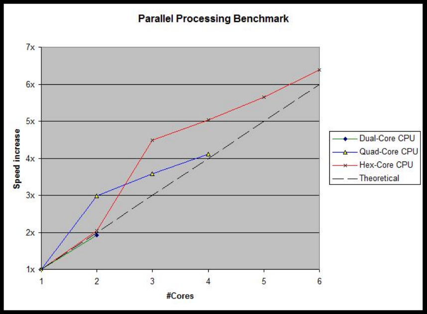

Exibe o número de núcleos/threads ativos.

O Map3D oferece suporte total ao processamento paralelo e à E/S de disco paralela com a opção multiprocessador/múltiplos discos.

Se você tiver licença para usar a opção multiprocessador/múltiplos discos, o Map3D executará todos os procedimentos de análise em paralelo, distribuídos entre todos os processadores disponíveis.

**CPU:** As CPUs recentes estão disponíveis com dois, quatro e seis núcleos. O Map3D V58 passou a oferecer suporte ao processamento paralelo, o que permite taxas de cálculo mais rápidas. Isso resulta em uma redução de mais de 6 vezes nos tempos de montagem da matriz e da grade. Computadores com várias CPUs seriam ainda mais rápidos.

O benchmark de processamento paralelo a seguir mostra claramente que você pode esperar que CPUs de dois núcleos tenham desempenho mais de duas vezes superior,

CPUs de quatro núcleos, mais de 4 vezes superior, e CPUs de seis núcleos, mais de 6 vezes superior. Em CPUs com hyper-threading habilitado, 2 threads de cálculo são sobrepostos no mesmo núcleo. Esse é o motivo pelo qual o Map3D-MP chega a atingir um desempenho melhor que o máximo teórico.

Para obter esses ganhos de desempenho, é necessário melhorar o poder de processamento e/ou a taxa de E/S de disco Análise > Opções > Unidade nº.
