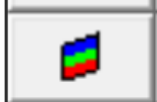

Ativa a barra de ferramentas Build.

Esta barra de ferramentas oferece acesso rápido às funções de construção de entidades usadas na etapa de construção e edição do modelo da análise BEM do Map3D Analysis > Go to CAD.

CAD > Build > FF Loop Constrói um bloco 3D multicantos do tipo FF, usado para escavações e zonas de material alternativo.

CAD > Build > DD Loop Constrói um bloco multicantos do tipo DD, usado para lavra tabular, camadas finas ou planos de falha.

CAD > Build > Grid Plane Constrói um plano de grade onde os resultados da análise são calculados.

CAD > Build > Grid Line Constrói uma linha de grade onde os resultados da análise são calculados.

CAD > Build > Construction Lines Constrói linhas de construção para definir a localização detalhada de feições subterrâneas, como escavações, contatos e estruturas.

CAD > Build > Enter Point Informa os valores das coordenadas de um ponto.

CAD > Build > Offset Remaining Desloca os pontos restantes.

CAD > Build > Undo Point Desfaz a última seleção de ponto.

CAD > Build > Redo Point Refaz a última seleção de ponto.

Pressionar a barra de espaço ativa automaticamente a função de construção e edição usada por último.
