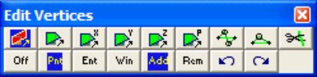

Esta rotina pode ser iniciada escolhendo qualquer função de edição (p. ex., um botão) ou simplesmente clicando com o botão direito em qualquer vértice.

Ao iniciar qualquer rotina de edição de entidades, você será primeiro solicitado a montar uma lista dos vértices que deseja editar.

   - Se Tools > Shift-key Selection estiver marcada, você deve manter pressionada a tecla Shift para fazer seleções múltiplas.

   - Por padrão, as entidades selecionadas são adicionadas à lista; porém, se a tecla Ctrl for mantida pressionada, as entidades selecionadas serão removidas da lista.

   - Enquanto mantém pressionada a tecla Shift ou Ctrl, você pode arrastar para abrir uma janela de seleção.

   - Pressionar a barra de espaço ativa automaticamente a última função de edição usada.

- Manter a tecla Alt pressionada ao clicar com o botão direito repete automaticamente a última função de edição usada.

Esta barra de ferramentas controla as diversas funções usadas na montagem da lista.

Interrompe a edição.

Seleciona vértices escolhendo um por vez.

Seleciona vértices escolhendo grupos.

Inclui todas as entidades dentro da janela selecionada.

- As entidades só serão selecionadas se a entidade inteira estiver contida na janela.

- Esta função também pode ser ativada mantendo pressionada a tecla Shift ou Ctrl e arrastando para abrir uma janela de interseção.

As entidades selecionadas serão adicionadas à lista.

As entidades selecionadas serão removidas da lista.

Desfaz a última seleção.

Refaz a última seleção.

Depois de selecionar as entidades desejadas, você pode escolher qualquer um dos botões de edição:

CAD > Edit > Stretch Vertices

CAD > Edit > Move Vertices to Point

CAD > Edit > Move Vertices to X CAD > Edit > Move Vertices to Y CAD > Edit > Move Vertices to Z CAD > Edit > Move Vertices to Plane CAD > Edit > Smooth Construction Lines CAD > Edit > Remove Construction Vertex CAD > Edit > Subdivide Construction Lines

- clique duas vezes em qualquer vértice para executar a função destacada,

- clique com o botão direito para ver uma lista de opções.

Depois de concluir qualquer operação de edição, você tem uma chance de desfazer as modificações selecionando

#### Undo

Você também pode restaurar o mesmo conjunto de seleção e modificar o mesmo conjunto de entidades novamente selecionando

Redo

Você pode ajustar o tempo de clique duplo usando

Tools > Double Click Time
