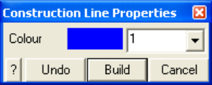

Edita a cor das linhas de construção.

Ao iniciar esta rotina, você será primeiro solicitado a montar uma lista das entidades que deseja editar

- Se Tools > Shift-key Selection estiver marcada, você deve manter pressionada a tecla Shift para fazer seleções múltiplas.

- O uso desta barra de ferramentas é detalhado em Build A List of Entities for Editing

- Pressionar a barra de espaço ativa automaticamente a última função de edição usada.

Depois de selecionar as entidades desejadas, você pode escolher qualquer um dos botões de edição:

CAD > Edit > Entity Properties Edita o tipo de bloco, a cor, a sequência de lavra, CAD > Edit > Erase Entities Apaga as entidades selecionadas, CAD > Edit > Move Entities Move as entidades selecionadas, CAD > Edit > Copy Entities Copia as entidades selecionadas, CAD > Edit > Scale Entities Dimensiona as entidades selecionadas, CAD > Edit > Rotate Azimuth Gira o azimute das entidades selecionadas, CAD > Edit > Rotate Dip Gira o mergulho das entidades selecionadas, CAD > Edit > Dump to File Despeja as entidades selecionadas em um arquivo, CAD > Edit > Group Agrupa as entidades selecionadas em um único bloco,

- clique duas vezes em qualquer vértice para executar a função destacada,

- clique com o botão direito para ver uma lista de opções.

Se algum dos campos da caixa de diálogo indicar "Variable", é porque alguns dos blocos selecionados têm propriedades diferentes nesse campo. Se quiser deixar essas propriedades como estão (ou seja, diferentes para cada bloco), deixe o campo como "Variable". Se quiser alterar o valor desse campo para todos os blocos selecionados, informe o valor desejado.

Colour - especifica o número da cor que será usada para exibir a linha de construção.

- Há um total de 10 cores disponíveis para exibição. Elas são numeradas de 1 a 10,

de 11 a 20,

de 21 a 30 etc.,

- de modo que a mesma cor é exibida para os números

- 1, 11, 21..., 2, 22, 32..., 3, 23, 33..., etc.

OK - conclui a edição das linhas de construção e modifica as propriedades que foram alteradas.

Cancel - interrompe a edição das entidades.

Depois de concluir qualquer operação de edição, você tem uma chance de desfazer as modificações selecionando

#### Undo

Você também pode restaurar o mesmo conjunto de seleção e modificar o mesmo conjunto de entidades novamente selecionando

#### Redo

Você pode ajustar o tempo de clique duplo usando

#### Tools > Double Click Time

Para exemplos do uso de linhas de construção na construção de modelos, consulte:

Model Building Tutorials
