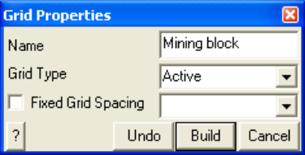

Edita o nome da grade e o espaçamento máximo.

Ao iniciar esta rotina, você será primeiro solicitado a montar uma lista das entidades que deseja editar

- Se Tools > Shift-key Selection estiver marcada, você deve manter pressionada a tecla Shift para fazer seleções múltiplas.

- O uso desta barra de ferramentas é detalhado em Build A List of Entities for Editing

- Pressionar a barra de espaço ativa automaticamente a última função de edição usada.

Depois de selecionar as entidades desejadas, você pode escolher qualquer um dos botões de edição:

CAD > Edit > Entity Properties Edita o tipo de bloco, a cor, a sequência de lavra, CAD > Edit > Erase Entities Apaga as entidades selecionadas, CAD > Edit > Move Entities Move as entidades selecionadas, CAD > Edit > Copy Entities Copia as entidades selecionadas, CAD > Edit > Scale Entities Dimensiona as entidades selecionadas, CAD > Edit > Rotate Azimuth Gira o azimute das entidades selecionadas, CAD > Edit > Rotate Dip Gira o mergulho das entidades selecionadas, CAD > Edit > Dump to File Despeja as entidades selecionadas em um arquivo, CAD > Edit > Group Agrupa as entidades selecionadas em um único bloco,

- clique duas vezes em qualquer vértice para executar a função destacada,

- clique com o botão direito para ver uma lista de opções.

Se algum dos campos da caixa de diálogo indicar "Variable", é porque alguns dos blocos selecionados têm propriedades diferentes nesse campo. Se quiser deixar essas propriedades como estão (ou seja, diferentes para cada bloco), deixe o campo como "Variable". Se quiser alterar o valor desse campo para todos os blocos selecionados, informe o valor desejado.

Name - especifica um nome descritivo para a grade.

Grid Type - especifica se a grade deve ser ativa (usada na análise de tensões) ou inativa (não usada na análise de tensões).

Maximum Spacing - especifica o espaçamento máximo permitido.

- Este parâmetro pode ser usado para forçar uma discretização fina e uniforme em grades selecionadas. Deve-se ter extremo cuidado ao especificar este valor, pois um valor pequeno pode facilmente levar a um problema de tamanho enorme.

- Em geral, este parâmetro deve ser deixado em branco (ou seja, não utilizado), e a discretização deve ficar a cargo do parâmetro _AG_. Este último concentra elementos apenas onde os resultados da análise são solicitados, otimizando o uso de elementos e minimizando o tamanho do problema.

CAD > Properties Control Parameters.

- Se este campo for deixado em branco, o parâmetro não é usado.

OK - conclui a edição dos blocos e modifica as propriedades que foram alteradas.

Cancel - interrompe a edição das entidades.

Depois de concluir qualquer operação de edição, você tem uma chance de desfazer as modificações selecionando

Undo

Você também pode restaurar o mesmo conjunto de seleção e modificar o mesmo conjunto de entidades novamente selecionando

Redo

Você pode ajustar o tempo de clique duplo usando

Tools > Double Click Time
