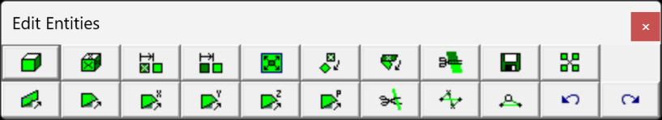

Ativa a barra de ferramentas Edit.

Esta barra de ferramentas oferece acesso rápido às funções de edição usadas na etapa de construção e edição do modelo da análise BEM do Map3D Analysis > Go to CAD

As funções de edição são agrupadas em duas seções, conforme você queira modificar blocos ou coordenadas.

#### Modificar blocos:

CAD > Edit > Entity Properties Edita o tipo de bloco, a cor, a sequência de lavra etc. CAD > Edit > Erase Entities Apaga as entidades selecionadas. CAD > Edit > Move Entities Move as entidades selecionadas. CAD > Edit > Copy Entities Copia as entidades selecionadas. CAD > Edit > Scale Entities Dimensiona as entidades selecionadas.

CAD > Edit > Rotate Azimuth Gira o azimute das entidades selecionadas.

CAD > Edit > Rotate Dip Gira o mergulho das entidades selecionadas. CAD > Edit > Slice Entities Fatia as entidades selecionadas.

CAD > Edit > Dump to File Despeja as entidades selecionadas em um arquivo. CAD > Edit > Group Agrupa as entidades selecionadas em um único bloco.

#### Modificar coordenadas:

CAD > Edit > Stretch Vertices Estica os vértices selecionados. CAD > Edit > Move Vertices to Point Move os vértices selecionados para um ponto. CAD > Edit > Move Vertices to X Move a coordenada x dos vértices selecionados. CAD > Edit > Move Vertices to Y Move a coordenada y dos vértices selecionados. CAD > Edit > Move Vertices to Z Move a coordenada z dos vértices selecionados. CAD > Edit > Move Vertices to Plane Move os vértices selecionados para um plano.

CAD > Edit > Subdivide Construction Lines Subdivide uma linha de construção.

CAD > Edit > Smooth Construction Lines Suaviza as linhas de construção. CAD > Edit > Remove Construction Vertex Remove um vértice de construção.

#### Undo - Redo

Depois de concluir qualquer operação de edição, você tem uma chance de desfazer as modificações selecionando

#### Undo

Você também pode restaurar o mesmo conjunto de seleção e modificar o mesmo conjunto de entidades novamente selecionando

Redo

Pressionar a barra de espaço ativa automaticamente a última função de edição usada.
