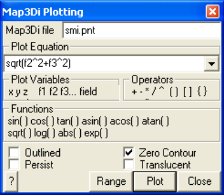

Esta opção permite visualizar os dados do Map3Di.

#### Map3Di File:

O arquivo de dados do Map3Di é simplesmente um arquivo de dados ASCII com a extensão padrão ".PNT".

Consulte CAD > Properties > Map3Di para detalhes sobre o formato dos dados.

Consulte Visualization > Plane > Make Map3Di File para detalhes sobre o formato dos dados.

#### Plot Equation:

Define o parâmetro que será plotado.

A janela suspensa permite armazenar até 20 equações diferentes. Elas são mantidas entre sessões do Map3D no arquivo map3d.ini.

#### Plot Variables:

f1 f2 f3… - campos de dados no arquivo de eventos.

#### Functions:

sin() cos() tan() - funções trigonométricas seno, cosseno e tangente. asin() acos() atan() - funções trigonométricas inversas. sqrt() - função raiz quadrada. log() - função logaritmo natural. abs() - função valor absoluto.

exp() - função exponencial (antilogaritmo).

#### Location:

x y z - coordenada do ponto da grade.

#### Operators:

+ - * / ^   operadores de adição, subtração, multiplicação, divisão e exponenciação. Observe que as exponenciações são calculadas primeiro, seguidas de multiplicação e divisão e, por fim, adição e subtração.

() [] &#123;&#125;   estilos de parênteses. Os pares de parênteses devem corresponder.

>   valor máximo. Por exemplo, se a equação de plotagem for especificada como f1 > 10, será plotado o maior valor entre f1 e 10.

&lt;   valor mínimo. Por exemplo, se a equação de plotagem for especificada como f1 &lt; 10, será plotado o menor valor entre f1 e 10.

#### Point Plotting Options:

Outlined – os retalhos de dados do Map3Di são exibidos com contorno.

#### Other:

Persist – quando marcada, os pontos serão replotados sempre que o modelo for reorientado, transladado ou ampliado. Como isso pode consumir tempo em modelos grandes, esta opção nem sempre é desejável. Translucent - desenha os pontos como esferas translúcidas.

Zero Contour - quando desmarcada, os contornos abaixo da faixa mínima de contorno não são desenhados. Isso é útil para exibir contornos em que apenas a parte superior da faixa é importante. Range – especifica o mínimo, o máximo e o intervalo para o dimensionamento do raio e para o traçado de contornos.

Plot - regenera o gráfico. Este botão pode ser colocado na barra de ferramentas View (Tools > View Toolbar Configure) ou na barra de ferramentas Contour (Tools > Contour Toolbar Configure).
