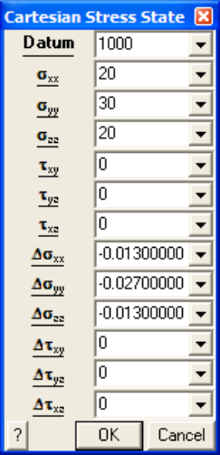

O estado de tensões pré-lavra é especificado como uma variação linear com a profundidade, em componentes cartesianas ou principais.

A variação de cada uma das componentes cartesianas é descrita como uma variação linear com a profundidade (por exemplo, para a componente sxx) como

- sxx + Dsxx ( _z_ - _Datum_ )

Para determinar valores apropriados para cada uma dessas componentes, o usuário deve primeiro selecionar uma profundidade

- ( _z_ = _Datum_ )

em que as tensões têm valores conhecidos. Esses últimos valores são os

sxx  syy  szz  txy  tyz  txz

valores constantes.

A variação de cada componente com a profundidade pode então ser especificada como

Dsxx  Dsyy  Dszz  Dtxy  Dtyz  Dtxz

valores de variação. Se você configurou seu sistema de coordenadas com _z_ positivo para cima, as variações devem ser especificadas como grandezas negativas, de modo que as tensões aumentem com a profundidade.

Por exemplo, se você sabe que a componente sxx tem valor de

30 MPa em _z_ = -1000m

e varia como ( _z_ é positivo para cima)

- 0.027 MPa/m

você especificaria

Datum = -1000 sxx = 30 Dsxx = -0.027
