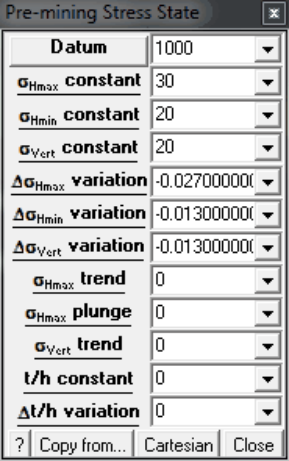
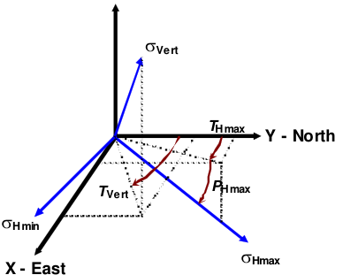

Datum - O estado de tensões pré-lavra é especificado como uma variação linear com a profundidade, em componentes principais ou cartesianas.

Copy from... - permite copiar o estado de tensões de outro material.

- Apenas o estado de tensões é copiado.

- As demais propriedades do material permanecem inalteradas.

Cartesian - O estado de tensões pré-lavra é especificado como uma variação linear com a profundidade, em componentes principais ou cartesianas.

As três componentes de tensão principal são denominadas componentes _Hmax_ , _Hmin_ e _Vert_ .

- sHmax é a tensão horizontal (aproximadamente) máxima.

- sHmin é a tensão horizontal (aproximadamente) mínima.

- sVert é a tensão (aproximadamente) vertical.

Essas componentes de tensão são perpendiculares entre si.

As componentes horizontais e vertical não precisam ser exatamente horizontais ou verticais. A direção (trend) e o caimento (plunge) de sHmax podem ser ajustados usando _THmax_ e _PHmax_ . A direção de sVert pode ser ajustada usando _TVert_ .

A variação de cada uma dessas componentes é descrita como uma variação linear com a profundidade (por exemplo, para a componente sHmax) como

sHmax + DsHmax ( _z_ - _Datum_ )

Para determinar valores apropriados para cada uma dessas componentes, o usuário deve primeiro selecionar uma profundidade _z_ em que as tensões têm valores conhecidos.

_Datum_ deve ser definido com este valor de _z_.

A magnitude da tensão nesta profundidade é especificada pelos seguintes valores constantes

sHmax sHmin sVert

A variação de cada componente com a profundidade pode então ser especificada pelos seguintes valores de variação

DsHmax DsHmin DsVert

Se você configurou seu sistema de coordenadas com _z_ positivo para cima, as variações devem ser especificadas como grandezas negativas, de modo que as tensões aumentem com a profundidade.

Por exemplo, se você sabe que a componente _Hmax_ tem valor de

30 MPa em _z_ = 1000m

e varia como ( _z_ é positivo para cima)

0.027 MPa/m

você especificaria

Datum = 1000 sa = 30 Dsa = -0.027

Por fim, a direção (trend) e o caimento (plunge) da componente _Hmax_ e a direção da componente _Vert_ definem de forma única a orientação do estado de tensões.

Os parâmetros

_t/h_ constant

D _t/h_ variation

referem-se à distribuição de temperatura ambiente/carga hidráulica e são especificados da mesma forma que as tensões.
