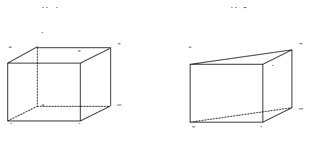
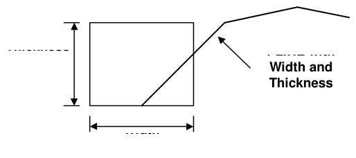
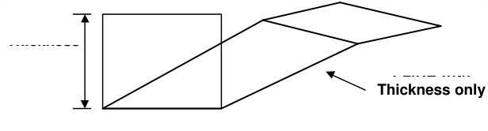
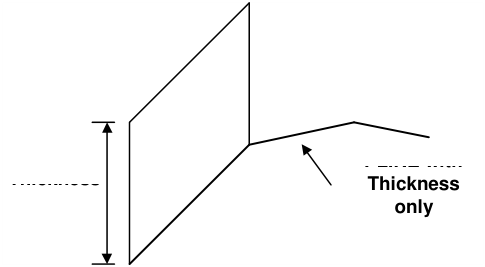
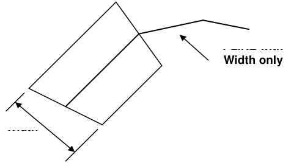
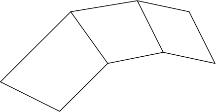
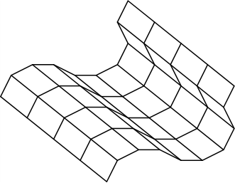

O formato DXF é um arquivo de troca de desenhos do AutoCAD com a extensão ".DXF".

Este formato é útil para trocar dados do modelo com outros softwares CAD.

#### Entidades do AutoCAD do tipo bloco tridimensional

O método mais confiável de gerar dados compatíveis com o Map3D é usar entidades tridimensionais do AutoCAD. Este tipo de entidade gera blocos, que são estruturados de forma idêntica aos blocos 3D FF do Map3D e, portanto, podem ser passados diretamente ao Map3D. O fechamento de todas as superfícies é garantido ao usar este comando, pois cada entidade tridimensional define um bloco fechado. Há muitas maneiras de gerar tais objetos no AutoCAD, conforme descrito a seguir.

#### 3DMESH

O método recomendado para definir entidades tridimensionais do AutoCAD é usar o comando 3DMESH, com THICKNESS e WIDTH do AutoCAD definidos como zero. Esses 3DMESH podem ser especificados com quaisquer valores desejados de M e N. Se N for definido como 3 ou 4, essas entidades entrarão no Map3D como blocos. Esta abordagem é a mais geral, mas também a mais complexa de especificar, pois é preciso definir a disposição tanto do piso quanto do teto da galeria ao longo de seu comprimento.

#### PLINE, POLYLINE ou ELLIPSE com WIDTH e THICKNESS

A técnica mais simples para gerar uma galeria ou realce com seção transversal retangular regular e altura uniforme é usar o comando PLINE do AutoCAD. Basta definir um UCS (sistema de coordenadas do usuário) do AutoCAD para a galeria e, em seguida, definir a linha central da cota do piso da galeria com o comando PLINE do AutoCAD. A largura da galeria é então especificada com o comando PEDIT do AutoCAD. É possível especificar uma largura constante ou uma largura variável em cada vértice. O COLOUR do AutoCAD (número de bloco do Map3D) e o THICKNESS do AutoCAD (altura da galeria) são especificados com o comando CHANGE PROPERTIES do AutoCAD. Os comandos POLYLINE e ELLIPSE do AutoCAD também podem ser usados para criar galerias com WIDTH e THICKNESS especificados.

#### PLINE, POLYLINE ou SOLID apenas com THICKNESS

Outro método simples de definir galerias ou realces com seção transversal retangular é usar os comandos PLINE, POLYLINE ou SOLID do AutoCAD com um THICKNESS do AutoCAD especificado (altura da galeria) e WIDTH do AutoCAD definido como zero (veja a Figura 32). Embora esta abordagem seja mais geral que PLINE, ela também é mais complexa de especificar, pois a planta baixa da galeria deve ser definida ao longo de seu comprimento. Se forem usados os comandos PLINE ou POLYLINE do AutoCAD, é preciso formar um laço fechado com 3 ou 4 segmentos de linha.

#### Outras entidades tridimensionais do AutoCAD

O AutoCAD fornece rotinas para gerar diversos objetos tridimensionais, incluindo esferas, toros, caixas, cones etc. Todos eles podem ser usados, se desejado. O usuário é responsável por fechar as extremidades abertas de formas como hemisférios e cones.

#### Entidades do AutoCAD do tipo placa bidimensional

Dados compatíveis com o Map3D também podem ser especificados em termos de entidades bidimensionais do AutoCAD. Esta técnica não é tão confiável quanto os métodos descritos acima, pois o fechamento de todas as superfícies deixa de ser garantido. O usuário deve definir as escavações com uma série de placas de superfície (todas com o mesmo número de cor do AutoCAD), que devem se unir ao longo de suas bordas e envolver completamente a escavação com uma pele de superfície contínua. Essas superfícies são estruturadas de forma idêntica às placas de superfície do Map3D. O fechamento de todas as superfícies não é garantido ao usar este método, pois o usuário pode deixar de fora um retalho de superfície, formando assim um buraco na superfície da escavação. O usuário deve ter cuidado para posicionar todas as placas de modo que todas as superfícies se fechem perfeitamente.

#### LINE, PLINE, 3DPOLY, POLYLINE e ELLIPSE - apenas THICKNESS

Essas entidades podem ser usadas para definir placas bidimensionais. Basta definir um UCS (sistema de coordenadas do usuário) do AutoCAD para a placa e, em seguida, definir a borda da placa usando qualquer um dos comandos LINE, PLINE, 3DPOLY, POLYLINE ou ELLIPSE do AutoCAD. O COLOUR do AutoCAD (número de bloco do Map3D) e o THICKNESS do AutoCAD (largura da placa) são especificados com o comando CHANGE PROPERTIES do AutoCAD. O WIDTH do AutoCAD deve ser definido como zero.

#### LINE, PLINE, 3DPOLY, POLYLINE e ELLIPSE apenas com WIDTH

Com essas entidades, define-se a linha central da placa usando qualquer um dos comandos LINE, PLINE, 3DPOLY, POLYLINE ou ELLIPSE do AutoCAD. A largura é então especificada com o comando PEDIT do AutoCAD. É possível especificar uma largura constante ou uma largura variável em cada vértice. O THICKNESS do AutoCAD deve ser definido como zero.

#### 3DFACE, POLYLINE ou LWPOLYLINE

Superfícies bidimensionais também podem ser geradas com o comando 3DFACE do AutoCAD. Este método é mais geral, mas, como todos os cantos do 3DFACE do AutoCAD devem ser especificados, também é mais complexo.

#### 3DMESH

Superfícies bidimensionais complexas podem ser geradas usando tipos de 3DMESH com N maior que 4 (p. ex., Rulesurf, Tabsurf, Revsurf etc.). Para essas formas, a rotina de conversão DXF cria uma série de 3DFACEs para descrever a superfície da escavação. Essas superfícies são estruturadas de forma idêntica às placas de superfície do Map3D. O fechamento das superfícies é bastante fácil de garantir nesses casos, devido à natureza regular da construção.

#### Entidades do AutoCAD não suportadas

Há várias entidades do AutoCAD não suportadas, o que significa que o Map3D não foi projetado para reconstruí-las como aparecem no AutoCAD. Essas entidades incluem CIRCLE, ARC e DOUGHNUT. Elas poderão ser suportadas em atualizações futuras do Map3D. Observe que a maioria das formas pode ser gerada por meios alternativos usando o comando ELLIPSE ou o comando 3DMESH do AutoCAD.

#### AutoCAD DXF EXTENDED ENTITY DATA

O DXF EXTENDED ENTITY DATA (EED) faz parte da especificação DXF. O EED permite marcar cada ENTITY do DXF com atributos de dados personalizados. A seguir está a lista dos EEDs suportados pelo Map3D.

A maioria dos sistemas CAD permite adicionar esses EEDs ao seu DXF. Por exemplo, o Deswik os chama de "atributos"; assim, no Deswik você agora pode criar geometrias do Map3D, incluindo a especificação de nomes, cores e sequência de lavra dos blocos do Map3D:

- Exporte cada bloco usando DXF-POLYLINE/POLYFACEMESH - este é o padrão do Deswik.

- Recomenda-se não usar DXF-3DFACE.

- No Deswik, os atributos são exportados para o DXF como AutoCAD Extended Entity Data.

- Os nomes dos atributos (não diferenciam maiúsculas de minúsculas) são definidos da seguinte forma: `o` MAP3D_BLOCKNAME - nome do bloco (o padrão é em branco).

   - MAP3D_BLOCKCOLOR ou MAP3D_BLOCKCOLOUR - número da cor do Map3D (o padrão é o número de cor definido no Deswik).

   - MAP3D_BLOCKTYPE - 1 para FF, 2 para DD, 98 para FF inativo, 99 para DD inativo, 0 para plano de grade (o padrão é 1 para FF).

   - MAP3D_MSTEP# - # é o número da etapa de lavra (o padrão é lavrado na etapa 1).

   - Ø Por exemplo, para escavar na etapa de lavra 2, crie um atributo chamado MAP3D_MSTEP2 e especifique 0 (escavação) como valor do atributo.

   - Ø Por exemplo, para preencher na etapa de lavra 3, crie um atributo chamado MAP3D_MSTEP3 e especifique 4 (em que é o número do material que representa o preenchimento) como valor do atributo.

   - MAP3D_BLOCKNUMBER - número identificador único do bloco (o padrão é um número único diferente para cada DXF-POLYLINE/POLYFACEMESH ou cada DXF-3DFACE).

- Os nomes dos atributos não diferenciam maiúsculas de minúsculas.

- Todos os atributos podem ser definidos como strings (código de grupo 1000), inteiros (código de grupo 1070 ou 1071) ou números reais (código de grupo 1040).

- Todos os atributos são opcionais - os padrões são fornecidos conforme especificado acima.

- Observe que, se nenhum atributo definido pelo Map3D for especificado, o DXF será lido com sucesso desde que você esteja usando DXF-POLYLINE/POLYFACEMESH.

- O Map3D simplesmente assumirá que cada DXF-POLYLINE/POLYFACEMESH é um bloco separado.

- Se você estiver usando vários DXF-3DFACEs, o Map3D pode ter dificuldade em agrupá-los em blocos.

- Problemas com isso ocorrem somente quando blocos adjacentes compartilham seus cantos e têm o mesmo nome.

- MAP3D_BLOCKNUMBER pode ser usado para identificar os DXF-3DFACEs que pertencem a blocos separados.
