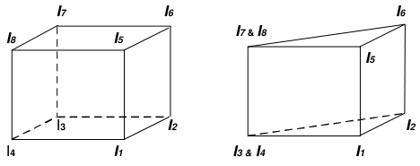
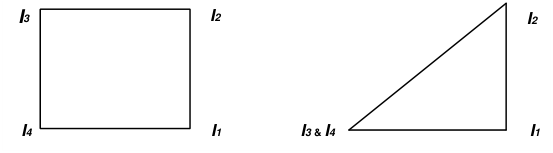
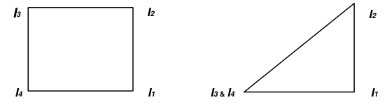
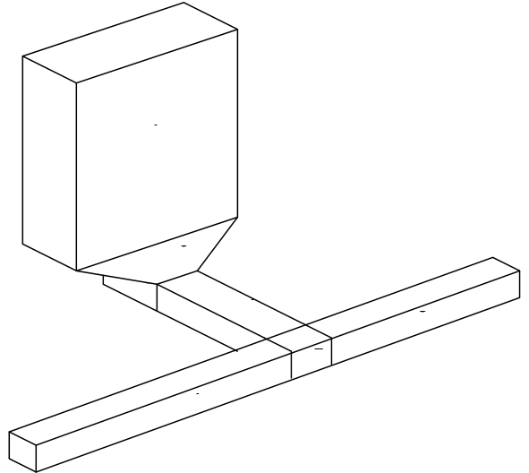
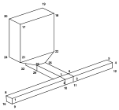
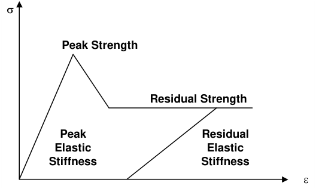

O formato INP é um arquivo de dados ASCII editável com a extensão ".INP".

Este é o formato de modelo recomendado do Map3D. Todas as funcionalidades do Map3D são compatíveis com este formato.

O arquivo é organizado em 7 seções:

1. Job Title

2. Control Parameters

3. Block Specification

4. Coordinate Specification

5. Material Property Specification

6. Grid Specification

7. Mining Step Specification

As linhas de comentário devem começar com um asterisco "*" na coluna 1.

Linhas em branco são ignoradas.

O comprimento máximo da linha é de 256 caracteres.

Vírgulas ou espaços podem ser usados para separar os campos de dados.

#### 1. Job Title

Esta seção permite ao usuário especificar um título descritivo para o projeto: deve ser especificada 1 linha de dados. Aspas não são necessárias. Apenas os primeiros 70 caracteres serão usados.

#### 2. Control Parameters

Esta seção permite ao usuário especificar os parâmetros de controle do trabalho.

#### _NLD,NIT,NPS RPAR,STOL AL,AG DOL,DON DOC,DOE,DOG,DOR_

Deve ser especificada 1 linha de dados. Todos os parâmetros devem aparecer em uma única linha.

Apenas os 7 primeiros parâmetros ( **_NLD,NIT,NPS  RPAR,STOL  AL,AG_** ) devem ser especificados. Os demais parâmetros receberão valores padrão, que podem ou não ser apropriados para sua aplicação.

Para uma descrição detalhada dos parâmetros, consulte CAD > Properties > Control Parameters

**_NPS_** Este item especifica o número de planos de simetria a serem usados na análise. Normalmente, nenhum plano de simetria é usado. Se a simetria for usada, as tensões de campo distante (Stress State) devem estar alinhadas com o eixo de simetria.

**_NPS_** =0   sem simetria **_NPS_** =1 _x_ &lt;=> _-x_ , a geometria é refletida no plano _y-z_ **_NPS_** =2 _x_ &lt;=> _-x_ e _y_ &lt;=> _-y_ , a geometria é refletida nos planos _y-z_ e _x-z_ **_NPS_** =3 _x_ &lt;=> _-x, y_ &lt;=> _-y_ e _z_ &lt;=> _-z_ , a geometria é refletida nos planos _y-z_ , _x-z_ e _x-y_

**_RPAR_** Durante o processo de solução da matriz, o parâmetro de relaxação é continuamente modificado pelo programa na tentativa de obter convergência com o menor número possível de iterações. Este parâmetro limita o valor máximo que será usado. O valor sugerido de 1.2 é recomendado para problemas bem condicionados. Para problemas muito mal condicionados, deve-se usar um valor de 0.8.

#### 3. Block Specification

Esta seção permite ao usuário definir a geometria do modelo. Os blocos 3D FF e os planos DD são construídos aqui.

**_N  'Block_Name' I_ 1** **_,I_ 2** **_,I_ 3** **_,I_ 4** **_I_ 5** **_,I_ 6** **_,I_ 7** **_,I_ 8** **_Type  Thickness,Width_**

Deve ser especificada 1 linha de dados por bloco.

Todos os parâmetros devem aparecer em uma única linha. Apenas os 5 primeiros parâmetros ( **_N I_ 1** **_,I_ 2** **_,I_ 3** **_,I_ 4** ) devem ser especificados. Use **_N_** =0 para encerrar a lista de blocos. Para uma descrição detalhada dos parâmetros, consulte

CAD > Build > Block

CAD > Build > FF Loop

#### CAD > Build > DD Loop

- **_N_** especifica o número da cor do bloco. Ele é usado para identificar este bloco ao definir os códigos de material e também para definir a cor do bloco na exibição gráfica. Devem ser usados números de cor diferentes para representar agrupamentos lógicos de blocos (p. ex., para diferentes níveis, seções ou unidades lógicas de lavra, como desenvolvimento, realce etc.). O maior número possível de blocos deve usar o mesmo número de identificação de bloco.

Há um total de 10 cores disponíveis para exibição. Elas são numeradas de

1 a 10, de 11 a 20, de 21 a 30 etc.,

de modo que a mesma cor é exibida para os números

1, 11, 21...,

- 2, 22, 32...,

3, 23, 33..., etc.

- **_'Block_Name'_** especifica um nome descritivo para o bloco (p. ex., realce 4540). O programa usará este nome ao fornecer informações sobre o volume do bloco, erros e avisos. O nome do bloco é opcional, mas, se usado, deve aparecer entre aspas simples. Apenas os primeiros 20 caracteres de qualquer nome de bloco serão usados.

- **_I_ 1** **_,I_ 2** **_,I_ 3** **_,I_ 4** **_I_ 5** **_,I_ 6** **_,I_ 7** **_,I_ 8** representam os números dos pontos de coordenadas que formam os cantos do bloco. Eles são descritos em detalhe a seguir.

- **_Type_** especifica qual tipo de elemento de contorno usar. Elementos inativos (98 para FF inativo e 99 para DD inativo) podem ser usados para exibir feições que devem ser incluídas apenas para fins de visualização e não usadas na análise de tensões propriamente dita.

- Para feições tridimensionais, como escavações, zonas de material alternativo, realces preenchidos etc., devem ser usados elementos de **_Type_** =1 (Força Fictícia).

- Os 4 primeiros cantos ( **_I_ 1** **_,I_ 2** **_,I_ 3** **_,I_ 4** ) representam os números de coordenadas que definem um lado (p. ex., a base) de um bloco de 6 faces. Os 4 cantos seguintes ( **_I_ 5** **_,I_ 6** **_,I_ 7** **_,I_ 8** ) definem o lado oposto do bloco (p. ex., o topo). Os cantos podem ser informados no sentido horário ou anti-horário. Qualquer um dos cantos pode ser repetido para definir formas de 3 lados e cunhas. Os blocos podem ser interligados para formar formas de escavação maiores e mais complexas, usando números de coordenadas comuns para especificar blocos adjacentes.

- Se desejado, as superfícies podem ser construídas com superfícies de 3 ou 4 lados, usando apenas os 4 primeiros cantos ( **_I1,I2,I3,I4_** ). Os 4 cantos seguintes ( **_I5,I6,I7,I8_** ) devem ser especificados como zeros. Os cantos podem ser informados no sentido horário ou anti-horário. Qualquer um dos cantos pode ser repetido para definir formas de 3 lados e cunhas.

- Essas superfícies podem ser interligadas para formar formas de escavação maiores e mais complexas, usando números de coordenadas comuns para especificar placas adjacentes. O usuário deve ter cuidado para garantir que sejam construídas superfícies completamente fechadas, sem deixar buracos ou placas faltando.

- Elementos de **_Type_** =2 (Descontinuidade de Deslocamento) devem ser usados para escavações de lavra tabular, fraturas e planos de falha.

- As superfícies são construídas com superfícies de 3 ou 4 lados, usando apenas os 4 primeiros cantos ( **_I_ 1** **_,I_ 2** **_,I_ 3** **_,I_ 4** ). Os 4 cantos seguintes ( **_I_ 5** **_,I_ 6** **_,I_ 7** **_,I_ 8** ) devem ser especificados como zeros. Os cantos podem ser informados no sentido horário ou anti-horário. Qualquer um dos cantos pode ser repetido para definir formas de 3 lados e cunhas.

- Essas superfícies podem ser interligadas para formar formas maiores e mais complexas, usando números de coordenadas comuns para especificar superfícies adjacentes.

- **_Thickness_** Este parâmetro é usado apenas em elementos do tipo 2 (descontinuidade de deslocamento), nos quais especifica a espessura aparente do material de preenchimento (ou seja, material de preenchimento de falha, largura da camada, largura de lavra ou altura do pilar). O deslocamento normal (fechamento) desta feição quando preenchida será limitado a esta espessura. Além disso, o deslocamento normal (fechamento) e o deslocamento cisalhante (deslizamento) são divididos pela _Thickness_ para determinar a deformação que ocorre no material de preenchimento. Este parâmetro deve ser especificado nas mesmas unidades usadas para especificar as posições das coordenadas (ou seja, metros ou pés).

- **_Width_** especifica a largura máxima permitida.

- Este parâmetro pode ser usado para forçar uma discretização uniforme nas entidades selecionadas. Deve-se ter extremo cuidado ao especificar este valor, pois um valor pequeno pode facilmente levar a um problema de tamanho enorme.

- Em geral, este parâmetro deve ser deixado em branco (ou seja, não utilizado), e a discretização deve ficar a cargo dos parâmetros **_AL_** e **_AG_**. Esses últimos parâmetros concentram elementos apenas onde os resultados da análise são solicitados, otimizando o uso de elementos e minimizando o tamanho do problema.

- Para um exemplo do uso deste parâmetro, consulte Tabular Mining Example.

#### Um exemplo simples

Para ilustrar o uso da construção de modelos com blocos construtivos tridimensionais, considere a construção de uma configuração simples de ponto de extração. Este modelo foi montado com 7 blocos. Os blocos 1, 2 e 3 formam a galeria de extração, o bloco 4 forma o travessão, os blocos 5 e 6 representam o ponto de extração e o bloco 7 representa o realce. O Map3D reconhece e exclui as superfícies comuns a blocos adjacentes.

Muitos blocos podem compartilhar o mesmo número de bloco (cor), o que permite usar um grupo de blocos para construir formas de escavação complexas. Uma consideração importante aqui é que o menor número possível de números de bloco deve ser usado, pois todas as superfícies entre blocos com números de bloco diferentes serão mantidas no banco de dados.

Os números de coordenadas da mesma configuração de ponto de extração são necessários se você quiser construir o modelo usando a especificação do arquivo de entrada do Map3D. Os blocos seriam numerados da seguinte forma:

- Block Specification

- N 'Block Name' I1,I2,I3,I4 I5,I6,I7,I8 Type,Thic,Width

- 1 'Block 1' 1 2 7 8 9 10 15 16 1 0 0

- 1 'Block 2' 2 3 6 7 10 11 14 15 1 0 0

- 1 'Block 3' 3 4 5 6 11 12 13 14 1 0 0

- 1 'Block 4' 7 6 26 25 15 14 30 29 1 0 0

- 2 'Block 5' 25 26 27 28 29 30 31 32 1 0 0

- 2 'Block 6' 21 22 23 24 25 26 27 28 1 0 0

- 2 'Block 7' 17 18 19 20 21 22 23 24 1 0 0

0

#### 4. Coordinate Specification

Esta seção permite ao usuário especificar as localizações das coordenadas usadas para definir os cantos de blocos, planos DD e planos de grade.

#### _M X,Y,Z_

Deve ser especificada 1 linha de dados por ponto de coordenada. Todos os parâmetros devem aparecer em uma única linha. Todos os 4 parâmetros ( **_M X,Y,Z_** ) devem ser especificados. Use N=0 para encerrar a lista de coordenadas.

**_M_** Este parâmetro é o número da coordenada. As coordenadas podem ser informadas em qualquer ordem desejada.

- **_X,Y,Z_** Estes parâmetros representam a localização da coordenada. Recomenda-se usar **_X_** para Leste, **_Y_** para Norte e **_Z_** para a cota (positiva para cima). Os valores devem ser especificados em unidades de comprimento (metros ou pés).

#### 5. Material Property Specification

Esta seção permite ao usuário especificar as propriedades de cada material usado no modelo. As propriedades de cada material são definidas em grupos de três linhas que especificam, respectivamente, o estado de tensões, os parâmetros constitutivos e os parâmetros de resistência.

**_M_ sa, sb, sc   Dsa, Dsb, Dsc** **_Ta,Pa,Tc   Datum   t/h_ ,D** **_t/h Mt   E_ p** **_,E_ r** **_v_ p** **_,v_ r** **_G_ n** **_,G_ s** **_A,C   'Material Name'_**

#### _Mf T_ o p , _T_ o r _UCS_ p , _UCS_ r _Cohesion_ p , _Cohesion_ r fp , fr fi

Para uma descrição detalhada dos parâmetros, consulte CAD > Properties > Material Properties

- Devem ser especificadas 3 linhas de dados por material; use _N=0_ para encerrar a lista.

#### Material Property Specification - Line 1 - Stress State

Esta linha de dados define o estado de tensões inicial do material número **_N_** . O material número 1 é reservado para o maciço rochoso hospedeiro.

**_M_ sa, sb, sc   Dsa, Dsb, Dsc** **_Ta,Pa,Tc   Datum   t/h_ ,D** **_t/h_**

Deve ser especificada 1 linha de dados numéricos por material. Todos os parâmetros devem aparecer em uma única linha. Apenas os 4 primeiros parâmetros ( **_M_ sa, sb, sc** ) devem ser especificados. Para uma descrição detalhada dos parâmetros, consulte Stress State

#### Material Property Specification - Line 2 - Constitutive Properties

As propriedades constitutivas são especificadas de cinco maneiras diferentes,

**_Mt_ =1** **_E_ p** **_,E_ r** **_v_ p** **_,v_ r** **_G_ n** **_,G_ s** **_0,0   A,C   'Material Name'_**

- em que **_E_ p** **_,E_ r** **_v_ p** **_,v_ r** representam, respectivamente, os valores de pico e residuais do módulo de Young (escala de maciço rochoso - deformação) e do coeficiente de Poisson

#### _E_ = 9 _BS_ /(3 _B_ + _S_ )

#### _v_ = (3 _B_ -2 _S_ )/(6 _B_ +2 _S_ )

**_G_ n** **_,G_ s** representam, respectivamente, os módulos viscosos normal e cisalhante,

- **_A,C_** representam, respectivamente, o coeficiente de expansão e a condutividade (usados apenas no Map3D Thermal-Fluid Flow).

Para mais detalhes, consulte

**Mohr-Coulomb in 3D FF Blocks**

**Mohr-Coulomb in DD Planes**

- **_Mt_ =2** **_B_ p** **_,B_ r** **_S_ p** **_,S_ r** **_G_ n** **_,G_ s** **_0,0   A,C   'Material Name'_**

   - em que **_B_ p** **_,B_ r** **_S_ p** **_,S_ r** representam, respectivamente, os valores de pico e residuais dos módulos volumétrico e de cisalhamento,

**_B_ =** **_E_ (1-2** **_v_ )/3**

**_S_ =** **_E_ / [ 2(1+** **_v_ ) ]**

**_G_ n** **_,G_ s** representam, respectivamente, os módulos viscosos normal e cisalhante,

   - **_A,C_** representam, respectivamente, o coeficiente de expansão e a condutividade (usados apenas no Map3D Thermal-Fluid Flow).

- **_Mt_ =3** **_Kn_ p** **_,Kn_ r** **_Ks_ p** **_,Ks_ r** **_G_ n** **_,G_ s** **_0,0   A,C   'Material Name'_**

   - em que **_Kn_ p** **_,Kn_ r** **_Ks_ p** **_,Ks_ r** representam, respectivamente, os valores de pico e residuais da rigidez normal e cisalhante,

#### _K_ n = _N/Thickness K_ s = _S/Thickness_

**_G_ n** **_,G_ s** representam, respectivamente, os módulos viscosos normal e cisalhante,

- **_A,C_** representam, respectivamente, o coeficiente de expansão e a condutividade (usados apenas no Map3D Thermal-Fluid Flow).

Este tipo de material só pode ser usado em planos DD.

**_Mt_ =4** **_N_ p** **_,N_ r** **_S_ p** **_,S_ r** **_G_ n** **_,G_ s** **_B,Et   A,C   'Material Name'_**

- em que **_N_ p** **_,N_ r** **_S_ p** **_,S_ r** representam, respectivamente, os valores de pico e residuais dos módulos normal e de cisalhamento,

- **_G_ n** **_,G_ s** representam, respectivamente, os módulos viscosos normal e cisalhante,

- **_A,C_** representam, respectivamente, o coeficiente de expansão e a condutividade (usados apenas no Map3D Thermal-Fluid Flow).

Este tipo de material só pode ser usado em planos DD.

Para mais detalhes, consulte **Fault-Gouge in DD planes**

**_Mt_ =5** **_N_ p** **_,N_ r** **_S_ p** **_,S_ r** **_G_ n** **_,G_ s** **_B,Et   A,C   'Material Name'_**

- em que **_N_ p** **_,N_ r** **_S_ p** **_,S_ r** representam, respectivamente, os valores de pico e residuais dos módulos normal e de cisalhamento,

- **_G_ n** **_,G_ s** representam, respectivamente, os módulos viscosos normal e cisalhante,

- **_B,Et_** representam, respectivamente, o limite de compressão e a deformação de transição,

- **_A,C_** representam, respectivamente, o coeficiente de expansão e a condutividade (usados apenas no Map3D Thermal-Fluid Flow).

Este tipo de material só pode ser usado em planos DD. Para mais detalhes, consulte **Backfill-Hyperbolic in DD planes**

Para o maciço rochoso hospedeiro e para zonas não homogêneas envolvidas por elementos FF, o valor de **_Mt_** deve ser 1 ou 2. Para material de preenchimento colocado em elementos DD, qualquer valor de **_Mt_** pode ser usado.

Na análise elástica, apenas o valor de pico é usado. Na análise não linear (deslizamento de falha ou escoamento do material no Map3D Non-Linear), o valor residual só é usado depois que o material escoa.

#### Material Property Specification - Line 3 - Strength Parameters

Deve ser especificada 1 linha de dados numéricos por material.

Todos os parâmetros devem aparecer em uma única linha.

Todos os parâmetros devem ser especificados se **_Mf_** for diferente de zero. Os parâmetros de resistência podem ser especificados de quatro maneiras diferentes:

#### _Mf_ =0

Nenhum critério de ruptura é usado.

**_Mf_ =1** **_To_ p** **_,To_ r** **_UCS_ p** **_,UCS_ r** **_Cohesion_ p** **_,Cohesion_ r wp** **_,_ wr wi**

Esses parâmetros são definidos em detalhe em

**Mohr-Coulomb in 3D FF Blocks**

**Mohr-Coulomb in DD Planes**

**_Mf_ =2** **_To_ p** **_,To_ r sc p** **_,_ sc r** **_m_ p** **_,m_ r** **_s_ p** **_,s_ r** Esses parâmetros são definidos em detalhe em

**Hoek-Brown in 3D FF Blocks**

#### _Mf_ =3 _To_ p _,To_ r _UCS_ p _,UCS_ r _Cohesion_ p _,Cohesion_ r wp _,_ wr

Esses parâmetros são definidos em detalhe em

**Drucker-Prager in 3D FF Blocks**

#### 6. Grid Specification

Esta seção permite ao usuário definir a localização dos planos de grade onde os resultados da análise serão calculados.

**_N  'Gird_Name' I_ 1** **_,I_ 2** **_,I_ 3** **_,I_ 4** **_I_ 5** **_,I_ 6** **_,I_ 7** **_,I_ 8** 0,0,0,0

**_N  'Grid_Name' I_ 1** **_,I_ 2** **_,I_ 3** **_,I_ 4** **_I_ 5** **_,I_ 6** **_,I_ 7** **_,I_ 8** **_Type  Thickness,Width_**

Deve ser especificada 1 linha de dados por bloco.

Todos os parâmetros devem aparecer em uma única linha.

Use **_N_** =0 para encerrar a lista de grades.

- **_N_** Este parâmetro é o número da grade. As grades devem ser numeradas consecutivamente a partir de 1, mas podem ser informadas em qualquer ordem desejada.

**_I3 I2_**

**_I4 I1_**

- **_'Grid_Name'_** Este parâmetro permite ao usuário especificar um nome descritivo para a grade (p. ex., grade da lapa superior através do realce 4540). O programa usará este nome ao fornecer informações sobre a grade. O nome da grade é opcional, mas, se usado, deve aparecer entre aspas simples. Apenas os primeiros 20 caracteres de qualquer nome de grade serão usados.

- **_I_ 1** **_,I_ 2** **_,I_ 3** **_,I_ 4** Estes parâmetros representam os números dos pontos de coordenadas que formam os cantos da grade.

As grades são construídas com planos de 4 lados. Os cantos podem ser informados no sentido horário ou anti-horário.

**_I_ 5** **_,I_ 6** **_,I_ 7** **_,I_ 8** Estes parâmetros não são usados e devem ser especificados como zeros. **_Thickness_** Este parâmetro não é usado e deve ser especificado como zero. **_Spacing_** especifica o espaçamento máximo permitido.

- Este parâmetro pode ser usado para forçar uma discretização uniforme na grade. Deve-se ter extremo cuidado ao especificar este valor, pois um valor pequeno pode facilmente levar a um problema de tamanho enorme.

- Em geral, este parâmetro deve ser definido como zero (ou seja, não utilizado), e a discretização deve ficar a cargo dos parâmetros **_AL_** e **_AG_**. Esses últimos parâmetros concentram elementos apenas onde os resultados da análise são solicitados, otimizando o uso de elementos e minimizando o tamanho do problema.

#### 7. Mining Step Specification

Este item permite ao usuário especificar o código de material a ser atribuído às entidades selecionadas em cada etapa de lavra.

#### _'Mining_Step_Title'_

#### _N, Mc_

Deve ser especificada 1 linha de dados numéricos por especificação de bloco.

Todos os parâmetros devem aparecer em uma única linha.

Devem ser especificados 2 parâmetros ( **_N,Mc_** ).

A sequência de lavra é definida especificando-se repetidamente uma lista de códigos de material. Cada lista é encerrada usando **_N_** =0. Em cada etapa de lavra, apenas os códigos de material que mudam precisam ser especificados. Os blocos permanecerão inativos até que um código de material seja atribuído.

Blocos que nunca recebem um código de material serão atribuídos ao tipo de bloco 98 ou 99 (ou seja, inativo); esses blocos serão incluídos no banco de dados apenas para fins de visualização, não serão usados na análise, e também não serão criadas interseções para essas superfícies.

- **_'Mining_Step_Title'_** Este parâmetro permite ao usuário especificar um nome descritivo para cada etapa de lavra. O programa usará este nome ao fornecer informações sobre a etapa de lavra. É opcional, mas, se usado, deve aparecer entre aspas simples.

- **_N_** Este parâmetro é o número de identificação do bloco usado para identificar quais blocos recebem o código de material especificado. Eles podem ser informados em qualquer ordem desejada. 0 especifica o fim de cada lista de etapa de lavra.

**_Mc_** Este parâmetro define o código de material do bloco. **_Mc_** _=0_ tensões superficiais iguais a zero. Isso normalmente é usado para indicar superfícies de escavação livres de tensão.

**_Mc=-M_** Um número de material negativo insere (aplica) o estado de tensões inicial do material como condição de contorno. Isso permite especificar quaisquer condições de carregamento de superfície desejadas. Na prática, equivale a inserir um material de rigidez zero, que, portanto, não pode acumular nem dissipar tensão. Isso normalmente é usado para indicar escavações com algum estado de tensões interno devido a suporte do terreno, preenchimento ou pressurização ativa.

Na maioria das análises, o maciço hospedeiro é tão rígido em comparação com o preenchimento que a quantidade de tensão acumulada ou dissipada é insignificante. A exceção seria a deformação não linear do material ou áreas de grande fechamento.

**_Mc=+M_** Um número de material positivo **_M_** especifica a inserção do material número **_M_** no estado de tensões inicial especificado para esse material. O material é colocado com o estado de tensões de partida igual ao estado de tensões inicial do material e, em seguida, pode acumular ou dissipar tensão com a deformação. A quantidade de variação de tensão dependerá da rigidez do material inserido. Esta opção é usada para atribuir propriedades de material alternativas a zonas definidas por blocos do tipo 1, ou para colocar material de preenchimento de falha ou de aterro em elementos do tipo 2 (descontinuidades de deslocamento), a fim de simular falhas ou zonas de lavra tabular preenchidas.

- Um exemplo simples que ilustra este recurso é dado na tabela a seguir:

* Mining Step Specification * Mining Step #1 * N,Mc

'Block #1 is assigned properties of Ore Material #2' 1   2 0

'Block #1 is excavated'

1   0 0 'Block #1 is backfilled with Material #3' 1   3 0
