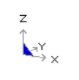
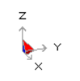

O sentido dos eixos do modelo é indicado por um ícone de orientação localizado no canto inferior esquerdo da tela. Esse ícone indica a direção dos eixos (X para Leste, Y para Norte e Z para cima).

Na vista acima, o eixo Y aponta principalmente para dentro da tela e um pouco para a direita, o eixo X aponta principalmente para a direita e um pouco para fora da tela, e o eixo Z aponta diretamente para cima. Observe que o lado de trás do ícone está sombreado em azul.

Na vista acima, o eixo Y aponta principalmente para a direita e um pouco para dentro da tela, o eixo X aponta principalmente para fora da tela e um pouco para a direita, e o eixo Z aponta diretamente para cima. Observe que o interior do ícone está sombreado em vermelho.

Há três modelos de rotação selecionáveis:

1. As rotações podem ser aplicadas à geometria atual. Este modo permite horizontes não horizontais

2. As rotações podem ser aplicadas de modo que o horizonte permaneça sempre horizontal, supondo que o eixo Z+ aponte para cima (Tools > Global Transform Z+ up). Isso faz com que a rotação com o mouse ocorra de forma oposta à de Tools > Global Transform Z- up.

3. As rotações podem ser aplicadas de modo que o horizonte permaneça sempre horizontal, supondo que o eixo Z- aponte para cima (Tools > Global Transform Z- up).

Isso faz com que a rotação com o mouse ocorra de forma oposta à de Tools > Global Transform Z+ up. É possível girar o modelo mantendo pressionado o botão esquerdo do mouse e aguardando o ponteiro de arraste

aparecer; em seguida, arraste o ícone de orientação até a posição desejada. Arrastar para cima ou para baixo gira o modelo para cima ou para baixo. Perto da parte inferior da tela, arrastar para a esquerda ou para a direita gira o modelo para a esquerda ou para a direita. Perto da parte superior da tela, arrastar para a esquerda ou para a direita gira o modelo no sentido anti-horário ou horário. Esta operação pode ser personalizada em Tools > Rotation Toolbar.

O modelo também pode ser girado com controles de tela sensível ao toque, arrastando 1 ou 2 dedos pela tela e fazendo o movimento de pinça para dar zoom. Esta operação pode ser personalizada em Tools > Rotation Toolbar.

Observações:

Antes de girar o modelo, você deve definir o centro de rotação desejado

#### View > Centre

Você pode ajustar o tempo de espera do arraste em

#### Tools > Drag Wait Time

As operações de rotação e translação podem ser repetidas automaticamente digitando n# antes de selecionar a operação. Por exemplo, para produzir uma exibição animada de um gráfico de tensões, especifique

Plot > Options > Persist Plot > Stress > Sigma:1 View > Rotation Increment > 10 digite 35# no teclado

selecione girar para a direita (na barra de ferramentas de rotação ou com a tecla PageDown)

Pressione a tecla Esc para cancelar a animação.

Digitar 0# repete a operação indefinidamente. Pressione a tecla Esc para interromper.

Tópicos relacionados:

Translação do modelo Selecionar posições de vista especiais

#### Índice

#### - 0 -

Arquivos 001 002 ...     510, 600

**- 3 -**

Formas de escavação 3D     27, 29, 30

#### - A -

Interrupção de uma análise do Map3D     461 Sobre o Map3D     2 Deformação absoluta     223, 299 Tensão absoluta     209, 299 Precisão     45, 308, 381, 462, 482 AG - espaçamento da malha     45, 300, 301, 302, 308, 381, 462 AL - tamanho do elemento     45, 300, 301, 308, 381, 462 Zonas de material alternativo     30

Caixa de diálogo Analysis     172, 308, 328, 381, 461, 462, 463, 464, 465, 489, 490

Caixa de diálogo Analysis Options     329, 465, 466, 467, 468, 469, 471, 473, 477, 478, 482, 484, 485, 486, 487, 489

Resultados da análise     164, 171, 172, 173, 186, 510, 524, 600

Tempo de análise     45, 308, 381, 462 Animação     184, 508 Aplicações do Map3D     11 Modelos conforme construídos (as-built)     27 Discretização automatizada     45, 300, 301, 302, 308, 381, 462 Valor médio dos pontos de contorno     317

#### - B -

Preenchimento com aterro     30, 33, 477, 487 Execução de análises em lote     466

Análise BEM     317, 390, 433, 461, 462, 465, 466, 467, 469, 471, 473, 477, 478, 482, 484, 485, 486, 487, 489, 490, 569, 594, 595, 597, 598

Exportação da tela em bitmap     173, 174, 184, 185, 508 Modelos de blocos     29, 30 BMP     173, 174, 184, 508 Interseções booleanas     467 Método dos Elementos de Contorno     12, 13, 477, 482, 487, 570

Barra de ferramentas Build     331, 335, 341, 348, 358, 360, 362, 364, 365, 366, 367, 368, 369, 436, 494, 507 Construção de blocos FF 3D     331, 335, 341, 348, 364, 365, 366, 367, 368, 369, 390, 394, 395, 397, 398, 400, 402, 407, 408, 410, 412, 413, 415, 416, 418, 421, 423 Construção de linhas de construção     362, 364, 365, 366, 367, 368, 369, 498

Construção de planos DD     331, 335, 341, 348, 364, 365, 366, 367, 368, 369, 390, 394, 395, 397, 398, 400, 402, 407, 408, 410, 412, 413, 415, 416, 418, 421, 423

Construção de linhas de malha de pontos de campo     358, 360 Construção de planos de malha de pontos de campo     358, 360, 364, 365, 366, 367, 368, 369, 494, 496

Construção de linhas e planos de pontos de campo     364, 365, 366, 367, 368, 369

Construção de túneis     331, 335, 341, 348, 364, 365, 366, 367, 368, 369 Lavra em massa - Tutorial de construção de modelos     85

#### - C -

CAD     426, 427, 428, 429 CAD > Build     331, 335, 341, 348, 358, 360, 362, 364, 365, 366, 367, 368, 369 CAD > Build menu     494, 507

CAD > Edit     390, 394, 395, 397, 398, 400, 402, 407, 408, 410, 412, 413, 415, 416, 418, 421, 423 CAD > Edit menu     495, 496, 498 CAD > Properties     308, 317, 381, 390 CAD > Properties menu     313, 314, 386, 387 CAD > Propertiesu     313, 386 CAD > Snap     369, 370, 371, 372, 373, 376, 377, 378, 379

CAD > Snap menu     494 CAD menu     303, 425 Barra de ferramentas CAD     436, 494, 507

Deformação cartesiana     221 Tensão cartesiana     208 Limpeza dos dados de linhas de construção     169 Limpeza dos dados do modelo     165 Verificação de fechamento e sobreposição     467 Matriz de coeficientes     471, 484, 485, 487 Problemas comuns na construção de modelos     39 Concluir a análise atual     489, 490 Realização de uma análise de tensões por BEM     462 Realização de uma análise no Map3D     328 Configuração de barras de ferramentas     196, 432, 433, 434, 435, 436 Modo console     466 Dados de linhas de construção     169, 170, 171, 508, 510, 511 Análise de contatos e interseções     464 Opções de gráfico de contornos     304 Faixa de contornos     302 Barra de ferramentas de contornos     432, 433, 594, 595, 597, 598 Cópia de dados do modelo     397 Fluência elasto-viscoplástica     469 Fonte personalizada dos botões     439 Cores personalizadas     437, 438, 439

**- D -**

Espessura do plano DD     496 Planos DD     27, 35, 36 Buffer de profundidade     440, 441 Deswick     511 Suporte a mesa digitalizadora     426, 502 Análise de discretização     462, 484, 485, 569 Discretização e agrupamento (lumping)     45, 300, 301, 302, 308, 381, 462 Exibição da vista discretizada     600 Discretização de um modelo     462 Teste de desempenho de disco     441 Requisitos de espaço em disco     45, 308, 381, 462, 484, 485 Componentes de deslocamento     224 Elementos de descontinuidade de deslocamento     27, 35, 36 Barra de ferramentas Displacement     224 Exibir uma imagem de tela salva     184, 185, 508

Soluções divergentes     45, 300, 301, 308, 381, 462 DOC - agrupamento de matriz     45, 300, 301, 308, 381, 462 DOE - agrupamento de elementos     45, 308, 381, 462 DOG - agrupamento de malha     45, 308, 381, 462 DOL - precisão da solução     45, 300, 301, 302, 308, 381, 462 DON - condicionamento da matriz     45, 300, 301, 308, 381, 462 DOR - razão de aspecto do elemento     45, 308, 381, 462 Rotação do modelo por arraste     431, 601 Translação do modelo por arraste     431, 599 Zoom do modelo por arraste     431, 599 Drucker-Prager em blocos FF 3D     232, 238, 240, 243, 246, 248, 251, 254, 256, 533 Exportação dos resultados da análise     175, 180 Exportação da imagem da tela     173, 174, 175, 508 Formato de arquivo DXF de linhas de construção     510, 511 Exportação da tela em DXF     174 Formato de arquivo DXF de modelo     511, 525 Formato de arquivo DXF de imagem de tela     174

**- E -** Barra de ferramentas Edit     390, 394, 395, 397, 398, 400, 402, 407, 408, 410, 412, 413, 415, 416, 418, 421, 423, 436, 495, 496, 498, 499, 501 Edição de dados do modelo     390, 430, 495, 496, 498, 499, 501 Tensão efetiva     209 Deformação elástica     222, 298 Fluência elasto-viscoplástica     469 Agrupamento de elementos (lumping)     45, 300, 301, 308, 381, 462 Tamanho do elemento     45, 300, 301, 308, 381, 462 Cálculo da taxa de liberação de energia     478 Exclusão de dados do modelo     394 ESS     200, 202, 203, 205 Arquivos EVP     443, 446 Tensão excedente     232, 238, 240, 243, 246, 248, 251, 254, 256, 259, 263, 265, 266, 268, 272, 276, 526, 531, 533, 535, 547, 556, 595 Coeficiente de expansão e condutividade     568 EXTENDED ENTITY DATA     511 Extrusão de planos em blocos     365

#### - F -

Critério de ruptura     232, 238, 240, 243, 246, 248, 251, 254, 256, 259, 263, 265, 266, 268, 272, 276, 526, 531, 533, 535, 547, 556, 595

Especificação do estado de tensão em campo distante     503, 505 Planos de falha     36 Fault-Gouge em planos DD     259, 263, 265, 266, 268, 272, 276, 535

Elementos de força fictícia     27, 29 File > Output menu     173, 174, 175, 180 File menu     164, 165, 166, 167, 168, 169, 170, 171, 172, 173, 184, 185, 186, 507, 508, 524, 525 Localizar um ponto de coordenadas específicas no modelo     195 Componentes de fluxo     230 Leis de fluxo     526, 535, 547, 556, 568 Barra de ferramentas Flow     230 Análise de fluxo de fluido/térmico     568 Desenho a mão livre - Tutorial de construção de modelos     60

Hyperbolic-Backfill em planos DD     259, 263, 265, 266, 268, 272, 276, 556

#### - I -

Especificação do estado de tensão in situ     503, 505 Blocos inativos     39 Deformação induzida     223, 299 Tensão induzida     209, 299 Especificação do estado de tensão inicial     503, 505 Inicializar todos os parâmetros de visualização     195 Formato de arquivo INP de modelo     515, 525

No plano     259, 263, 265, 266, 268, 272, 276 Deformação no plano     213, 215, 216, 218 Tensão no plano     200, 202, 203, 205 Interpretação dos resultados     15, 23, 478 Análise de interseções     464, 467, 468, 485, 569 Introdução     2

#### - J -

#### - G -

GIF     173, 174, 184, 508

Ir para os gráficos na etapa atual da análise     463 Ir para a etapa de construção e edição do modelo     463 Agrupamento de malha (lumping)     45, 300, 301, 302, 308, 381, 462 Seleção de malha     303, 425, 436

Espaçamento da malha     45, 300, 301, 302, 308, 381, 462 Superfície do terreno     35 Agrupamento de dados do modelo     408

#### - H -

Help menu     456, 457

Remoção de superfícies ocultas     440, 441 Barra de ferramentas Hide Block Colours     189, 190, 196, 435 Barra de ferramentas Hide Cline Colours     190 Barra de ferramentas Hide Construction Line Colours     190, 196, 435 Barra de ferramentas Hide     186, 196, 435 Ocultação de partes do modelo     186 Hoek-Brown em blocos FF 3D     232, 238, 240, 243, 246, 248, 251, 254, 256, 531

JPEG     173, 174, 184 JPG     173, 174, 184

#### - L -

Locação do Map3D     2

Limitações e deficiências     15

Carregamento de um modelo a partir de um arquivo     164, 165, 167, 464, 507, 525

Carregamento de resultados da análise a partir de um arquivo recente     186

Carregamento de resultados da análise a partir de um diretório usado recentemente 524

Carregamento de resultados da análise a partir de um arquivo de reinício     164, 171 Carregamento de dados de linhas de construção a partir de um arquivo     169, 170 Carregamento de dados do modelo a partir de um diretório usado recentemente 524

Carregamento de dados do modelo a partir de um arquivo usado recentemente     186 Cálculo da rigidez do sistema de carregamento     478 Cálculo local da taxa de liberação de energia     478 Agrupamento (lumping) e discretização     45, 300, 301, 302, 308, 381, 462

#### - M -

Map3D     2, 9, 11, 12, 13, 569, 570 Opções de análise do Map3D     329 Map3Di     314, 387, 453 Códigos de material     33 Especificação das propriedades dos materiais     313, 386, 464, 503, 505, 526, 531, 533, 535, 547, 556, 568 Condicionamento da matriz     45, 300, 301, 308, 381, 462 Agrupamento de matriz (lumping)     45, 300, 301, 308, 381, 462 Solução da matriz     465, 467, 486 Deformação de cisalhamento máxima     212 Tensão de cisalhamento máxima     199 Tensão média     207 Valor médio dos pontos de contorno     317 Comandos de menu - Caixa de diálogo Analysis     172, 308, 381, 461, 462, 463, 464, 465, 489, 490 Comandos de menu – Caixa de diálogo Analysis     328 Comandos de menu - Caixa de diálogo Analysis Options 465, 466, 467, 468, 469, 471, 473, 477, 478, 482, 484, 485, 486, 487, 489 Comandos de menu – Caixa de diálogo Analysis Options 329

Comandos de menu - CAD     426, 427, 428, 429 Comandos de menu - CAD > Build     331, 335, 341, 348, 358, 360, 362, 364, 365, 366, 367, 368, 369 Comandos de menu - CAD > Build menu     494, 507 Comandos de menu - CAD > Edit     390, 394, 395, 397, 398, 400, 402, 407, 408, 410, 412, 413, 415, 416, 418, 421, 423

Comandos de menu - CAD > Edit menu     495, 496, 498 Comandos de menu - CAD > Properties     308, 313, 314, 317, 381, 386, 387, 390 Comandos de menu - CAD > Snap     369, 370, 371, 372, 373, 376, 377, 378, 379 Comandos de menu - CAD > Snap menu     494 Comandos de menu - CAD menu     303, 425 Comandos de menu  File     169, 170 Comandos de menu - File     164, 165, 166, 167, 168, 169, 171, 172, 173, 184, 185, 186 Comandos de menu - File > Output     173, 174, 175, 180 Comandos de menu - File menu     507, 524, 525 Comandos de menu - Help menu     456, 457

Comandos de menu - Plot     302 Comandos de menu - Plot > Displacement     224 Comandos de menu - Plot > Flow     230 Comandos de menu - Plot > Miscellaneous     302 Comandos de menu - Plot > Properties     308, 313, 317, 381, 386, 390

Comandos de menu - Plot > Strain     210, 212, 213, 215, 216, 218, 220, 221, 222, 223, 226, 298, 299 Comandos de menu - Plot > Strength Factors     232, 238, 240, 243, 246, 248, 251, 254, 256, 259, 263, 265, 266, 268, 272, 276

Comandos de menu - Plot > Stress     198, 199, 200, 202, 203, 205, 207, 208, 209, 226, 299

Comandos de menu - Plot > Surface Components     279, 280, 281, 282, 283, 284, 285, 286, 287, 292, 294, 295, 296, 297, 298, 300, 301

Comandos de menu - Plot menu     594, 595, 597, 598 Comandos de menu – Plot menu     304, 317 Comandos de menu - Seismic     443, 446, 453, 456, 492 Comandos de menu - Tools     196, 430, 431, 432, 433, 434, 435, 436, 437, 438, 439, 440, 441, 442 Comandos de menu – Tools menuComandos de menu - ToolsTools menu     439

Comandos de menu - View > Find Coordinate     195 Comandos de menu - View > Hide     186 Comandos de menu - View > Hide Block Colours     189, 190

Comandos de menu - View > Hide Cline Colours     190 Comandos de menu - View > Initialize     195 Comandos de menu - View > Length     196, 435 Comandos de menu - View > Pan     196, 435 Comandos de menu - View > Render     192, 194, 600 Comandos de menu - View > Zoom     196, 435 Comandos de menu - View > Zoom Extents     195 Comandos de menu - View menu     196, 197 Comandos de menu -File menu     508 Mesclar superfícies adjacentes     468 Mesclar pontos de coordenadas próximos entre si 467 Mesclagem de dados do modelo     507, 525 Projeto de mina     23 Seleção da etapa de lavra     173 Sequência de etapas de lavra     33

Construção de modelos     12, 27, 29, 30, 33, 35, 36, 39, 60, 85, 106, 314, 331, 335, 341, 348, 358, 360, 362, 387, 390, 394, 395, 397, 398, 400, 402, 407, 408, 410, 412, 413, 415, 416, 418, 421, 423, 426, 463, 467, 468, 485, 486, 494, 496, 498, 507, 525 Dados do modelo     164, 165, 166, 167, 168, 186, 314, 387, 464, 467, 486, 507, 509, 511, 515, 524, 525, 569 Ícone de orientação do modelo     601 Mohr-Coulomb em blocos FF 3D     232, 238, 240, 243, 246, 248, 251, 254, 256, 526 Mohr-Coulomb em planos DD     259, 263, 265, 266, 268, 272, 276, 547 Deslocamento de pontos de campo muito próximos de superfícies de contorno     473 Movimentação de dados do modelo     395, 412, 413, 415, 416, 418

#### - N -

Modelagem numérica     9, 11, 12, 13, 15, 23

#### - O -

Exportação da tela em OBJ     175 Formato de arquivo OBJ de imagem de tela     175 Deformação de cisalhamento octaédrica     220 Tensão de cisalhamento octaédrica     207 Cavas a céu aberto     36 OpenGL     440, 441 Zonas de minério     27, 29, 30 Visão geral do Map3D     9 Visão geral da construção de modelos     12

#### - P -

Estudos paramétricos     15 Exportação da tela em PDF 3D     175 Formato de arquivo PDF 3D de imagem de tela     175 Tamanho da caixa de seleção     442 Deformação plástica     222, 298 Plot > Displacement     224 Plot > Flow     230 Plot > Miscellaneous     302 Plot > Properties     308, 313, 317, 381, 386, 390

Plot > Properties menu     313, 386

Plot > Strain     210, 212, 213, 215, 216, 218, 220, 221, 222, 223, 226, 298, 299 Plot > Strength Factors     232, 238, 240, 243, 246, 248, 251, 254, 256, 259, 263, 265, 266, 268, 272, 276 Plot > Stress     198, 199, 200, 202, 203, 205, 207, 208, 209, 226, 299 Plot > Surface Components     279, 280, 281, 282, 283, 284, 285, 286, 287, 292, 294, 295, 296, 297, 298, 300, 301 Plot menu     302, 303, 304, 317, 425, 594, 595, 597, 598 Opções de plotagem     304 Plotagem de componentes de superfície durante a análise     461, 462 PNG     173, 174, 184, 508 Formato de arquivo PNT de linhas de construção     508, 510 Exportação de resultados da análise em PNT     175, 180 Exportação da tela em PNT     175, 508 Formato de arquivo PNT de modelo     509, 525 Formato de arquivo PNT de imagem de tela     175, 508 Problemas mal condicionados     45, 300, 301, 308, 381, 462 Deformações principais     210 Tensões principais     198 Probabilidade     232, 238, 240, 243, 248, 251, 256, 259, 263, 265, 266, 268, 272, 276 Tamanho do problema     45, 308, 381, 462

#### - R -

RAM para armazenamento da matriz     485, 487 Faixa para plotagem de contornos     302 Diretórios usados recentemente     524 Arquivos usados recentemente     186 Confiabilidade das previsões da modelagem     15 Renderização dos contornos     304 Renderização do modelo     192, 194 Renumeração de superfícies para que o volume seja positivo     486 Redefinir todos os parâmetros de visualização     195 Arquivos de reinício     510, 600 Reinício de uma análise     172 Restauração de uma posição de vista e faixa de contornos salvas anteriormente     185

Previsões da resposta do maciço rochoso     15, 23, 478 Subtração de resultados de análises     172 Rotação de dados do modelo     400, 402 Suporte e vendas     2 Rotação do modelo     197, 431, 601 Colocação de suporte     30, 33, 477, 487 Barra de ferramentas Rotation     431 Barra de ferramentas Surface Components     279, 280, 281, 282, Execução de várias análises consecutivas     466 283, 284, 285, 286, 287, 292, 294, 296, 297, 298, 300, 301, 598 **- S -** Barra de ferramentas Surface Components     295 Modelos de superfície     27, 30 Suspensão de uma análise do Map3D     489 Vendas e suporte     2

Vendas e suporte     2 Salvamento de um modelo em um arquivo     166 Salvamento de um modelo com um novo nome de arquivo     166, 168 Salvamento de dados de linhas de construção em um arquivo     171 Salvamento de dados de linhas de construção com um novo nome de arquivo     171 Salvamento de dados do modelo     407 Salvamento da posição de vista atual e das faixas de contornos 185 Escalonamento de dados do modelo     398 Exportação da tela     173, 174, 175, 184, 185, 508 Seismic     443, 446, 453, 456, 492 Seismic menu     443, 446, 453, 456, 492 Momento sísmico     317 Rolagem suave na caixa de diálogo Analysis     442 Suavização de linhas de construção     421, 423 Barra de ferramentas Snap     369, 370, 371, 372, 373, 376, 377, 378, 379, 436, 494, 502 Precisão da solução     45, 300, 301, 302, 308, 381, 462, 482

#### - T -

Lavra tabular - Tutorial de construção de modelos     106 Zonas de lavra tabular     36 Abordagem Observacional de Terzaghi     15 Teste de desempenho de disco     441 Análise de fluxo térmico/de fluido     568 Formas de escavação tridimensionais     27, 29, 30 Barras de ferramentas     431, 433, 436, 594, 595, 597, 598 Tools menu     196, 430, 431, 432, 433, 434, 435, 436, 437, 438, 439, 440, 441, 442 Deformação total     222, 298 Tensão total     209 Translação e zoom do modelo     599 Translação do modelo     196, 431 Barra de ferramentas Translation     431 Tutorial     60, 85, 106

Barra de ferramentas Solve     433, 434 Posições de vista especiais     197 Análise de fluxo térmico/de fluido em regime permanente     568 Barra de ferramentas Strain     210, 212, 213, 215, 216, 218, 220, 221, 222, 223, 226, 298, 299, 597 Critério de resistência     232, 238, 240, 243, 246, 248, 251, 254, 256, 259, 263, 265, 266, 268, 272, 276, 526, 531, 533, 535, 547, 556, 595 Barra de ferramentas Strength Factors     232, 238, 240, 243, 246, 248, 251, 254, 256, 259, 263, 265, 266, 268, 272, 276, 595

#### - U -

Plano ubíquo     259, 263, 265, 266, 268, 272, 276 Deformação no plano ubíquo     213, 215, 216, 218 Tensão no plano ubíquo     200, 202, 203, 205 Atualização do arquivo de resultados     172 Fonte de botão definida pelo usuário     439 Cores definidas pelo usuário     437, 438, 439 Gráficos de contornos definidos pelo usuário     443, 446, 453, 456, 492 Exportação de resultados da análise definida pelo usuário     175, 180 Gráficos definidos pelo usuário     226 Pontos definidos pelo usuário para cálculo de tensões     473

Ícone de orientação de tensões     599 Barra de ferramentas Stress     198, 199, 200, 202, 203, 205, 207, 208, 209, 226, 299, 594 Alongamento de dados do modelo     410 Subdivisão de quadriláteros não planos em triângulos 485

#### - V -

View > Hide Block Colours  Menu     189, 190 View > Hide Cline Colours Menu     190 View > Hide Menu     186 View > Render Menu     192, 194, 600 View menu     195, 196, 197, 435 View toolbar     189, 190, 196, 435 Visualização de planos de malha     303, 425, 436 Visualização de etapas de lavra     173 Exportação da tela em VRML     175 Formato de arquivo VRML de imagem de tela     175

#### - W -

Exportação da tela em WRL     175 Formato de arquivo WRL de imagem de tela     175 [www.map3d.com/how_to_buy](https://www.map3d.com/how_to_buy)     2

#### - Z -

z-buffering     440, 441 Zoom para que todas as entidades fiquem visíveis     195 Zoom do modelo     197, 431
