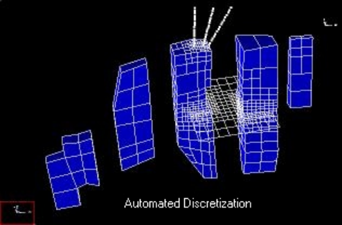
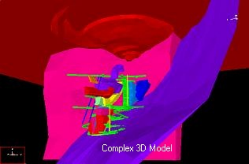
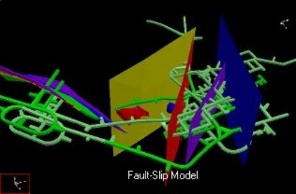
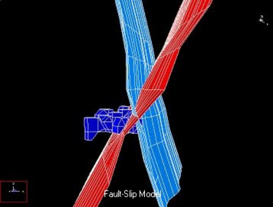
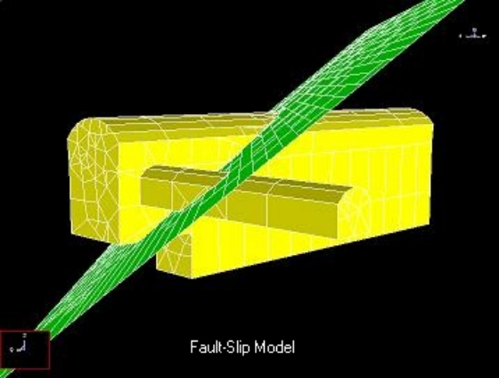

**Map3D Fault-Slip** - análise de tensões em maciço rochoso elástico com deslizamento de falhas totalmente plástico.

Este módulo é usado para realizar a análise de tensões de modelos 3D. O software é usado em projetos civis, geológicos e de mineração.

Inclui o modelador CAD 3D (Map3D Modeller), o visualizador de resultados (Map3D Results Viewer) e o banco de dados visual GIS.

A análise de tensões utiliza o BEM (método dos elementos de contorno) e oferece muitos recursos:

- Problemas de porte muito grande. O Map3D pode realizar análises de tensões em modelos com milhares de escavações (mais de um milhão de graus de liberdade). Isso permite uma representação detalhada da geometria e elimina a necessidade de simplificar modelos grandes (a simplificação excessiva é uma das principais fontes de erro na modelagem). Modelos de toda a mina podem ser simulados com facilidade.

- Formas de escavação 3D complexas e completas. Modelos detalhados conforme construídos (as-built) e formas 3D complexas podem ser analisados com facilidade. Como a análise de tensões se baseia no método dos elementos de contorno (BEM), é necessário especificar apenas as superfícies das escavações (e de outras feições). Não é preciso definir (subdividir em elementos) os pilares entre escavações adjacentes. Quaisquer formas arbitrárias são combinadas facilmente em um único modelo grande, pronto para análise.

- Múltiplas zonas elásticas com módulos diferentes (diques rígidos ou minério macio). O Map3D é totalmente capaz de incorporar zonas de materiais alternativos. Isso facilita a consideração de tipos de rocha rígidos ou macios.

- Zonas com diferentes estados de tensão pré-lavra.

- Lavra tabular com pilares em escoamento. Esta aproximação costuma ser adequada para grandes minas de veios estreitos.

- Planos de falha discretos e não planares que deslizam e dilatam de forma elasto-visco-plástica (incluindo fluência). Esses recursos são implementados com o método da descontinuidade de deslocamento. Leis de fluxo elasto-visco-plásticas são implementadas para acomodar diversos tipos de comportamento. A análise de deslizamento de falhas, tanto para mineração quanto para simulação de terremotos, é atendida com facilidade.

- É possível simular trincas e fraturas, incluindo cálculos da taxa de liberação de energia e do fator de intensidade de tensão. A propagação de fraturas pode ser simulada como uma série de etapas discretas.

- São necessárias várias etapas de lavra para considerar efeitos como a colocação de aterro ou a propagação de trincas. Atualmente, o Map3D permite 40 etapas. Diversos materiais podem ser substituídos em escavações ou fraturas em qualquer etapa.

- As interseções booleanas automáticas permitem que escavações, falhas e fraturas se cruzem e se sobreponham. Sem esse recurso, a modelagem de feições que se interceptam seria praticamente impossível em modelos complexos. O Map3D lida com essas situações com facilidade.

- Discretização automatizada. Os modelos podem ser discretizados manualmente, se desejado, ou essa tarefa pode ficar a cargo das rotinas automatizadas do programa. Essas rotinas garantem que os elementos se concentrem apenas onde são necessários, oferecendo precisão consistentemente alta e otimizando o tempo de análise.

Uma versão de demonstração do Map3D Fault-Slip está disponível sem custo. Todos os recursos estão disponíveis, exceto que o usuário só pode executar problemas de pequeno porte. Esta versão é extremamente útil para ensinar os fundamentos de modelagem, visualização e CAD 3D.

Map3Di Integrated Seismicity
