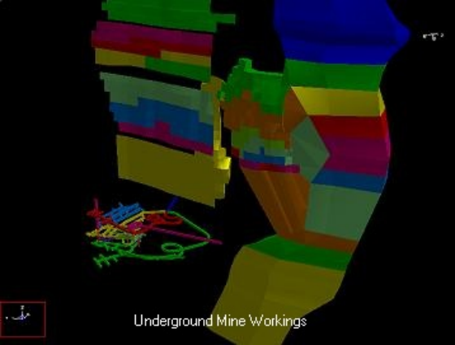
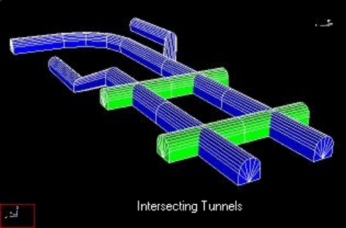
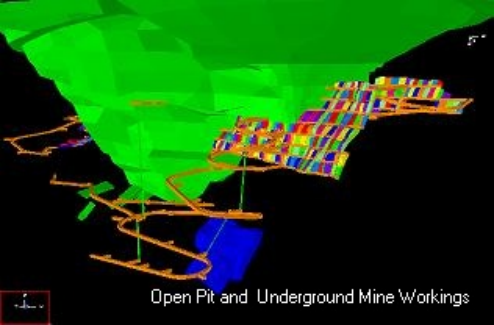
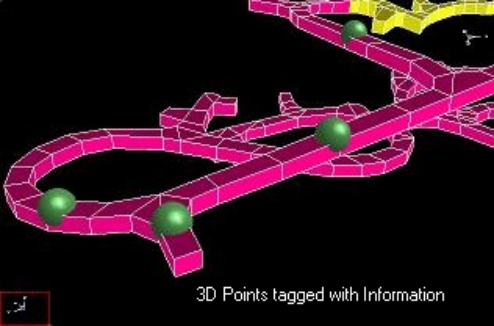
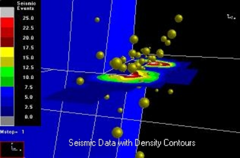

**Map3D Modeller** - CAD 3D e banco de dados visual GIS.

Este módulo é usado para construir e visualizar modelos 3D. O software é usado em projetos civis, geológicos e de mineração.

O sistema de CAD 3D (baseado em OpenGL), fácil de usar, inclui desenho a mão livre, digitalização ou seleção de objetos para construir e editar 5 tipos básicos de entidade:

- Blocos 3D. Essas entidades são usadas para construir realces (stopes), zonas de minério, diques e túneis. A construção é mais simples quando se define uma série de seções transversais ou plantas de nível

(cada uma pode ter formato diferente e número diferente de pontos). O Map3D pode simplificá-las, se desejado, e depois interpolar entre os laços para formar formas 3D complexas.

- Feições 2D. Essas entidades são usadas para construir falhas, lavra tabular, topografia do terreno e fraturas. Essas feições não precisam ser planas. Fraturas e falhas curvas e com desvio são totalmente suportadas.

- Planos de malha. É possível definir seções transversais para gerar contornos ou simplesmente para cortar o modelo.

- · Linhas de malha. São particularmente úteis para representar a localização de furos de sondagem e de suporte do terreno. A localização e a orientação de instrumentos são facilmente identificadas.

- Linhas de construção. Dados simples de levantamento, como as linhas de eixo de galerias, são representados com mais facilidade por linhas de construção. Isso permite importar e exportar facilmente para outros pacotes de CAD (com suporte completo a dxf e pnt) e também é uma forma rápida de exibir dados de linhas.

- Modelos com sombreamento por fonte de luz. O sombreamento por fonte de luz do OpenGL é suportado para uma representação aprimorada do modelo.

Inclui um conjunto completo de funções de edição, como copiar, mover, esticar, achatar, escalar, girar e muito mais. Isso permite manipular graficamente as entidades acima com facilidade.

O banco de dados visual GIS pode ser usado para armazenar, analisar e exibir um banco de dados com qualquer informação desejada, incluindo dados sísmicos e informações geológicas, como teor, qualidade do maciço rochoso etc.

Os pontos 3D podem ser marcados com uma série de:

- valores numéricos (por exemplo, cor, magnitude, orientação, tempo etc.),

- palavras-chave (para filtragem),

- mensagens de texto,

- nomes de arquivos (por exemplo, arquivos gráficos, documentos, planilhas, desenhos etc.).

A exibição desses itens pode ser filtrada de várias maneiras. A localização de cada ponto pode ser exibida como esferas sombreadas em cor, com tamanho e cor escalados segundo diversas combinações de parâmetros. A densidade da magnitude dos pontos pode ser contornada em um plano segundo funções de densidade definidas pelo usuário. Os planos de contorno podem ser definidos pelo usuário ou ajustados por regressão linear automatizada.

Map3D Results Viewer
