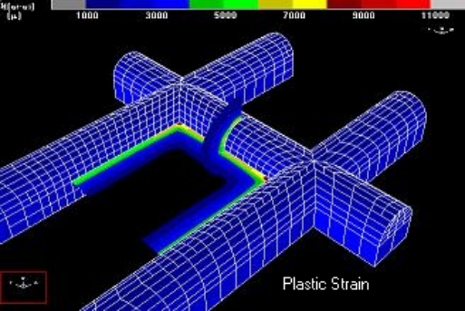
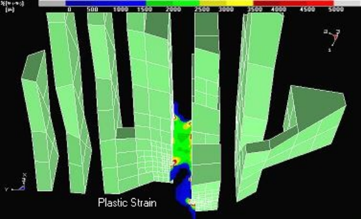
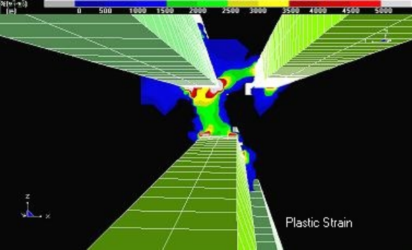
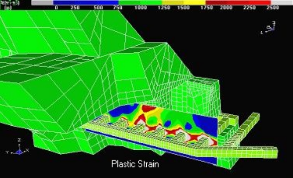

**Map3D Non-Linear** - resposta não linear do maciço rochoso.

Inclui todos os recursos do Map3D Fault-Slip e acrescenta a capacidade de o maciço rochoso 3D escoar sob cargas que excedem a resistência da rocha e se deformar de forma não linear para dissipar as tensões excedentes. Este recurso é útil para simular camadas espessas, pilares sobretensionados, encontros, aterro e resposta à fluência. Esta formulação resolve o problema não linear na superfície dos elementos de contorno e interpola esses efeitos entre esses contornos. Isso representa uma primeira aproximação da modelagem inelástica, com a vantagem de permitir problemas de grande porte e execução muito rápida.

Map3D Visco-Plastic
