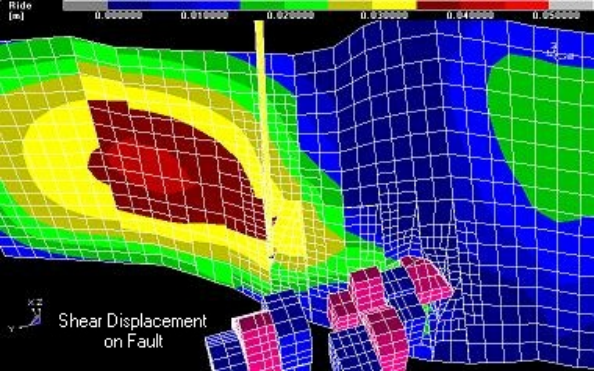
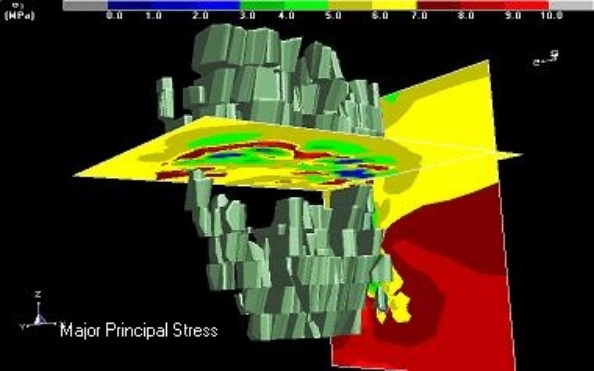
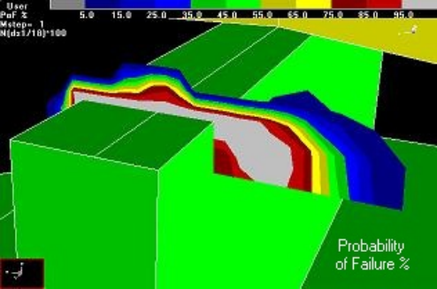
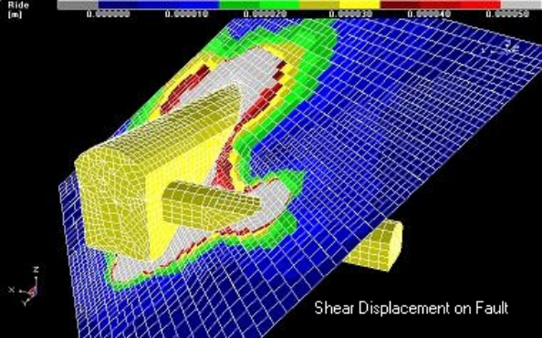
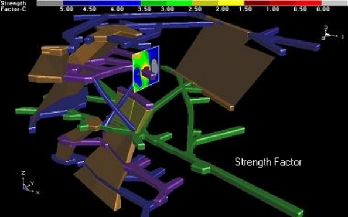

**Map3D Results Viewer** - visualização e análise dos resultados da análise de tensões.

Inclui o banco de dados visual GIS, mas não o sistema de CAD.

- visualiza resultados de análises de tensões gerados pelos códigos de análise de tensões do Map3D

- exibe contornos em planos de corte, ao longo de linhas e em pontos específicos

- funções de contorno definidas pelo usuário

- exportação direta para o Excel para gerar gráficos x-y

- exibição de trajetórias 3D

- exibição de todos os parâmetros de tensão, deformação, deslocamento e resistência, incluindo componentes principais e valores resultantes em planos e linhas definidos pelo usuário

- exportação nos formatos dxf e pnt para compatibilidade com outros sistemas de CAD e de exibição

- contornos de probabilidade de ruptura

- contornos de fator de segurança

- modelos com sombreamento por fonte de luz

- contornos topográficos

**Map3D Fault-Slip**
