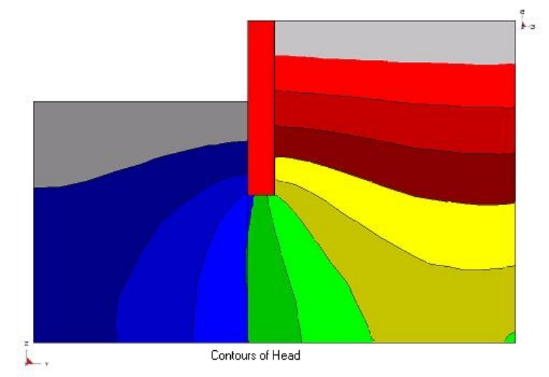
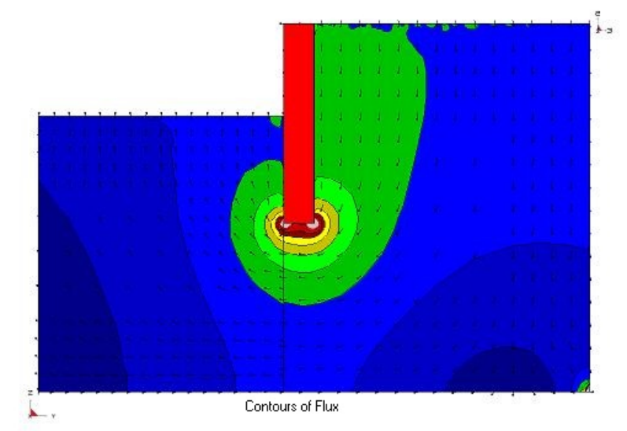

**Map3D Thermal-Fluid Flow** - análise de tensão térmica e fluxo de fluido.

Inclui todos os recursos do Map3D Fault-Slip e acrescenta a solução simultânea de tensão térmica em regime permanente e fluxo de fluido. O programa é configurado de modo que o usuário precise especificar apenas as condições de contorno de temperatura/carga hidráulica; o problema de tensão térmica é então resolvido simultaneamente. Este recurso é útil para simular efeitos de aquecimento/resfriamento e a resposta drenada/não drenada.

Map3D Non-Linear
