**Map3D Visco-Plastic** - resposta elasto-visco-plástica 3D do maciço rochoso (ainda em desenvolvimento - não disponível comercialmente no momento).

Inclui todos os recursos do Map3D Fault-Slip e acrescenta a capacidade de o maciço rochoso 3D se comportar de forma elasto-visco-plástica. Este modelo apresenta uma solução completa das equações de plasticidade incremental não associada e acrescenta a capacidade de o maciço rochoso 3D escoar sob cargas que excedem a resistência da rocha e se deformar de forma não linear para dissipar as tensões excedentes. Esta capacidade de simulação fornece os grandes deslocamentos necessários para simular estudos de interação entre suporte do terreno e aterro. Este recurso é útil para simular camadas espessas, pilares sobretensionados, encontros, aterro e resposta à fluência. Esta formulação resolve o problema não linear nas zonas especificadas do maciço rochoso.

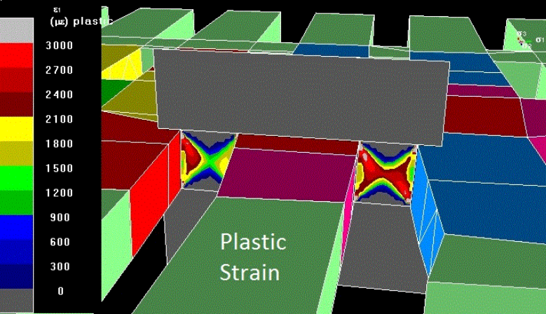

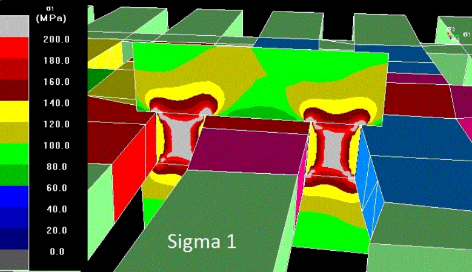

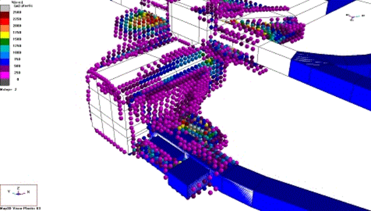

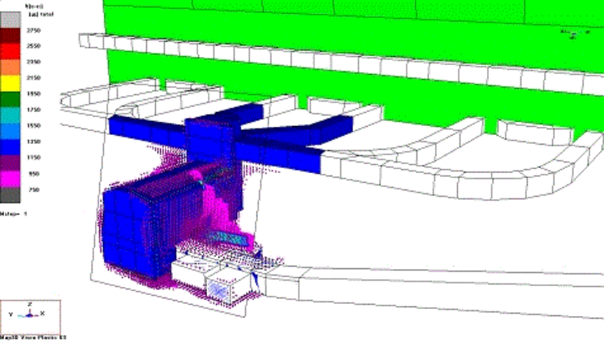

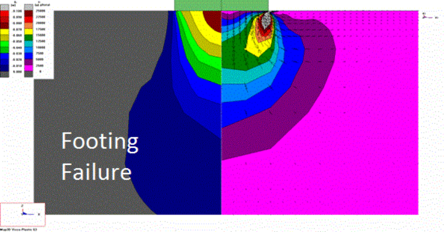

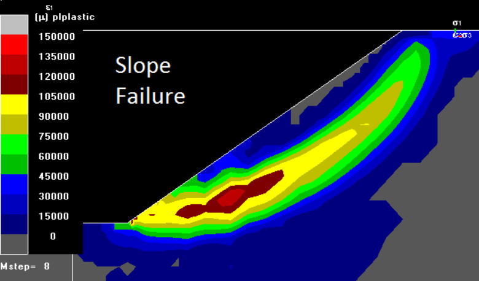

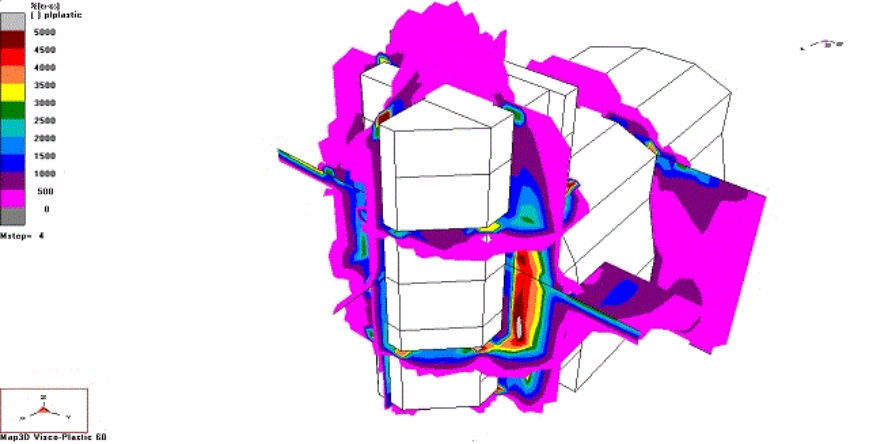

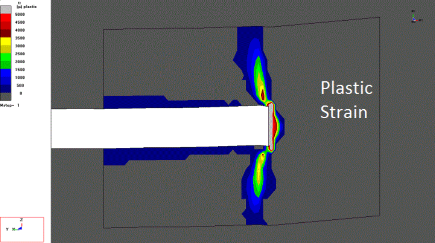

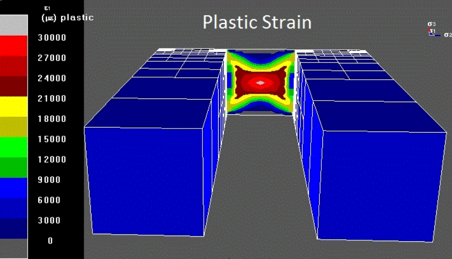

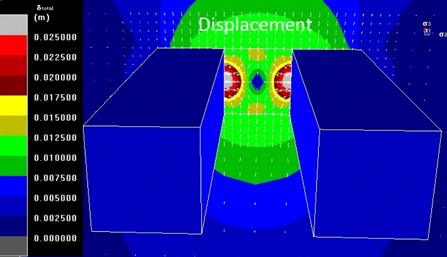

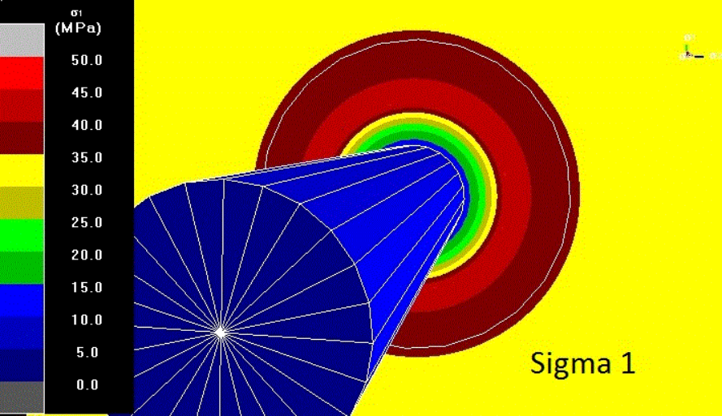

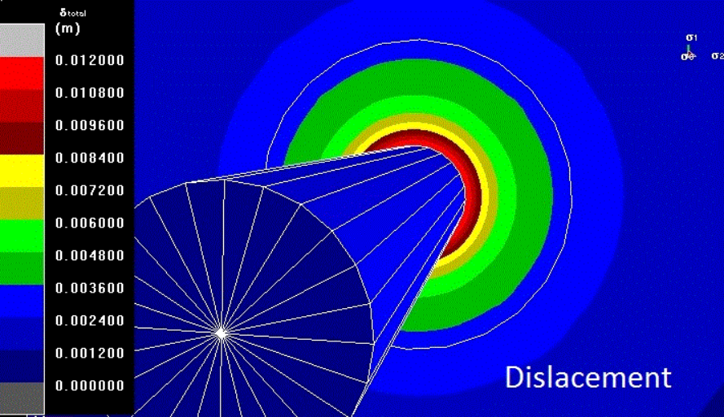

Map3D Overview
