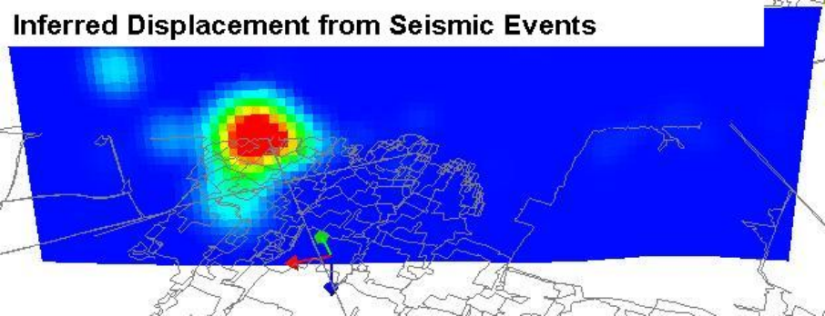
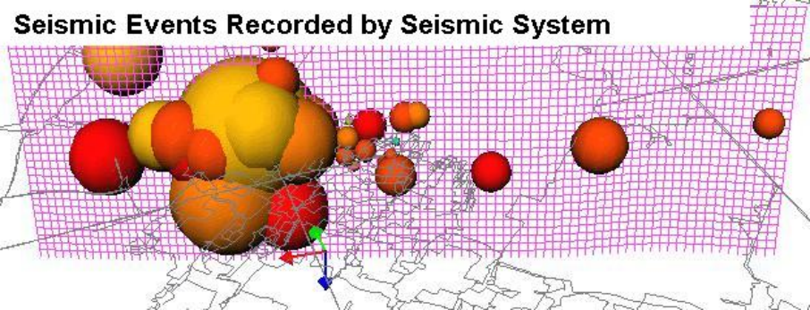
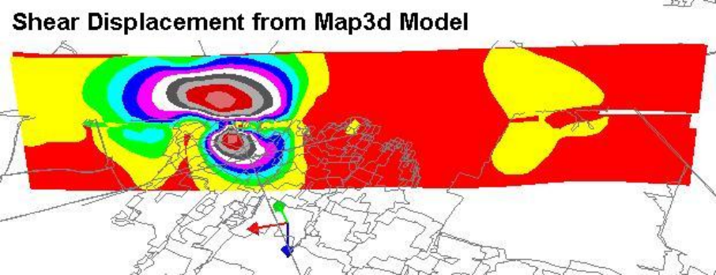

**Map3Di Integrated Seismicity** - sobreposição de efeitos de carregamento de campo externos à análise de tensões.

Inclui todos os recursos do Map3D Fault-Slip e acrescenta efeitos de carregamento de campo. Os efeitos de carregamento de campo podem ser importados de qualquer banco de dados de aquecimento térmico, pressão de fluido, comportamento não linear e deformações indicadas pela sismicidade. Esses efeitos podem ser usados para caracterizar feições geológicas 2D e 3D, acomodar mudanças de litologia e incorporar efeitos de carregamento sísmico à análise de tensões.

A modelagem numérica permite prever a resposta do maciço rochoso ao avanço das escavações de lavra. Embora o efeito de feições geológicas, como falhas ou mudanças de litologia, possa ser facilmente incorporado ao modelo, muitas vezes a localização, a orientação e as propriedades de comportamento

dessas feições são incertas. Isso pode resultar em modelos de baixa confiabilidade e, portanto, de utilidade limitada para os operadores da mina. O Map3Di permite sobrepor efeitos de carregamento de campo externos ao modelo do Map3D. O carregamento de campo pode vir de aquecimento térmico, pressão de fluido, comportamento não linear etc. Além disso, ele pode ser determinado a partir de muitas formas de monitoramento in situ, incluindo, por exemplo, pressões de fluido (por exemplo, rebaixamento de poços, barragens, fraturamento hidráulico), aquecimento (por exemplo, aquecimento natural, armazenamento de rejeitos nucleares) e deformações (por exemplo, monitoradas com extensômetros).

Outra fonte importante de informações sobre carregamento de campo in situ é a atividade sísmica. Por definição, a presença de sismicidade indica que o maciço rochoso está cedendo à carga e, portanto, se deformando de alguma maneira. A sismicidade pode indicar cisalhamento em um plano de falha ou não linearidade do material 3D, possivelmente causada por uma feição litológica fraca. O Map3Di permite sobrepor ao modelo de mina do Map3D as deformações indicadas pela sismicidade. Por exemplo, se a sismicidade indica que está ocorrendo cisalhamento em determinado local, isso pode ser imposto no modelo, redistribuindo as tensões para acomodar esse efeito.

O conceito por trás do Map3Di é sobrepor algum carregamento de campo conhecido às feições usuais de modelagem (tensão pré-lavra, geometria do modelo, diques, falhas etc.) para fornecer uma previsão composta das tensões, deformações e deslocamentos em todo o maciço rochoso. A integração da modelagem numérica com o monitoramento sísmico por meio do método dos elementos de contorno do Map3Di permite sobrepor ao modelo numérico as deformações indicadas pela sismicidade. Isso caracteriza efetivamente as feições geológicas e incorpora o efeito que elas exercem na resposta do maciço rochoso.

A informação de carregamento de campo se resume à especificação de: deslizamento e dilatação em um segmento de um plano de deslizamento e/ou deformação de uma zona 3D. Mas de onde vem essa informação:

- Suponha que você meça a distribuição de temperatura em toda a mina e queira aplicar esse carregamento de campo a um modelo do Map3Di. Para isso, subdivide-se todo o maciço rochoso em pequenas zonas 3D e especifica-se a temperatura em cada zona. Em seguida, é necessário calcular a "expansão térmica livre" de cada zona. Depois, basta indicar ao Map3Di que use esse carregamento de campo. O Map3Di executa os cálculos necessários para determinar a contribuição de tensão do carregamento de campo integrado.

- Suponha que você injete uma calda pesada em uma fratura e, depois que ela endurecer, perfure alguns furos para determinar a dilatação causada na fratura, e queira aplicar esse carregamento de campo a um modelo do Map3Di. Para isso, subdivide-se a fratura em pequenas zonas planas e especifica-se a dilatação em cada zona. Depois, basta indicar ao Map3Di que use esse carregamento de campo. O Map3Di executa os cálculos necessários para determinar a contribuição de tensão do carregamento de campo integrado.

- Suponha que, a partir da sismicidade, você determine que partes do maciço rochoso estão se deformando e outras não. Para isso, subdivide-se todo o maciço rochoso em pequenas zonas 3D e calcula-se a deformação em cada zona. Depois, basta indicar ao Map3Di que use esse carregamento de campo. O Map3Di executa os cálculos necessários para determinar a contribuição de tensão do carregamento de campo integrado.

Observe que o modelo do Map3Di pode conter todas as feições usuais, incluindo escavações, diques rígidos, falhas etc. Os efeitos do carregamento de campo e de todas essas outras feições serão sobrepostos para fornecer uma previsão composta final das tensões, deformações e deslocamentos em todo o maciço rochoso.

Como o Map3Di nos ajuda a superar as limitações na aplicação da Abordagem Observacional de Terzaghi ao projeto? Há muitos benefícios possíveis ao adotar essa abordagem:

- Primeiro, é preciso reconhecer que pretendemos aplicar condições de carregamento de campo conhecidas, medidas a partir de dados de campo (sismicidade, temperatura, pressões de fluido ou deformações). Isso, por si só, pode ser considerado um exercício de calibração ou ajuste fino, em oposição a fazer uma previsão. Estamos literalmente acrescentando informação ao modelo.

- A riqueza de informações oriunda do monitoramento sísmico é enorme. O monitoramento sísmico fornece o volume e a distribuição espacial de informações sobre a resposta do maciço rochoso que não podem ser obtidos de nenhuma outra forma a um custo razoável. O Map3Di oferece um mecanismo para usar diretamente essas informações na calibração do modelo. Devido à natureza em tempo real da sismicidade, torna-se viável percorrer o ciclo lavrar/monitorar/reprojetar a cada incremento de lavra. Assim, em vez de passar anos fazendo observações visuais para desenvolver um histórico da resposta do maciço rochoso, há potencial para calibrar o modelo com muito mais rapidez.

- Talvez o aspecto mais importante seja a possibilidade de se adaptar, em tempo real, a condições variáveis do maciço rochoso. Isso permite reconhecer e se adaptar a condições locais que mudam rapidamente, como litologia ou fraturamento. É possível atualizar a calibração do modelo à medida que as condições mudam. Isso tem o potencial de melhorar significativamente a confiabilidade das previsões.

- Por fim, ao incorporar, por exemplo, algum deslizamento de falha indicado pela sismicidade, você de fato caracteriza o efeito desse deslizamento e o incorpora ao modelo. Por exemplo, se a sismicidade indica que está ocorrendo cisalhamento em determinado local, isso pode ser imposto no modelo, redistribuindo as tensões para acomodar exatamente esse efeito.

Map3D Thermal-Fluid Flow
