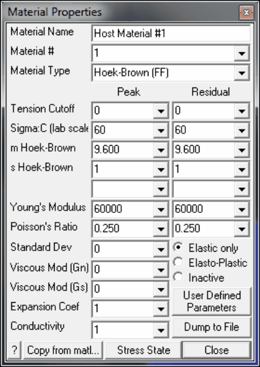
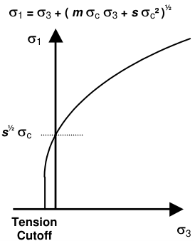

O material Hoek-Brown só pode ser usado como critério de ruptura em análises elásticas no Map3D Fault-Slip.

Material Name - especifica um nome descritivo para o material.

Material # - especifica o número do material.

- O material nº 1 é reservado para o material da rocha encaixante (host).

- Os demais números de material são usados para definir zonas de material alternativo, como minério, argila de falha (gouge), aterro etc.

Material Type - especifica o tipo de material (Mohr-Coulomb, Hoek-Brown, Drucker-Prager, Fault-Gouge, Hyperbolic-Backfill, Quadratic-Backfill, Equilibrated-Gouge, Yielding-Pillar ou nenhum).

- Hoek-Brown - define a envoltória de ruptura como uma linha curva.

- Para blocos FF 3D, o critério de Hoek-Brown define a resistência em termos das tensões principais da seguinte forma:

**Hoek-Brown em blocos FF 3D**

- O corte de tração (tension cutoff) e sc são especificados em unidades de tensão (MPa ou psi).

- Somente os valores de pico são usados.

Young's Modulus e Poisson's Ratio - especificam o módulo de Young (escala do maciço rochoso - deformação) em unidades de tensão (MPa ou psi).

- Somente os valores de pico são usados.

Standard Deviation - especifica o desvio padrão em unidades de tensão (MPa ou psi).

- Este parâmetro descreve a incerteza que você tem sobre os parâmetros de resistência.

- Este parâmetro é usado apenas para plotar a probabilidade de ruptura por cisalhamento Plot > Strength Factors > Rockmass Probability N-distribution.

Viscous Modulus ( _Gn_ e _Gs_ ) - Estes parâmetros não são usados no material Hoek-Brown.

Expansion Coefficient e Conductivity são usados apenas no Map3D Thermal-Fluid Flow. O Map3D Thermal- Fluid Flow pode ser usado para resolver simultaneamente o fluxo de calor/fluido em regime permanente acoplado à análise de tensões.

Elastic only - quando marcada, este material responde apenas de forma elástica, ou seja, os parâmetros de resistência não serão usados.

- Isso pode ser usado para definir zonas com propriedades elásticas e/ou estados de tensão iniciais diferentes. Isso pode incluir, por exemplo, diques rígidos, zonas de minério macio, aterro ou elementos de suporte.

Elasto-Plastic - quando marcada, este material responde de forma elasto-visco-plástica, ou seja, os parâmetros de resistência serão usados como lei de fluxo.

- Isso pode ser usado para definir zonas com propriedades elásticas e parâmetros de resistência diferentes.

- Observe que, no Map3D Fault-Slip, somente elementos DD (isto é, argila de falha) podem responder de forma não linear.

- No Map3D Non-Linear, o maciço rochoso 3D também pode escoar plasticamente.

- O escoamento de materiais Hoek-Brown não é suportado no momento.

Inactive - quando marcada, este material não será usado na análise de tensões e, portanto, não afetará as tensões, deformações ou deslocamentos previstos.

- Isso pode ser usado para definir zonas com diferentes parâmetros de resistência a serem usados na geração de contornos de fatores de resistência.

User Defined - permite especificar parâmetros definidos pelo usuário para uso em contornos.

- Parâmetros diferentes são definidos para cada número de material.

      - Plot > Stress > User

   - Estes parâmetros são usados com

- Isso pode ser usado para definir zonas com diferentes parâmetros de resistência a serem usados na geração de contornos de fatores de resistência.

Dump to File - permite exportar todos os dados de propriedades dos materiais para um arquivo, para visualização no Bloco de Notas ou no Excel.

Copy from material - permite copiar as propriedades de um número de material para outro. Todas as propriedades, incluindo o estado de tensão, são copiadas.

Stress State - especifica o estado de tensão inicial (campo distante) do material.

- A maioria dos materiais é inserida em blocos com o mesmo estado de tensão (campo distante).

- Materiais como escoras ou aterro são colocados com tensões iniciais próximas de zero.

Tópicos relacionados:

Mohr_Coulomb em blocos FF 3D

Drucker-Prager em blocos FF 3D
