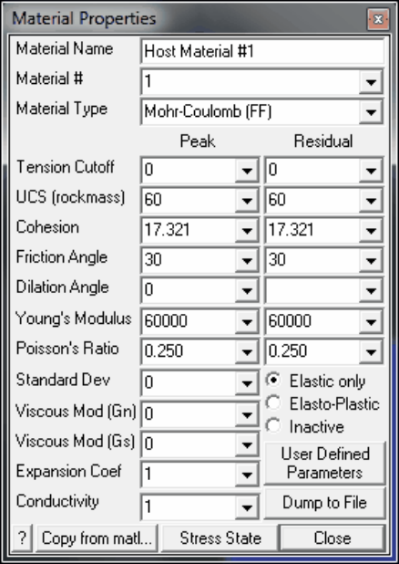
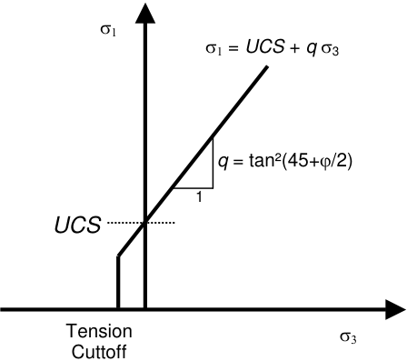
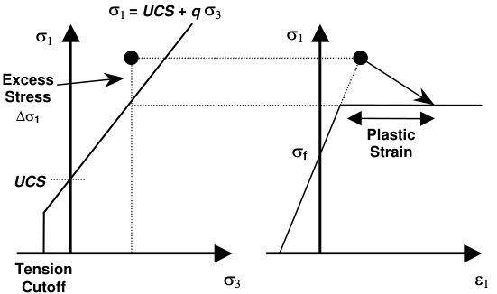
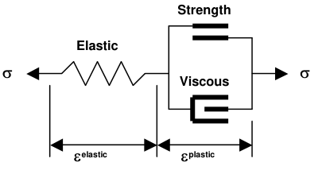

O material Mohr-Coulomb pode ser usado para descrever a resposta não linear em blocos FF 3D no Map3D NonLinear. Ele também pode ser usado como critério de ruptura em análises elásticas no Map3D Fault-Slip.

Material Name - especifica um nome descritivo para o material.

Material # - especifica o número do material.

- O material nº 1 é reservado para o material da rocha encaixante (host).

- Os demais números de material são usados para definir zonas de material alternativo, como minério, argila de falha (gouge), aterro, materiais amolecidos etc.

Material Type - especifica o tipo de material (Mohr-Coulomb, Hoek-Brown, Drucker-Prager, Fault-Gouge, Equilibrated-Gouge, Yielding-Pillar, Hyperbolic-Backfill, Quadratic-Backfill, Softened-Material ou nenhum).

- Mohr-Coulomb - define a envoltória de ruptura como uma linha reta.

- Para blocos FF 3D, o critério de Mohr-Coulomb define a resistência em termos das tensões principais da seguinte forma:

#### Mohr-Coulomb em blocos FF 3D

- O corte de tração (tension cutoff) e a _UCS_ são especificados em unidades de tensão (MPa ou psi).

- O ângulo de atrito e o ângulo de dilatação são especificados em graus.

- A coesão está relacionada à _UCS_ e ao ângulo de atrito pela relação _UCS_ =2 _Coh_ tan(45+j/2). Se a coesão for especificada, a _UCS_ é determinada a partir dessa relação.

- Os valores de pico desses parâmetros são usados até a ruptura. Após o escoamento, os valores residuais são usados para fornecer uma resposta de amolecimento por deformação.

- Os valores residuais são ignorados em análises elásticas.

Young's Modulus e Poisson's Ratio - especificam o módulo de Young (escala do maciço rochoso - deformação) em unidades de tensão (MPa ou psi).

- Os valores de pico desses parâmetros são usados até a ruptura.

- Após o escoamento, os valores residuais são usados. Os valores residuais são ignorados em análises elásticas.

Standard Deviation - especifica o desvio padrão em unidades de tensão (MPa ou psi).

- Este parâmetro descreve a incerteza que você tem sobre os parâmetros de resistência.

- Este parâmetro é usado apenas para plotar a probabilidade de ruptura por cisalhamento Plot > Strength Factors > Rockmass Probability N-distribution.

Viscous Modulus ( _Gn_ e _Gs_ ) - Estes parâmetros são usados apenas em análises não lineares (blocos FF 3D no Map3D Non-Linear e planos DD no Map3D Fault-Slip). Para blocos FF 3D, apenas _Gs_ é usado.

- O módulo viscoso descreve a resposta à fluência, em que a resistência à fluência é determinada como o coeficiente de fluência _C_ multiplicado pela taxa de deformação plástica. Observe que o usuário deve selecionar tanto o coeficiente de fluência _C_ quanto o tamanho do passo de tempo D _t_ e, em seguida, especificar o quociente entre eles como o módulo viscoso _G_ .

- Especifique o módulo viscoso em unidades de tensão (MPa ou psi).

Expansion Coefficient e Conductivity são usados apenas no Map3D Thermal-Fluid Flow.

- O Map3D Thermal-Fluid Flow pode ser usado para resolver simultaneamente o fluxo de calor/fluido em regime permanente acoplado à análise de tensões.

Elastic only - quando marcada, este material responde apenas de forma elástica, ou seja, os parâmetros de resistência não serão usados.

- Isso pode ser usado para definir zonas com propriedades elásticas e/ou estados de tensão iniciais diferentes. Isso pode incluir, por exemplo, diques rígidos, zonas de minério macio, aterro ou elementos de suporte.

Elasto-Plastic - quando marcada, este material responde de forma elasto-visco-plástica, ou seja, os parâmetros de resistência serão usados como lei de fluxo.

- Isso pode ser usado para definir zonas com propriedades elásticas e parâmetros de resistência diferentes.

- Observe que, no Map3D Fault-Slip, somente elementos DD (isto é, argila de falha) podem responder de forma não linear.

- No Map3D Non-Linear, o maciço rochoso 3D também pode escoar plasticamente.

Inactive - quando marcada, este material não será usado na análise de tensões e, portanto, não afetará as tensões, deformações ou deslocamentos previstos.

- Isso pode ser usado para definir zonas com diferentes parâmetros de resistência a serem usados na geração de contornos de fatores de resistência.

User Defined - permite especificar parâmetros definidos pelo usuário para uso em contornos.

- Parâmetros diferentes são definidos para cada número de material.

   - Plot > Stress > User

- Estes parâmetros são usados com

- Isso pode ser usado para definir zonas com diferentes parâmetros de resistência a serem usados na geração de contornos de fatores de resistência.

Dump to File - permite exportar todos os dados de propriedades dos materiais para um arquivo, para visualização no Bloco de Notas ou no Excel.

Copy from material - permite copiar as propriedades de um número de material para outro. Todas as propriedades, incluindo o estado de tensão, são copiadas.

Stress State - especifica o estado de tensão inicial (campo distante) do material.

- A maioria dos materiais é inserida em blocos com o mesmo estado de tensão (campo distante).

- Materiais como escoras ou aterro são colocados com tensões iniciais próximas de zero.

Na análise elástica, as tensões principais são normalmente usadas com o critério de resistência de Mohr-Coulomb ou de Hoek-Brown para estimar o grau de dano devido à sobretensão. Pode-se esperar que mais tensão excedente em uma análise elástica correlacione-se, em geral, com maiores quantidades de deformação plástica em uma análise não linear. Como nenhum dos parâmetros é sensível à orientação, este critério é representativo da estabilidade de um maciço rochoso homogêneo.

#### Mohr-Coulomb em blocos FF 3D

A sobretensão pode ser apresentada de várias formas, incluindo:

Plot > Strength Factors > dS1 - Excess Stress

Plot > Strength Factors > dTmax - Excess Stress

Plot > Strength Factor > SF-A - Strength/Stress Plot > Strength Factor > SF-B - Strength/Stress

Plot > Strength Factors > SF-C - Strength/Stress

Por outro lado, na análise não linear as tensões nunca podem exceder a resistência, a menos que algum nível de fluência seja usado (neste último caso, a fluência viscosa pode permitir estados de tensão acima do critério de ruptura, indicando falta de equilíbrio estático). Portanto, na análise não linear normalmente se considera diretamente a deformação plástica ou a taxa de deformação plástica prevista pelo modelo como indicador de dano.

Em blocos FF 3D, as deformações elásticas são determinadas a partir das tensões por

sxx   = sxxf  + [ (1-n) exxelastic + n ( eyyelastic + ezzelastic ) ] _E_ / [ (1+n) (1-2n) ] syy  = syyf + [ (1-n) eyyelastic + n ( ezzelastic + exxelastic  ) ] _E_ / [ (1+n) (1-2n) ] szz   = szzf  + [ (1-n) ezzelastic  + n ( exxelastic + eyyelastic ) ] _E_ / [ (1+n) (1-2n) ] txy  = txyf +  exyelastic _E_ / (1+n) tyz  = tyzf  +  eyzelastic _E_ / (1+n) txz  = txzf  +  exzelastic _E_ / (1+n)

onde _E_ e n representam, respectivamente, o módulo de Young (escala do maciço rochoso - deformação) e o coeficiente de Poisson, e sf e tf representam o estado de tensão inicial (pré-lavra)

No Map3D Non-Linear, se a tensão ultrapassar a resistência, a deformação plástica pode ser determinada limitando-se a tensão

onde

s1 - s1° - _C_ De1plastic /D _t_ = _UCS_ + _q_ ( s3 - s3° - _C_ De3plastic /D _t_ ) s1°  = [ (1-n) e1plastic + n ( e2plastic + e3plastic ) ] _E_ / [ (1+n) (1-2n) ] s2°  = [ (1-n) e2plastic + n ( e3plastic + e1plastic ) ] _E_ / [ (1+n) (1-2n) ] s3°  = [ (1-n) e3plastic + n ( e1plastic + e2plastic ) ] _E_ / [ (1+n) (1-2n) ]

A deformação plástica acumulada eplastic é determinada como a soma dos incrementos plásticos de fluência Deplastic em todos os passos de fluência.

Se a tensão ficar abaixo do corte de tração, a deformação plástica pode ser determinada limitando-se a tensão

s3 - s3° - _C_ De3plastic /D _t_ = _To_

A deformação volumétrica plástica também pode ter uma componente de dilatação

evolume = ( e1plastic + e2plastic + e3plastic ) = tan( _dilation angle_ ) e1plastic

A deformação total é igual à soma das partes elástica e plástica.

A resposta de fluência é simulada usando um modelo de fluência linear (de Bingham).

Em cada passo de fluência, o estado de tensão em todos os elementos em escoamento (elementos em que a tensão excede a resistência) é calculado como a resistência mais a resistência à fluência

s = _Strength_ + _C_ Deplastic /D _t_

_C_ = _G_ D _t_

onde a resistência à fluência é determinada como o coeficiente de fluência _C_ multiplicado pela taxa de deformação plástica. Observe que o usuário deve selecionar tanto o coeficiente de fluência _C_ quanto o tamanho do passo de tempo D _t_ e, em seguida, especificar o quociente entre eles como o módulo viscoso _G_ . A resistência à fluência pode ser usada simplesmente como uma técnica para amortecer as deformações não lineares ou para a simulação de fluência dependente do tempo real

#### Analysis > Options > Creep

As deformações podem ser apresentadas de várias formas, incluindo:

Plot > Strain > Value > Elastic

Plot > Strain > Value > Plastic Plot > Strain > Value > Total

Plot > Strain > E1 - Deformação principal maior Plot > Strain > E2 - Deformação principal intermediária

Plot > Strain > E3 - Deformação principal menor

Plot > Strain > Emax - Deformação de cisalhamento máxima

Plot > Strain > Evolume - Deformação volumétrica

Tópicos relacionados:

Hoek-Brown em blocos FF 3D

Drucker-Prager em blocos FF 3D
