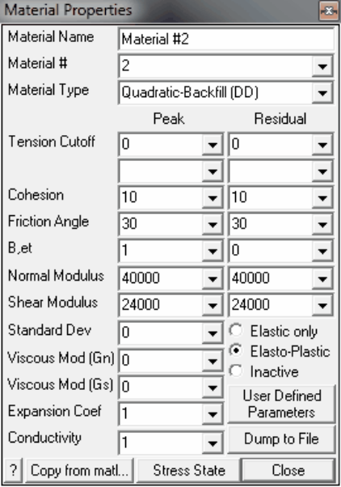
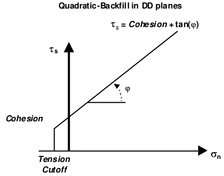
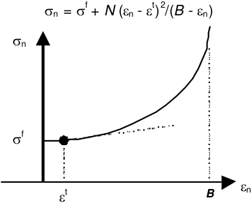
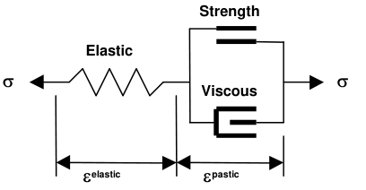

O material Quadratic-Backfill pode ser usado para descrever a resposta não linear em planos DD no Map3D Fault-Slip, no Map3D Non-Linear e no Map3D Visco-Plastic.

Material Name - especifica um nome descritivo para o material.

Material # - especifica o número do material.

- O material nº 1 é reservado para o material da rocha encaixante (host).

- Os demais números de material são usados para definir zonas de material alternativo, como minério, argila de falha (gouge), aterro etc.

Material Type - especifica o tipo de material (Mohr-Coulomb, Hoek-Brown, Drucker-Prager, Fault-Gouge, Hyperbolic-Backfill, Quadratic-Backfill, Equilibrated-Gouge, Yielding-Pillar ou nenhum).

- Quadratic-Backfill - define a envoltória de ruptura como uma linha reta, da mesma forma que o Mohr-Coulomb em planos DD, mas sem _UCS_ .

- A resistência é definida em termos das tensões de cisalhamento e normal no plano da seguinte forma:

- O corte de tração (Tension Cutoff) e a coesão são especificados em unidades de tensão (MPa ou psi).

- O ângulo de atrito e o ângulo de dilatação são especificados em graus.

- A coesão e o ângulo de atrito definem a resposta ao cisalhamento.

- O corte de tração define a resposta na direção normal ao plano de cisalhamento.

- Os valores de pico desses parâmetros são usados até a ruptura.

- Após o escoamento, os valores residuais são usados para fornecer uma resposta de amolecimento por deformação.

- Os valores residuais são ignorados em análises elásticas.

- Se a pressão de fluido for especificada como parte do Stress State, usa-se a tensão normal efetiva (sn-p), em que p é a pressão de fluido.

B, et - para planos DD, o critério Backfill-Hyperbolic define a resposta normal hiperbólica da seguinte forma:

**Quadratic-Backfill em planos DD**

- A tensão normal varia de acordo com a relação hiperbólica.

- À medida que a deformação se aproxima do valor _B_ , a tensão normal torna-se rapidamente infinita, limitando assim a quantidade de deslocamento normal (convergência) que pode ocorrer.

Normal and Shear Modulus - especificam os módulos em unidades de tensão (MPa ou psi).

- A resposta normal é definida acima. _N_ representa o valor da tensão normal (para sf =0) em en=(et -½)+v( _B-_ et +¼).

- As tensões de cisalhamento que atuam nas superfícies dos elementos estão relacionadas à parcela elástica do deslocamento de cisalhamento (deslizamento) por meio do módulo de cisalhamento, como no modelo Fault-Gouge.

Standard Deviation - especifica o desvio padrão em unidades de tensão (MPa ou psi).

- Este parâmetro descreve a incerteza que você tem sobre os parâmetros de resistência.

- Este parâmetro é usado apenas para plotar a probabilidade de ruptura por cisalhamento Plot > Strength Factors > InPlane Probability N-distribution.

Viscous Modulus ( _Gn_ e _Gs_ ) - Estes parâmetros são usados apenas em análises não lineares (blocos FF 3D no Map3D Non-Linear e planos DD no Map3D Fault-Slip).

- O módulo viscoso descreve a resposta à fluência, em que a resistência à fluência é determinada como o coeficiente de fluência _C_ multiplicado pela taxa de deformação plástica. Observe que o usuário deve selecionar tanto o coeficiente de fluência _C_ quanto o tamanho do passo de tempo D _t_ e, em seguida, especificar o quociente entre eles como o módulo viscoso _G_ .

- _Gn_ não é usado no modelo hiperbólico.

- Especifique o módulo viscoso em unidades de tensão (MPa ou psi).

Expansion Coefficient e Conductivity são usados apenas no Map3D Thermal-Fluid Flow.

- O Map3D Thermal-Fluid Flow pode ser usado para resolver simultaneamente o fluxo de calor/fluido em regime permanente acoplado à análise de tensões.

Elastic only - quando marcada, este material responde apenas de forma elástica, ou seja, os parâmetros de resistência não serão usados.

- Isso pode ser usado para definir zonas com propriedades elásticas e/ou estados de tensão iniciais diferentes. Isso pode incluir, por exemplo, diques rígidos, zonas de minério macio, aterro ou elementos de suporte.

Elasto-Plastic - quando marcada, este material responde de forma elasto-visco-plástica, ou seja, os parâmetros de resistência serão usados como lei de fluxo.

- Isso pode ser usado para definir zonas com propriedades elásticas e parâmetros de resistência diferentes.

- Observe que, no Map3D Fault-Slip, somente elementos DD (isto é, argila de falha) podem responder de forma não linear.

- No Map3D Non-Linear, o maciço rochoso 3D também pode escoar plasticamente.

Inactive - quando marcada, este material não será usado na análise de tensões e, portanto, não afetará as tensões, deformações ou deslocamentos previstos.

- Isso pode ser usado para definir zonas com diferentes parâmetros de resistência a serem usados na geração de contornos de fatores de resistência.

User Defined - permite especificar parâmetros definidos pelo usuário para uso em contornos.

- Parâmetros diferentes são definidos para cada número de material.

Plot > Stress > User

   - Estes parâmetros são usados com

- Isso pode ser usado para definir zonas com diferentes parâmetros de resistência a serem usados na geração de contornos de fatores de resistência.

Dump to File - permite exportar todos os dados de propriedades dos materiais para um arquivo, para visualização no Bloco de Notas ou no Excel.

Copy from material - permite copiar as propriedades de um número de material para outro. Todas as propriedades, incluindo o estado de tensão, são copiadas.

Stress State - especifica o estado de tensão inicial (campo distante) do material.

- A maioria dos materiais é inserida em blocos com o mesmo estado de tensão (campo distante).

- Materiais como escoras ou aterro são colocados com tensões iniciais próximas de zero.

A sobretensão pode ser apresentada de várias formas, incluindo:

Plot > Strength Factors > dTip Tensão de cisalhamento excedente no plano

Plot > Strength Factors > dTub Tensão de cisalhamento excedente no plano ubíquo

Plot > Strength Factors > SF-ip Strength/Stress

Plot > Strength Factors > SF-ub Strength/Stress

Por outro lado, na análise não linear as tensões nunca podem exceder a resistência, a menos que algum nível de fluência seja usado (neste último caso, a fluência viscosa pode permitir estados de tensão acima do critério de ruptura, indicando falta de equilíbrio estático). Portanto, na análise não linear normalmente se considera diretamente a deformação plástica ou a taxa de deformação plástica prevista pelo modelo como indicador de dano.

Em planos DD, as deformações elásticas são determinadas a partir das tensões por

ts = tf + _Shear Modulus_ eselastic

sn = sf + _Normal Modulus_ (enelastic- et )2/( _B_ - enelastic)

onde _Shear Modulus_ e _Normal Modulus_ representam, respectivamente, os módulos elásticos do material de argila de falha nas direções de cisalhamento e normal, e tf e sf representam o estado de tensão inicial nas direções de cisalhamento e normal, e

> elastic / _Thickness_ eselastic =  ds

> elastic / _Thickness_ enelastic =  dn

onde dselastic e dnelastic representam, respectivamente, a componente elástica do deslocamento de cisalhamento (deslizamento) e do deslocamento normal (convergência), e _Thickness_ representa a espessura do plano DD (isto é, argila de falha, largura da camada, largura de lavra ou altura do pilar). A espessura do plano DD é definida com

CAD > Build > DDLoop

e pode ser modificada com

CAD > Edit > Entity Properties

Em elementos DD, se a tensão de cisalhamento ultrapassar a resistência, a deformação plástica pode ser determinada limitando-se a tensão

ts - ts° - _C_ Desplastic /D _t_ = _Cohesion_ + tan(j) ( sn - sn° - _C_ Denplastic /D _t_ )

onde

ts° = _Shear Modulus_ esplastic sn° = _Normal Modulus_ enplastic

A deformação plástica acumulada eplastic é determinada como a soma dos incrementos plásticos de fluência Deplastic em todos os passos de fluência.

Se a tensão normal ficar abaixo do corte de tração, a deformação plástica pode ser determinada limitando-se a tensão

sn - sn° - _C_ Denplastic /D _t_ = _To_

No caso de ruptura por cisalhamento, a deformação plástica normal também pode ter uma componente de dilatação

plastic enplastic = tan( _dilation angle_ ) es

A deformação total é igual à soma das partes elástica e plástica.

A resposta de fluência é simulada usando um modelo de fluência linear (de Bingham).

Em cada passo de fluência, o estado de tensão em todos os elementos em escoamento (elementos em que a tensão excede a resistência) é calculado como a resistência mais a resistência à fluência

_Strength_ + _C_ Denplastic /D _t_

_C_ = _G_ D _t_

onde a resistência à fluência é determinada como o coeficiente de fluência _C_ multiplicado pela taxa de deformação plástica. Observe que o usuário deve selecionar tanto o coeficiente de fluência _C_ quanto o tamanho do passo de tempo D _t_ e, em seguida, especificar o quociente entre eles como o módulo viscoso _G_ . A resistência à fluência pode ser usada simplesmente como uma técnica para amortecer as deformações não lineares ou para a simulação de fluência dependente do tempo real

Analysis > Options > Creep

As deformações, o deslocamento de cisalhamento (deslizamento) e o deslocamento normal (convergência) podem ser apresentados de várias formas, incluindo:

Plot > Surface > Value > Elastic Plot > Surface > Value > Plastic Plot > Surface > Value > Total

Plot > Strain > E1 - Deformação principal maior

Plot > Surface > Es Deformação de cisalhamento

Plot > Surface > En Deformação normal Plot > Surface > ds Deslocamento de cisalhamento (deslizamento)

Plot > Surface > dn Deslocamento normal (convergência)

Também é de interesse o incremento plástico de fluência Deplastic, a contribuição do elemento viscoso para a resistência ao cisalhamento

Dts   = _C_ Desplastic /D _t_

Plot > Surface > dEs Deformação de cisalhamento incremental

Plot > Surface > dTs Tensão de cisalhamento excedente

Tópicos relacionados:

Mohr-Coulomb em planos DD

Fault-Gouge em planos DD
