Materiais amolecidos podem ser usados para simular o escoamento do terreno e os consequentes efeitos de redistribuição de tensões. Embora a modelagem de plasticidade seja, sem dúvida, o melhor método para isso, o amolecimento de material também pode ser usado para simular o escoamento do terreno, a redistribuição de tensões e, portanto, o possível impacto nas áreas vizinhas. A vantagem dessa abordagem é que ela permite ao engenheiro investigar o comportamento não linear de forma rápida e fácil.

A teoria por trás do amolecimento é explicada em detalhes em **Elastic softening to simulate plastic yielding.pdf** . A seguir, um breve resumo.

Na modelagem numérica, o alívio de tensões de um maciço rochoso elástico é obtido permitindo deformações plásticas. Essas deformações dissipam a tensão excedente indicada pela resposta elástica. Um método alternativo para induzir deformações plásticas é mostrado na figura abaixo. Nele, o módulo tensão-deformação é reduzido progressivamente em magnitude. Observa-se que, embora tecnicamente isso reduza a rigidez da resposta elástica tensão-deformação, isso pode ser interpretado como equivalente a incrementos (Dep ) de deformação plástica.

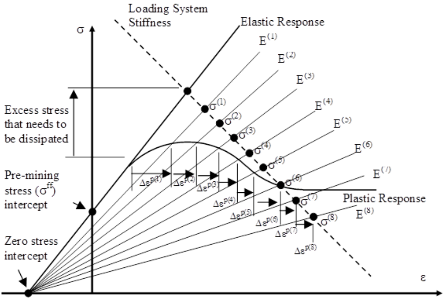

Entende-se, em geral, que a ruptura da rocha resulta de ruptura por cisalhamento e pode ser simulada com a redução do módulo de cisalhamento; já as variações de volume estão associadas à dilatação ou à compactação, dependendo das condições de tensão e da natureza da própria rocha. A redução do módulo de cisalhamento pode ser usada para reduzir o diferencial de tensão (s1-s3), e a redução do módulo volumétrico pode ser usada para controlar a deformação volumétrica

(evolume=e1+e2+e3). Isso permite o controle independente do processo de ruptura por cisalhamento e da resposta dilatante. Quer o amolecimento seja automatizado ou feito manualmente, é claro que deve-se ter cuidado para aliviar as tensões em uma quantidade realista, de modo que o estado final de tensão nos pilares afetados satisfaça um critério de resistência bem calibrado.

O módulo volumétrico não amolecido **_B_** e o módulo de cisalhamento **_G_** podem ser determinados a partir do módulo de Young **_E_** e do coeficiente de Poisson da seguinte forma:

**_B = E/3/(1-2_** n **_) G = E/2/(1+_** n **_)_**

O módulo volumétrico amolecido **_Bs_** e o módulo de cisalhamento amolecido **_Gs_** são determinados usando o parâmetro de amolecimento de volume (Volume Softening) **_b_** e o parâmetro de amolecimento de cisalhamento (Shear Softening) **_g_** , na tabela abaixo, de modo que

**_Bs = B×b Gs = G×g_**

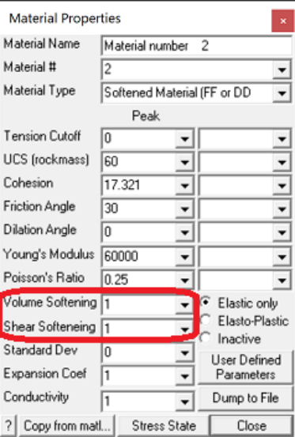

Por exemplo, o amolecimento por cisalhamento com **_g=1_** representa ausência de amolecimento, enquanto o amolecimento por cisalhamento com **_g=0.5_** representa uma redução de 50% no módulo de cisalhamento...

Para demonstrar a simplicidade do procedimento de amolecimento, apresenta-se um exemplo de um túnel sobretensionado com escoamento das paredes laterais. Note que o objetivo deste exemplo não é reproduzir os resultados da modelagem plástica, nem se deve esperar conseguir fazê-lo. No entanto, ele demonstrará o amolecimento das paredes laterais, o alívio de tensões, a transferência de tensões e o escoamento. Aqui, deseja-se demonstrar que, com o amolecimento:

- as tensões podem ser dissipadas para os encontros vizinhos,

- podem ser geradas as maiores deformações e deslocamentos associados à plasticidade.

#### Resultados do modelo plástico

Considere um túnel circular com 1 m de raio e tensões pré-lavra homogêneas de 30 MPa. Foi usado um critério de ruptura de MohrCoulomb em todo o modelo, com UCS de 11,9 MPa, ângulo de atrito de 30°, módulo de Young de 6780 MPa e coeficiente de Poisson de 0,21. Este modelo foi analisado usando o Map3D Visco-Plastic. Foi usado comportamento elástico/perfeitamente plástico, com a taxa de dilatação definida como zero. Abaixo, a tensão principal maior é mostrada à esquerda e o deslocamento é mostrado à direita.

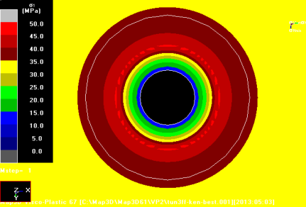

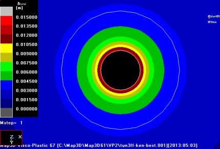

Esses resultados do modelo do Map3D Visco-Plastic coincidem de perto com a solução analítica fechada para as tensões e os deslocamentos plásticos. Para referência, a solução analítica elástica também é mostrada.

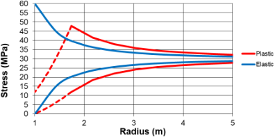

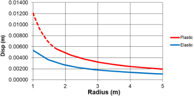

#### Resultados do modelo amolecido

Para modelar o caso acima com amolecimento, uma zona ao redor das paredes laterais do túnel foi amolecida, como mostrado abaixo, onde a galeria é mostrada em azul e a zona amolecida em roxo. Esta zona amolecida foi escolhida com o mesmo tamanho da zona plástica determinada acima (1,74 m de raio).

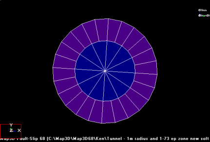

Neste caso, deseja-se demonstrar que a convergência plástica pode ser emulada com um modelo amolecido simples.

Aqui, o módulo de cisalhamento elástico foi amolecido por um fator **_g=0.2_** , enquanto o módulo volumétrico foi mantido constante. Abaixo, a tensão principal maior é mostrada à esquerda e o deslocamento é mostrado à direita.

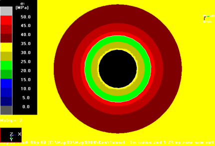

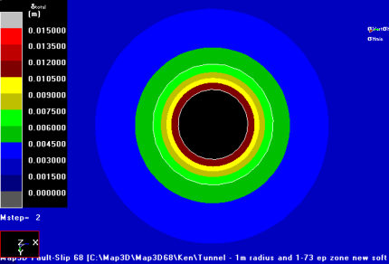

Os resultados amolecidos mostram uma excelente concordância tanto para a tensão principal menor plástica quanto para o deslocamento. Note que, embora os valores reais da tensão principal maior amolecida não coincidam em detalhe com os resultados plásticos na zona de escoamento, em média eles têm aproximadamente a magnitude correta. Além disso, a tensão foi redistribuída para o "encontro" elástico com bastante precisão, mostrando quase exatamente a concentração de tensão esperada.

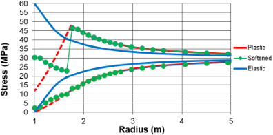

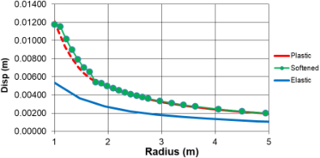

Embora os resultados do amolecimento não coincidam perfeitamente com os da análise plástica, é evidente que eles simularam o escoamento do material das paredes laterais e aproximaram muito mais os resultados elásticos dos do modelo plástico. Parece que o amolecimento de material pode ser usado para simular o escoamento do terreno, a redistribuição de tensões e, portanto, o possível impacto nas áreas vizinhas. A vantagem dessa abordagem é que ela permite ao engenheiro investigar o comportamento não linear de forma rápida e fácil, em comparação com a modelagem plástica. Os modelos amolecidos exigem um aumento muito pequeno no tempo de análise em comparação com modelos elásticos simples.

Uma descrição mais detalhada e exemplos são fornecidos em **Elastic softening to simulate plastic yielding.pdf** .
