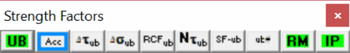

Ativa a barra de ferramentas de fatores de resistência – após a análise BEM no Map3D.

Esta barra de ferramentas oferece acesso rápido aos gráficos dos modos de ruptura.

#### Resistência do maciço rochoso

Plot > Strength Factors > Strength Parameters modifica os parâmetros de resistência 3D de Mohr-Coulomb, Hoek-Brown e Drucker-Prager.

Plot > Strength Factors > SF-A gera contornos da razão resistência/tensão pelo método A Plot > Strength Factors > SF-B gera contornos da razão resistência/tensão pelo método B Plot > Strength Factors > SF-C gera contornos da razão resistência/tensão pelo método C

Plot > Strength Factors > SF/A gera contornos da razão tensão/resistência pelo método A Plot > Strength Factors > SF/B gera contornos da razão tensão/resistência pelo método B Plot > Strength Factors > SF/C gera contornos da razão tensão/resistência pelo método C

Plot > Strength Factors > dS1 gera contornos da tensão principal maior excedente Ds1

Plot > Strength Factors > dTmax gera contornos da tensão de cisalhamento máxima excedente Dtmax = D½ ( s1 - s3 )

Plot > Strength Factors > dToct gera contornos da tensão de cisalhamento octaédrica excedente Dtoct = D1/3 [(s1 - s2)² + (s2 - s3)² +(s3 - s1)²]½

Plot > Strength Factors > Ns1 gera contornos da probabilidade de ruptura calculada como N(Ds1/s), em que s é o desvio padrão.

Plot > Strength Factors > Acc gera contornos do dano acumulado.

#### Resistência no plano

Plot > Strength Factors > In-plane parameters modifica os parâmetros de resistência no plano de Mohr-Coulomb

Plot > Strength Factors > SF-ip gera contornos da razão resistência/tensão usando as tensões no plano Plot > Strength Factors > SF/ip gera contornos da razão tensão/resistência usando as tensões no plano

Plot > Strength Factors > dTip gera contornos da tensão de cisalhamento no plano excedente Dtip

Plot > Strength Factors > NTip gera contornos da probabilidade de ruptura calculada como N(Dtip/s), em que s é o desvio padrão.

Plot > Strength Factors > Acc gera contornos do dano acumulado.

#### Resistência do plano ubíquo

Plot > Strength Factors > Ubiquitous Parameters modifica os parâmetros de resistência do plano ubíquo de Mohr-Coulomb

Plot > Strength Factors > SF-ub gera contornos da razão resistência/tensão usando as tensões no plano ubíquo

Plot > Strength Factors > SF/ub gera contornos da razão tensão/resistência usando as tensões no plano ubíquo

Plot > Strength Factors > dTub gera contornos da tensão de cisalhamento no plano ubíquo excedente Dtub

Plot > Strength Factors > NTub gera contornos da probabilidade de ruptura calculada como N(Dtip/s), em que s é o desvio padrão.

Plot > Strength Factors > Acc gera contornos do dano acumulado.

#### Observações:

A barra de ferramentas de fatores de resistência só pode ser ativada após a etapa de construção do modelo - CAD

#### Etapas de análise do Map3D

Qualquer um desses componentes pode ser adicionado à barra de ferramentas de contornos, se desejado

Tools > Configure Contouring Toolbar
